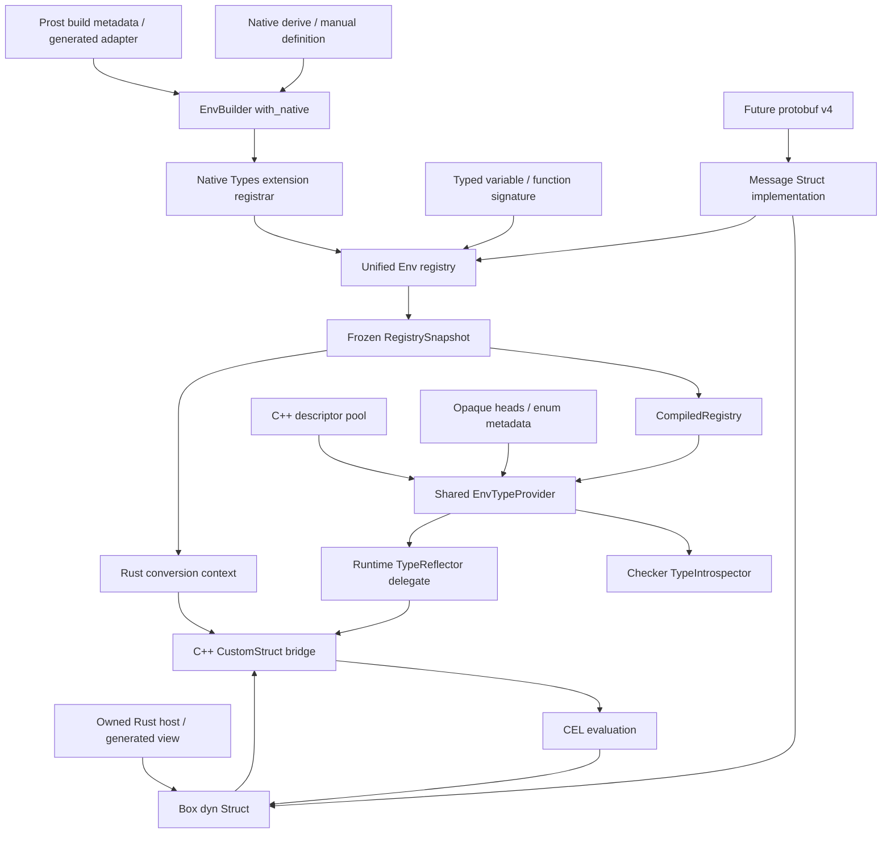

# cel-cxx Native Types 扩展、Prost 与值转换设计

状态：设计定稿候选，供执行计划与实现使用；新增接口尚未实现。

日期：2026-10-11。本文以当前 cel-cxx `7ff30ee425d` 和 cel-cpp `c84e883df5932dcc992dd3494a771c37e85ae1fe` 为实现基线；实际依赖来自 xjasonli/cel-cpp 分支。相对早期调研的 cel-cxx `609805b`，当前提交只增加 Apple 构建支持，本文涉及的类型、值、函数与 FFI 代码没有变化。对照仓库 cel-go 为 `12ea74fdf5f4806087b979ee05d6e38ab35c151f`，cel-java 为 `798c0be3a7beef6816344e0323294067bc1d8b1c`。

本文是本次工作的唯一规范性设计。[目录与阅读指引](README.md) 说明核心章节、专题补充与验证记录的分工。补充材料解释依据与取舍，不另定义一套 API 或默认行为；发生差异时以本文为准。

文中的“必须”是正确性或验收要求；“首版”是本次可以据此制定执行计划的交付范围；“未来”不属于首版完成条件。API 示例表达目标接口，内部类型草图省略实现细节，不能把示例当作现有可调用 API。

## 阅读导航

- [1. 目标与交付范围](#1-目标与交付范围)
- [2. 固定决策](#2-固定决策)
- [3. 总体架构](#3-总体架构)
- [4. 类型定义、身份与 Env 注册](#4-类型定义身份与-env-注册)
- [5. Rust 值表示与所有权](#5-rust-值表示与所有权)
- [6. Option、Box、Arc 与统一解码](#6-optionboxarc-与统一解码)
- [7. 扩展函数与生命周期](#7-扩展函数与生命周期)
- [8. 普通 Native 字段与构造](#8-普通-native-字段与构造)
- [9. Checker、Runtime 与 FFI](#9-checkerruntime-与-ffi)
- [10. 字段编号、错误通路与运行配置](#10-字段编号错误通路与运行配置)
- [11. Prost 生成式 protobuf profile](#11-prost-生成式-protobuf-profile)
- [12. 相等、zero、展示与资源边界](#12-相等zero展示与资源边界)
- [13. Future 官方 Rust protobuf v4](#13-future-官方-rust-protobuf-v4)
- [14. 公共 API 场景](#14-公共-api-场景)
- [15. crate、模块与现有代码迁移](#15-crate模块与现有代码迁移)
- [16. 线程、panic 与生命周期不变量](#16-线程panic-与生命周期不变量)
- [17. 错误分类与诊断](#17-错误分类与诊断)
- [18. 验证与验收矩阵](#18-验证与验收矩阵)
- [19. 对后续执行计划的输入](#19-对后续执行计划的输入)
- [20. 补充资料与维护](#20-补充资料与维护)

## 1. 目标与交付范围

在 cel-cxx 中提供通过 Env 注册类型的 Native Types 扩展，让业务 Rust struct、Rust enum 和 prost message 直接作为 CEL 具名对象使用，并保持泛型变量、函数参数、函数返回及表达式结果之间的组合性。扩展使用 cel-cpp 的通用 struct/provider 接口；本设计同时补齐所需的通用值转换、函数安全和 FFI 能力。

首版交付：

1. Native Types 扩展的 `EnvBuilder::with_native::<T>()` 注册入口；为 named/tuple/newtype/unit struct 及非空 enum 的各类 variant 提供普通 Native derive，覆盖声明、字段检查、读取、has、嵌套对象、集合、显式构造和结果恢复。语法形态与明确限制见第 4.7–4.9 节。
2. 真实 Rust 对象的拥有型存储、动态 Struct trait、消费型 move 与类型安全 downcast，以及跨求值 arena 的结果存活。
3. std Option 的统一 CEL optional 值语义，Box/Arc 的类型透明，以及统一的本地解码入口。
4. prost-build 的生成式 protobuf adapter，支持本文限定的 proto2/proto3 字段、oneof、enum 与 WKT。
5. 统一 registry、checker/runtime provider、BasicStruct 类型恢复及必要的 cel-cpp 修补。
6. 同步/异步函数的安全拥有型调用；借用调用采用独立、可编译验证的生命周期接口。
7. 普通 Rust 与 protobuf 两类语义 profile、各自的 bool 相等与 zero 策略，以及字段/构造/转换错误的 CEL 传播。
8. 去掉 protobuf-rust v3、常态序列化 StructValue 及同义泛型 Optional 包装，迁移现有示例和文档。

首版不包括：

- 官方 Rust protobuf v4 的实际接入；保留明确的后端边界与启用门槛。
- cel-cpp 的旧 CelValue、Legacy* 值/适配器与兼容 API：cel-cxx 不提供这套接入能力，也不保留 Legacy 值变体。
- editions、protobuf extensions、groups、MessageSet、unknown-field 保留及完整 partial message 表示。
- Any codec、一般 JSON 序列化、protobuf context/type mask，以及外部 C++ CustomStruct 互操作。
- 完整 Rust Unknown 值往返和 partial evaluation API。
- Native 的异步字段 getter、已发布共享对象的可变 setter。
- select optimization 对 Native 的支持；普通按名称选择必须完整工作。
- 同一 Env 内同名 prost/v4 的隐式互转。
- union、空 enum、裸 tuple 的自动对象映射，以及 `repr(packed)` 或借用字段的自动 derive；具体拒绝范围和可用替代见第 4.9 节。

允许 breaking change。首版不以保留旧编码接口、旧 Optional 方法或旧不安全借用注册语法作为设计约束。

## 2. 固定决策

| 项目 | 决策 |
|---|---|
| CEL 类型 | 使用现有 StructType/BasicStructType，不新增 Native Kind |
| 类型查询 | 保留内建/WKT 与 Opaque；普通 struct 先查 Native，类型名未命中再查 C++ descriptor pool；enum 单独按常量解析 |
| 能力入口 | `EnvBuilder::with_native::<T>()` 注册根类型，Env 按注册内容安装 Native Types 支持；不另设开关 |
| Native 来源 | 普通 Rust named/tuple/unit struct、非空 enum 与 prost message |
| 语义 profile | Rust / Protobuf；随类型定义固定，prost-build 扩展默认生成 Protobuf |
| Message 来源 | 未来官方 Rust protobuf v4；不再接入 protobuf-rust v3 |
| 动态 struct | `StructValue = Box<dyn Struct>`；Native/prost/future Message 仅在具体实现中区分 |
| 静态与动态接口 | 沿用 Opaque/TypedOpaque 分层：TypedStruct 提供具体类型接口，库自动实现动态 Struct |
| legacy / foreign C++ 接入 | 不支持 cel-cpp legacy API/值；本设计不接入任意外部 C++ CustomStruct，不增加 Legacy/Foreign 变体 |
| 日常消息存储 | 实际 Rust 对象/owner/view；bytes 仅用于显式 codec |
| 普通 Option | `Option<T> ↔ optional_type<τ(T)>` |
| 动态 optional | `Value::Optional(Option<Box<Value>>)`；无 OptionalValue 名称要求 |
| Box/Arc | CEL 类型透明；输入、恢复、物化能力分别定义 |
| 普通 Rust 字段 | 实际 struct/record 字段始终 present；enum 的 variant 选择字段仅在该分支选中时 present |
| newtype / tuple struct | 保留名义类型；单字段为 value，多字段为 _0/_1 等；不自动透明 |
| unit 与零字段对象 | 裸 () 映射 null；unit struct/普通空 message 保留具名 struct；enum 的 null 仅是无 payload 选择字段的标记；见第 4.11 节 |
| 普通 Rust enum | 每个 variant 都有选择字段，以 presence 表达是否选中；payload 不额外包 optional；无可见 payload 用 null 标记 |
| presence 与 optional | 固定采用第 4.10 节的分层规则：has 查询存在性，Option 表达值内容，.? 将选择结果显式转成 optional |
| prost 字段 | descriptor 驱动 protobuf profile，覆盖存储类型推导 |
| 表示选择 | 每个 Env、每个 CEL 全名只有一种权威表示 |
| pool 值准入 | 普通 pool message 的可达 message 依赖必须全部保持 pool/WKT 表示；依赖被 Native 覆盖时拒绝该 pool 类型，不重写其实际 carrier 的 schema |
| checked AST 导入 | 保留表达式与源码信息，清除旧类型/引用元数据，在目标 Env 重新检查；不承诺保留源 Env 的返回类型或 overload 选择 |
| 类型注册 | EnvBuilder 显式注册 Native 根类型并展开字段依赖；泛型声明只推导类型，Env 构建时校验并冻结 |
| 解码 | 本库 FromValue/FromOwnedValue 为权威；递归使用同一个显式 ValueContext，便利入口仅在最外层创建 operation；std TryFrom 仅受限便利接口 |
| Native owner | T 实现 TypedStruct 并自动取得 Struct，Box 直接拥有 T；求值内部可临时借用，消费型边界允许 move |
| Clone / owned 恢复 | TypedStruct 要求 Clone，Struct 使用 DynClone；借用解码复制，消费解码移出，schema/view 另按物化能力 |
| 普通 Native 比较 | 宿主 `T::PartialEq`，返回 bool；不强制 Eq，不调用字段 getter |
| protobuf 比较 | bool；可证明一致时复用 prost 派生 PartialEq，只补 presence/default-view 等差异 |
| C++ 比较分派 | Parsed/本库 Custom 两种操作数顺序均由 Custom comparator 判定；普通 Native 与 Parsed 同名也为 false，已验证 Empty 是专用例外 |
| 无 arena 的 predicate | has/zero/type/debug 不执行转换，也不计入 Native 转换预算；表达式执行限制独立控制重复调用 |
| Rust PartialEq | Native 包装的比较采用对应 profile；身份另用显式 API |
| 构造 | 独立 opt-in；builder 保存字段槽位，Build 验证后组装完整 T，发布后只读 |
| 字段编号 | 普通 Native 为 0/无编号；prost 为真实 tag |
| optional library | 标准 Rust 环境默认启用 |
| null | CEL null 独立；protobuf wrapper 使用规范的缺失 null 解包 |

`τ(T)` 表示 Rust T 的静态 CEL 类型。静态类型相同，不保证不同 Rust 所有权形式都具有同样的双向转换能力。

## 3. 总体架构



职责必须分开：

- metadata 决定名称、字段类型、profile、依赖和能力。
- EnvBuilder 接受 Native/Opaque/enum 注册与 descriptor pool 配置；组合 provider 决定名称优先级，Rust registry 与 C++ pool 分别保存各自定义。
- owner 决定对象/视图如何存活，不决定 CEL 类型。
- 字段 adapter 决定读取、presence、默认值与构造语义。
- C++ bridge 实现 StructValue 接口及 arena 包装，不重新猜测 Rust 类型。
- codec 执行显式 wire 编解码，不成为常态值表示。

Rust Value 可以在 Env 之外构造。其 Native 值携带不可变类型定义和 owner；进入 Env 时才验证 registry 与配置。不能为了让值独立存在，建立第二份可随意改变名称/字段规则的 registry。

两类 Rust 来源共用承载机制，不共用全部语义：C++ **类型**使用 `BasicStructType`，C++ **值**通过 `CustomStructValueInterface` 承载 Rust owner。普通 protobuf message 使用这条路径；protobuf enum 转成 CEL int，映射为 CEL 内建值的 WKT 使用专用 adapter，不强行包装成 BasicStruct。

### 3.1 两种语义 profile

| 维度 | Rust profile | Protobuf profile |
|---|---|---|
| 来源 | 符合第 4.6–4.9 节要求的 Rust struct / enum | schema 与实际 carrier 校验通过的 prost message |
| 语义依据 | cel-go native object / cel-java 自定义 StructValue 的宿主适配思路，具体 Rust 合同由本文规定 | CEL protobuf 映射及 message equality 规范；已声明差异单独测试 |
| 字段名称与类型 | derive/manual definition，按 Rust 类型推导 | protobuf 全名、原字段名、tag、descriptor 类型 |
| struct/record 中的 `Option<T>` 字段 | CEL optional，字段本身始终 present | schema presence，读取返回 T 对应值或 protobuf default |
| enum variant 选择字段 | 声明 payload 类型或无 payload 的 null 标记；选中时 present，未选中直接读取为 CEL Error | oneof 按 protobuf presence/default |
| 默认值与构造 | 显式 field default/factory；默认只读 | protobuf default、required、oneof；生成 builder |
| 相等 | `T::PartialEq`；skip 仅控制字段暴露 | 优先复用标准派生 PartialEq，按 schema 修正 presence/default-view，不经过 CEL getter 解包 |
| enum | derive 生成具名 tag/payload 对象；也可手写 definition 或另选显式 scalar adapter | protobuf enum 为 int + 具名常量；oneof 为父 message 成员 |

cel-go 的普通 native object 使用宿主比较和 Go 的零值 presence；cel-java 的 `StructValue`/value provider 让适配器定义选择与构造。它们不是一套可以直接搬到 Rust 的统一反射规则。本文保留 Rust 已选定的规则：普通字段总是存在，Option 表示 CEL optional；不复制 Go 的 `IsZero` presence。Java Native Types 可以包装 enum 实例，但这不构成跨语言统一的 enum 数字、名称或常量映射；具体对照见第 4.6 节。

### 3.2 profile 的配置边界

profile 属于 `StructDefinition`，参与 definition key、注册冲突检查与生成代码校验。普通 `Struct` derive 默认选择 Rust；`ProstNative` 和 prost-build 扩展选择 Protobuf。公有 definition builder 可以显式选择 profile，但 Protobuf 分支必须提交并校验完整 protobuf metadata 与配套操作，不能只切换一个 has/Option 标志。

这不是 Env 中可随时翻转的开关。同一 Rust TypeId 的 canonical 定义必须确定；不得在两个 Env 中把同一 `Option<i64>` 字段分别解释成 optional 和 protobuf presence。要同时暴露两种视图，使用不同的 Rust newtype、明确的 CEL 名称与各自 adapter。prost 生成类型若选择普通宿主视图，也必须按此规则另建 Rust profile 定义；首版不提供改写 protobuf canonical 全名的快捷选项。

普通 Rust struct 可以包含已有 Protobuf profile 的子 message；子对象仍遵守自己的定义。父字段是否把 Option 解释为 presence，由父字段的 profile 决定。将字段值单独绑定为变量/函数参数时，适用其独立 TypedValue 规则，不继承父字段的 protobuf 上下文。

普通 Rust struct 内的 enum 字段同样沿用 E 已确定的独立表示：Struct derive 的 E 为具名 tag/payload 子对象，显式 scalar adapter 为 int/string，生成的普通 protobuf enum 为 int。不能仅因 E 来自 prost 就把普通父字段改成 protobuf presence，或把 oneof 成员自动展开进普通父 struct；组合规则见第 8.4 节。

### 3.3 Native Types 扩展的边界

Native Types 是 cel-cxx 实现的宿主类型扩展，由 Env 安装。它负责把 Rust 类型定义接入 checker/runtime，包含字段、presence、构造与值适配；扩展不必只由新增 CEL 函数组成。Go 的 `ext.NativeTypes(...)` 和 Java 的 `CelExtensions.nativeTypes(...)` 提供了这种环境接入方式；本设计基线的 cel-cpp 已有通用 struct/provider 接口，但没有对应的 Native Types library。源码对照见 [扩展入口依据](supplements/native-interop.md#native-types-library-与-env-扩展)。

| 层次 | 职责 |
|---|---|
| 通用类型和值系统 | TypedValue、ValueType/StructValue、Env 的统一 registry/resolver、Option/Box/Arc 转换、函数签名与安全解码；不增加 Native 专用 trait 方法 |
| Native Types 扩展 | 宿主 Struct 实现、definition/builder/profile，以及 Env 内的 Native 注册与 provider 适配 |
| Prost adapter | 为普通 prost message 生成 Native 定义与 Protobuf profile；复用同一扩展 |
| C++/FFI 支撑 | CustomStruct wrapper 和 provider glue；通用 TypeSpec、错误传播等修补保持引擎通用性 |

公有入口统一为 `EnvBuilder::with_native::<T>()`，其中 `T: TypedStruct`。调用将 T 作为本环境公开的根类型；`build()` 展开依赖并安装所需 checker/runtime 支持。没有独立的启用布尔值，也没有“注册了类型但忘记启用扩展”的状态。不同根可链式调用；同一完整定义重复注册幂等。注册与变量/函数声明的先后顺序不影响最终结果。

**扩展的引擎接入点是 type provider，registry 保存 Native/Opaque/显式 enum 定义。** build 将冻结定义与现有 C++ descriptor pool 组合为一个 EnvTypeProvider，同时接入 checker 的 TypeIntrospector 和 runtime 的 TypeReflector。普通 struct 先查 Native，类型名未命中再查 pool；pool 候选还须通过第 9.2.3 节的表示闭包检查，不要求把 pool 中的所有 message 转录为 Native 定义。值的读取、presence、比较由准入后的 representation 完成，构造由选中的 provider 分支创建 builder。名称优先级不能改变已经存在的 protobuf 对象布局。首版不公开任意 Rust TypeProvider 插件接口，也不让每个 Native 根各装一个 provider；手写 TypedStruct 与安全 definition builder 已是宿主扩展接口。

跨来源的名称冲突与最终分派由 Env 决定。所有 Env 都使用同一组合规则，包括没有 Native 根的 Env；只有非空 Native 注册闭包才带入宿主定义和 factory。Native 可覆盖同名普通 pool message；它与另一显式注册的宿主 backend 同名仍是冲突。future Message 可独立使用这套基础设施，不要求注册 Native 根。完整安装协议见第 9.2 节。

默认 Env 没有 Native 根，不会自动扫描或公开派生了 Struct 的宿主。`build()` 对组合 provider 无法解析的声明返回缺失类型错误；即使 pool 恰有同名 schema，也不因此注册 Rust 宿主。冻结后从 dyn、集合、lazy 或函数返回进入 Env 的 Native 值仍验证 Native 注册与定义身份。生成的 prost 模块 helper 通过 Env 注册选定的根与常量 metadata，所需支持随注册内容安装。

Rust 中创建 StructValue/Value 或取得静态类型描述不要求存在 Env；跨入 Env 时才应用上述注册规则。内建值、已有 Opaque 和通用转换规则不要求 Native 注册；已经转换成 CEL 内建值的 WKT 不要求 Native 根，具名 Native holder 则要求。

extension 表示每个 Env 的安装边界，不要求采用 `with_ext_*` 布尔开关。首版将实现组织在本 crate 的 `extensions::native_types` 模块，不额外引入独立 crate、Cargo `native` feature 或通用 Library trait；这些不是使用扩展的前提。已有 `derive`/`prost` feature 控制宏与依赖是否可用，不代替 Env 的类型注册，也不改变定义时固定的 profile。

## 4. 类型定义、身份与 Env 注册

### 4.1 三种身份

| 身份 | 用途 | 不可替代的检查 |
|---|---|---|
| CEL 全名 | checker 名义类型、字段与函数匹配 | 不证明 Rust 内存类型 |
| Rust TypeId | 恢复真实宿主 T | 不决定 protobuf 字段 profile |
| C++ NativeTypeId | 识别本库 bridge wrapper | 不证明同名 foreign struct 属于本库 |

同名 Native 值还必须匹配注册的定义/profile 身份。生成的 definition key 至少包括宿主 TypeId、canonical 名称、profile/version 与 adapter 身份；字段签名用于冲突诊断。禁止只比较全名后强制 downcast。

enum 的合成 variant record 另用“父 enum definition key + variant 身份”作为 key。它有独立 CEL 全名，但没有独立的用户 Rust payload 类型；不能把宿主 E 的 TypeId 当成该 record 的 Rust 类型。其 owner 与恢复边界见第 5.6 节。

manual definition 必须是针对该宿主的确定定义，不依赖 Env 或可变全局状态换字段/回调。adapter 身份使用显式 revision/生成 marker，不把函数指针地址相等当作同一定义的证明；schema fingerprint 只能做快速筛选，冲突判断还要核对规范化 metadata，不能用一次 hash 相等证明语义相同。

普通 Rust 类型的 canonical 名称由定义指定，不默认使用 Rust module path 作为稳定 CEL 名称。同一宿主类型不能在不同 Env 中通过配置悄悄换名；需要另一名义类型时使用显式 Rust newtype。

泛型 struct/enum 的每个 Rust 实例必须有可区分的合法 CEL 名称；derive 要求显式、纯名称策略，缺少策略时报编译错误。不同 Rust 参数可能同为 CEL int，例如 i32 与 i64，不能只用参数的 CEL 类型名区分实例。不要把 Rust 的 `type_name::<T>()` 原样作为 CEL 标识符。

### 4.2 公有接口与私有执行接口

**采用与现有 `Opaque / TypedOpaque` 一致的 `Struct / TypedStruct` 分层。** Struct 是动态对象接口；TypedStruct 是具体 Rust 类型的接口，提供静态定义及 Clone/PartialEq 约束。库通过 `impl<T: TypedStruct> Struct for T` 自动提供动态操作，不再使用 NativeType 名称。完整接口见第 5.1 节。Rust ValueType 仍使用 Struct(StructType)，C++ 仍使用 StructType/BasicStructType；普通 Rust 与 prost 不新增 CEL Type/Kind。

注册入口是 `EnvBuilder::with_native::<T>()`，其中 `T: TypedStruct`，返回 `Result<Self, Error>`。它调用 `<T as TypedStruct>::definition()`，不需要创建 T 实例。EnvBuilder 持有 Native Types 扩展的注册配置与私有 registrar，负责依赖展开、冲突与配置校验，并在 build 时安装所需支持、发布不可变 snapshot。返回的 StructDefinition 只是不可变 metadata，不直接写入环境。安装规则见第 3.3 节。

`TypedValue` 保持原样：

```rust
pub trait TypedValue {
    fn value_type() -> ValueType;
}
```

调用 value_type 只返回静态 CEL 类型，不接收 Env、不修改 registry，也不通过全局表隐式安装定义。内建值、Option/Box/Arc、集合与已有 Opaque 不承担 Native 专用注册职责。

StructDefinition 的安全 builder 声明名称、字段、profile、依赖及可选 constructor/profile decoder。普通宿主在 TypedStruct 中提供 get/has/equality/zero，库转发为 Struct 的动态操作；内部 view 可以直接实现 Struct。需要擦除的 factory 回调先以具体类型检查，再返回 StructValue 或对应 Value。enum 的合成 record 由生成的私有 view 实现 Struct，不要求用户声明不存在的 `E::Variant` Rust 类型，也不开放伪造 host/view 身份的 unchecked 接口。

与现有 Opaque derive 一样，宏使用动态接口的名字：`#[derive(cel_cxx::Struct)]` 为宿主 T 生成 TypedStruct、TypedValue、消费型 IntoValue、借用/消费型解码及字段转换能力，Struct 由库的 blanket impl 提供。运行值直接是 `Value::Struct(Box::new(t))`，没有默认 NativeInstance<T> 包装。TypedStruct 要求 T: Clone + PartialEq；T/Box<T> 输入可以移入，借用输入需要独立值时复制。下游也可以手写 TypedStruct，裸 T 的便利转换仍使用具体类型实现，避免与通用容器 blanket 重叠。首版不另设 Native<T> 共享投影 API。

下游 derive 只实现公有 TypedStruct 与转换接口；库为符合 Any + Send + Sync 的具体类型自动提供内部擦除能力，详见第 5.3 节。公有 builder 与必要的 `doc(hidden)` `__macro_support` 必须实际可见，且版本与宏严格配套；不能要求生成代码引用真正私有路径。

普通 Native 的目标使用方式：

```rust
#[derive(Clone, PartialEq, cel_cxx::Struct)]
#[cel_cxx(type_name = "example.User")]
struct User {
    name: String,
    age: Option<i64>,
    address: Address,
    #[cel_cxx(skip)]
    internal_id: u64,
}
```

普通 derive 支持 `type_name`、`crate`、字段 `rename`/`skip`、显式 `construct`、字段 `default`及 `zero_with`；enum 另支持类型级 `tag = "kind"` 与 variant 级 `rename`。具体适用位置见第 4.7–4.9 节。protobuf derive 不复用普通 rename/presence 属性更改 schema；它使用生成的原始 protobuf 名称和 profile。

derive 的名称/profile属性在编译或注册时核对 CEL 语法、重复字段和类型合法性。Rust raw identifier 先恢复逻辑字段名，再应用明确 rename；CEL 字段需要 quoted identifier 时使用 parser 支持的引用语法，不更改 protobuf 原名。当前依赖默认支持 quoted field identifiers；应用关闭该选项时，相应表达式按 parser 规则报错。泛型名称策略必须是纯函数并在访问字段依赖前取得名称；首版不自动生成依赖完整 schema 的名称，不能把名称计算重新变成注册循环。

一个字段描述包括：

- CEL 名称、可选真实编号、声明的 TypeRef。
- profile 与读取/presence 策略；对应操作由 Struct 实现。
- builder 中是否可赋值、是否必填、缺省策略。
- 子类型/enum 的依赖定义引用；包含非递归 key/name 与惰性的定义获取函数，由 Env 读取，不接收 registrar。
- protobuf-specific label/default/oneof/effective enum policy/WKT 身份。

实现可用安全的 typed helper 生成字段分派与 factory 回调，不得以裸宿主内存偏移作为稳定访问 ABI。

TypedStruct 要求宿主 PartialEq；Rust profile 的 eq_struct 使用该比较，Protobuf profile 提供第 12.2 节的相等 adapter，可复用标准派生 PartialEq 并补确有差异的规则。Clone/PartialEq 约束留在 TypedStruct，不进入动态 Struct，也不要求 Eq；拥有 PartialEq 不代表可省略 profile adapter。

### 4.3 Env 注册入口与声明校验

Native 根类型由调用方通过 `EnvBuilder::with_native::<T>()` 显式注册，根定义可达的字段依赖由 Env 递归展开。生成的 prost 模块可以提供批量注册 helper，但它接受/返回 EnvBuilder 并调用其注册接口，不直接访问 registrar，也不在模块加载或值转换时注册；helper 所选内容和直接注册使用同一安装、冲突与冻结流程。

| 入口或类型 | 职责 |
|---|---|
| `with_native::<T>()` | 将 T 的定义作为注册根，展开可暴露字段的 Native、enum 与 protobuf 专用 metadata 依赖，并要求 Env 安装所需支持 |
| 生成的 prost 模块注册 helper | 在同一 EnvBuilder 上显式注册选定的根与导出的 enum 常量等 metadata |
| `declare_variable::<T>`、函数参数与返回类型 | 通过 TypedValue/函数签名推导 CEL 类型；不据此安装 Native 定义 |
| `Option/Box/Arc/Native`、引用、list/map 等复合类型 | 保留各自的类型推导规则；Env 递归通过组合 provider 检查具名引用，Native 定义依赖仍须在注册闭包内 |
| scalar、标准集合与已有 Opaque | 沿用各自的类型规则及 Env 构建流程，不要求实现 Struct/TypedStruct 或调用 Native 注册接口 |

例如 User 含 Address 字段时，注册 User 会包含 Address，无需逐个注册子类型；若函数还返回未被这些根覆盖的 Order，则须再显式注册 Order。`Result<T, E>` 的函数返回声明只检查 T，E 不引入 CEL 类型依赖。映射为 CEL 内建值的 WKT 遵守第 11.9 节的专用规则，不因此要求普通 Native 根注册。

字段依赖不只包含具名对象。普通 Native 字段直接使用生成的 protobuf enum E 时，其 field capability 提供对应常量 metadata 的惰性引用，Env 随父类型一起收集；E 的 CEL 类型仍是 int。这些依赖属于 Native 字段定义，不放入 TypedValue，也不从值或 int 类型名反推 enum 来源。Option/Box/Arc/list/map value 的字段适配必须保留依赖，即使实际值为空也不遗漏。

`build()` 统一展开全部显式根的依赖，校验注册内容与所有变量/函数声明，再安装所需支持；声明与注册的调用顺序不影响结果。具名引用在 Native/Opaque/内建及 pool 均未命中时，返回包含声明位置、缺失全名及 Native 注册或 descriptor 配置提示的错误，不降为 dyn。仅含 `StructType(name)` 的声明可以由 pool 满足；TypedValue 不携带宿主定义身份，因此不能据此证明已注册 T。真正的 Native 值入境仍要求对应注册根，缺少时报告 `with_native::<T>()` 提示。已有重复声明、重载或明显注册冲突可以提前报错。

声明中的 CEL 全名仅表示类型引用，不证明 Rust TypeId 或 adapter 身份一致。真实 Native 值进入 Env、函数解码和结果恢复时，仍须执行第 4.1、4.5 与第 5 节的身份校验。

注册和声明校验都依据静态 metadata，不依赖运行值。即使字段为 None 或空 list/map，已注册 Native 根的定义依赖仍须完整；声明 `Option<User>` 或 `Vec<User>` 不自动注册 User。单纯符号引用可以由 pool 满足，但首次出现真实 User 值时仍须 Native 注册；不能以空容器的成功绑定证明稍后可接收未注册的宿主。

对于普通 enum，闭包还包含所有 variant 的暴露 payload 类型及合成 record 定义。`with_native::<Parent>()` 经 E 字段展开这些依赖，不要求先构造每一种 variant，也不要求用户注册不存在的 Rust 类型 `E::Variant`。

Value 的静态类型为 dyn，不能从其泛型签名发现未来可能返回的任意宿主类型。动态变量/函数可能产生 Native 时，同样须在 EnvBuilder 显式注册对应根，或由已注册根的字段依赖覆盖。Env 冻结后，activation、lazy binding 和函数返回只验证，不临时改 checker。

### 4.4 递归注册算法

1. Env 的私有 registrar 从显式注册根取得非递归 key/name/profile，检查同名定义是否冲突。
2. 先记录 `Discovering` 占位，再读取本地字段声明。
3. 通过字段 metadata 的惰性定义引用访问子类型；再次遇到 Discovering key 即停止递归。
4. 解析字段 TypeRef、enum 常量与能力，检查冲突和缺失依赖。
5. 将定义标为 Ready。
6. 所有根闭包与变量/函数声明校验成功后，才构建并发布 RegistrySnapshot。

递归字段只存 logical key/name 和惰性定义获取函数，不持有 `Arc<ChildSchema>`，避免 A→B→A 形成 schema owner 泄漏。遍历与去重由 Env 执行，不调用子类型的注册方法。

该规则同样覆盖 `enum Expr { Leaf(i64), Add(Box<Expr>, Box<Expr>) }`：E 与 E.Add 的定义引用形成有限图。递归地改变泛型参数、产生无限个不同实例的 schema 不在支持范围；编译期或注册期给出有界诊断，不能依赖栈溢出终止。Env 构建配置提供 `max_schema_types=10_000` 与 `max_schema_fields=100_000`；Native 注册闭包按唯一 definition/字段计数，pool 准入按每个请求闭包中的唯一 descriptor/字段计数，回边不重复收费。schema 遍历使用显式工作栈；复合 TypeRef 参数树另遵守有界深度检查。超限返回 schema 资源错误，不发布半成品或降为 dyn；这些限制独立于求值预算。

不要在泛型函数内部用一个 static/OnceLock 假定“每个 T 有一份缓存”；Rust 这种 static 不按单态化 T 分别实例化。可重新构造轻量 typed definition，由 registrar 按完整 definition key intern；若缓存，key 必须区分宿主 TypeId、定义身份及合成 variant，不能把 E 与 E.C/E.D 存成同一个类型。

注册失败不发布部分 Env。snapshot 的类型名称、字段名和 C++ Type 参数必须有至少与 Env 同寿命的 owner。

上述占位只解决注册遍历，不解决 Rust trait solver 的递归。derive 为第 6/8 节的具体 host capability 生成实现时，不得把包含 Self 的完整字段类型再次放进该实现的 where 条件。例如 `Option<Box<Node>>: FieldCapability` 作为 `FieldCapability for Node` 的前置条件会形成 E0275；应该先生成 Node 的具体实现，在方法体中通过已存在的容器实现访问 next。泛型 Node<T> 只对必要的非递归泛型叶子 T/用户声明的边界加约束。自动 derive 若无法判定递归边界，应给出明确诊断并允许用户声明 bounds，不能生成无穷 trait 证明链。

### 4.5 权威分派与可见性

每个 Env 的组合 provider 统一分派；RegistrySnapshot 是 Rust 扩展定义的来源，descriptor pool 保留 protobuf 定义：

- 同一完整定义重复注册可幂等。
- 两份显式宿主定义同全名但宿主、profile、schema 或 backend 不同则拒绝。
- 同名 prost-native/v4-proto 拒绝；不同 Env 可以各自选择。
- Native 与 pool 中同名普通 message 的 metadata 可以共存，所有按名 schema/字段/builder 查询选择 Native；同名 ParsedMessage 值不得因此成为可用的第二种表示。依赖它的 pool 父消息须按第 9.2.3 节拒绝。
- 冲突检查覆盖实际注册根沿字段、list/map value 等可达的闭包。
- WKT/内建保留名称只能由对应内建 adapter 处理。
- 合成 protobuf map_entry 不作为独立 CEL message 注册。
- Native 未命中且表示闭包通过检查的普通 protobuf 类型可从本 Env 的 pool（含既有 generated underlay）解析；pool 命中不能替代 Rust 宿主注册或恢复身份。

Native 名称一旦命中 registry，该类型的字段 miss、空字段集、只读 builder 和错误均终止，不得再用同名 protobuf descriptor 补齐。**回退依据是类型名未命中，不是一次字段/构造操作没有结果。** 整个查询使用同一组合 dispatcher；在当前 checker 链里仅追加一个 Native provider 不满足此要求。Opaque、enum 与不同类别的同名冲突按第 9.2 节处理。

跨 Env 值可以复用 owner，但必须重新验证目标 Env 的注册定义。相同 schema/profile 可以接受；不同定义即使同名也拒绝。

### 4.6 普通 Rust 类型的准入条件与 enum 边界

普通 Native 首版必须满足：

1. 宿主是 `Sized + Send + Sync + 'static` 的 Rust 类型，并提供确定的合法 CEL 对象名称和固定字段 schema。derive 覆盖第 4.7–4.8 节的 struct/enum 形态；不因字段或 variant 的语法不同要求调用方逐一手写 adapter。
2. 宿主实现 `PartialEq`，比较只读、无可观察副作用并能终止。不要求 Eq：包含 f32/f64 的 struct 可以使用 PartialEq，NaN 不必自反。要求 Clone，不要求 Default/Debug/Display。
3. 每个暴露字段都有可注册的类型和安全的读取方式；内建 scalar、string/bytes、Option、Box/Arc、list/map、已适配 struct 与受验证的 Value/dyn 可组合。map key 限 CEL 支持的 bool/int/uint/string。支持只读并不自动给予 owned 解码或构造能力。
4. getter 的引用必须来自保持存活的 owner，且对象在一次求值中稳定；不能返回临时锁 guard、临时分配或外部短借用的地址。首版没有异步 getter。
5. 构造与字段默认值分别 opt-in，并提供对应完整能力；真实宿主的 Clone/消费型恢复是默认能力。skip 字段无需 CEL 转换能力，但宿主整体仍须满足上述条件；明确的语法、属性与字段能力限制见第 4.9 节。

普通 Rust enum 的默认对象映射与 protobuf 的生成语义分开：

| Rust 来源/适配方式 | CEL 表示 | 注册与恢复 |
|---|---|---|
| 普通非空 enum 的 Struct derive | 一个具名 E，tag 与所有分支的 payload 字段具有固定 schema | `with_native::<E>()`；真实 enum 由 owner 保存，可借用 &E，消费时移出 E，借用解码时 Clone |
| 普通 enum 的手写 TypedStruct | 作者明确声明的固定对象 schema | 遵守相同的类型、owner、比较与能力合同；不随运行 variant 更换定义 |
| 普通 enum 的显式 scalar adapter，通常用于无 payload 枚举 | 明确选择 int 或 string | 使用对应 TypedValue/转换与字段能力；无需 Native 根；反向转换验证值并恢复已知 variant |
| prost 生成的 protobuf enum | int raw number + descriptor 具名常量 | 由宿主字段依赖或生成的模块 helper 注册常量；不创建 E 的 StructValue 对象类型 |
| prost 生成的 oneof enum | 父 message 的各个 protobuf 成员字段 | 随父 message 注册；不把 oneof 分组作为独立 CEL struct |

Go 没有与 Rust 对应的 enum 语法；其 native adapter 把带名称的整数/字符串字段按底层 kind 映射为 CEL scalar，不自动发现 Go const。Java Native Types 会扫描并包装 enum 实例为宿主 StructValue，过滤 Enum 的标准方法和 static 字段；这不等于按 ordinal/name 映射或自动导出 variant 常量。本文的 Rust sum type 映射是独立设计选择，依据与对照见 [语法和 enum 差异](supplements/native-interop.md#rust-语法形态与映射依据)。

标量适配是另一种显式选择：不得同时为同一 Rust E 安装 scalar 与具名对象两套 TypedValue/IntoValue 规则，需要两种视图时用不同 newtype。int/string 表示会失去 CEL 名义 enum 身份，不能与相同 scalar 区分重载；反向转换拒绝未映射的数字/字符串，不做无检查的整数强转。首版不新增 scalar enum derive、自动 variant 常量扫描或默认 discriminant 策略。

prost-build 扩展必须自动处理 protobuf enum 与 oneof，不要求调用方逐个手写适配，也不把它们默认转成上述 Rust 对象。`prost::Enumeration` 和 `prost::Oneof` 是 derive 宏，不是可供 blanket impl 约束的统一 enum trait；仅有这些宏或 `prost::Message` trait 也不包含完整 CEL schema。生成入口必须结合 FDS 与实际 Rust 布局提供第 11 节的能力。

### 4.7 struct 的逐形态映射

下表均为 Rust profile 的 Struct derive，满足第 4.6 节条件即可支持；表中 S 代表明确指定的 CEL 全名。newtype 是单字段 tuple struct 的惯用称呼，不是另一种 Rust item。语法依据见 [Rust Reference：struct](https://doc.rust-lang.org/reference/items/structs.html)。

| Rust 定义形态 | 默认 CEL schema / 读取 | 构造时的 Rust 形态 |
|---|---|---|
| `struct S { x: T, y: U }` | 具名 S，字段 x: τ(T)、y: τ(U)；s.x、s.y | `S { x, y }` |
| `struct S { value: T }` | 仍是具名 S 与普通 value 字段，不自动透明 | `S { value }` |
| `struct S(T);` | newtype 仍是具名 S，单字段 value: τ(T)；s.value | `S(value)` |
| `struct S(T, U);`，或更多字段 | 具名 S，字段 _0: τ(T)、_1: τ(U) 等；s._0 | `S(v0, v1)` |
| `struct S;` | 具名零字段 S | `S` |
| `struct S {}` | 具名零字段 S | `S {}` |
| `struct S();` | 具名零字段 S | `S()` |

三个零字段形态都可用 CEL `S{}` 构造，但前提仍是显式启用 construct。它们不会变成 CEL null，也不会因同为空而失去各自的名义身份。裸 Rust `()` 已有 CEL null 映射，与 unit struct 分开。零字段注册、presence 与 protobuf Empty 的统一边界见第 4.11 节。

字段 rename/skip/default 同样适用于 tuple struct。多字段 tuple 的默认名称按原始位置编号，skip 后不重排；即使只剩一个暴露字段，也不改为 value。single-field newtype 的 value 可以 rename；若唯一字段 skip，CEL 中成为零字段对象，构造仍须为隐藏的真实字段提供 default/factory。

`#[repr(transparent)]` 只影响 Rust 布局，不开启 CEL 类型透明。需要把业务 newtype 映射为 int/string 等内建类型时，明确实现相应 scalar/transparent adapter；首版不另加自动 transparent derive 属性。同一 Rust 类型不能同时选择该标量规则和具名 Struct derive。Box/Arc 的现有透明规则不扩展成“任何单字段 struct 都透明”。

### 4.8 enum variant 的逐形态映射

每个非空 enum E 默认有一个具名 CEL 类型 E；其 schema 在所有实例上固定，包含始终存在的 `kind: string`，以及**每个 variant 的选择字段**。有可见 payload 时字段类型就是 payload 类型，不额外包 optional；没有可见 payload 时类型为 null，使用标记值。只有该 variant 当前被选中时，该字段才 present。Rust variant 的三类语法见 [Rust Reference：enum](https://doc.rust-lang.org/reference/items/enumerations.html)。presence/optional 的固定决策与组合规则集中在第 4.10 节。

| Rust variant 形态 | E 中声明的选择字段 | 选中时的访问 |
|---|---|---|
| `A(String)` | A: string | `e.A` |
| `B(MyStruct)` | B: MyStruct | `e.B.x`；拥有型 MyStruct 子对象 |
| `C { x: T, y: U }` | C: E.C；合成 record 含 x、y | `e.C.x`、`e.C.y` |
| `C { x: T }` | C: E.C；保留单字段 record 形态 | `e.C.x`，不折叠成 e.C 标量 |
| `D(T, U)`，或更多字段 | D: E.D；合成 record 含 _0、_1 等 | `e.D._0`、`e.D._1` |
| `V`、`V()`、`V {}` | V: null；无 payload 分支的 presence 标记 | `has(e.V)`；选中时 e.V 为 null，也可比较 kind |
| `V(())` | V: null；这是一个真实 unit 值 payload | `has(e.V)`；选中时 e.V 为 null，构造时此真实 payload 必填 |
| `Maybe(Option<T>)` | Maybe: optional_type<τ(T)> | `e.Maybe.hasValue()` 判断 payload 的 Some/None |
| `V(Newtype)`、`V(Box<T>)`、`V(Arc<T>)` | 沿用 τ(payload)；Newtype 保留自身名义类型，Box/Arc 类型透明 | 按实际 payload 的字段/值读取 |

例如对于 `C { x: i32, y: String }`，`e.C` 的静态类型始终是 E.C；当前为 C 时返回字段视图，否则直接读取产生 CEL Error。`has(e.C)` 判断当前是否为 C，`e.?C` 返回 optional<E.C>。这允许自然写出 `has(e.C) && e.C.x > 0`，不要求 `e.C.value().x`。has/get 必须按同一次稳定的 enum 值匹配；不能为未选中分支制造默认 payload。

这是 enum 选择字段的条件 presence，不改变实际 struct/record 字段的规则：一旦取得 e.C，`has(e.C.x)` 对已暴露 x 为 true；若 C 未选中，`has(e.C.x)` 中求值 e.C 仍会报错，判断分支应使用 `has(e.C)`。对 `Maybe(None)`，has(e.Maybe)=true 而 e.Maybe.hasValue()=false；另一个 variant 的 has(e.Maybe)=false。e.?Maybe 保留外层选择 optional 与内部 Option 两层，不 flatten。

全为 unit 的 enum、单一 variant enum、混合 payload 的 enum 都使用同一规则。`#[repr(u8)] enum E { A = 1, B = 2 }` 仍是具名 E + kind，不自动变成 int；Rust 语法允许的带 payload 显式 discriminant 也不影响映射。实现以安全 match 选择 variant，不读取内存 tag，不用整数强转恢复 enum。空 enum 没有值，首版 derive 明确拒绝。

无 payload 的 null 标记只占据该 variant 的选择字段，不把 E 本身映射为 null，也不新增空的 E.V 类型。`e.?V` 在选中时为 some(null)、未选中时为 none；两者必须区分。`V` 与 `W(())` 即使选择字段同为 null 类型，仍由字段名、tag 与 Rust 初始化形态区分；标记字段的构造可省略，真实 payload 的构造必填，见第 8.5 节。

名称与属性规则：

- `#[cel_cxx(tag = "kind")]` 可改 tag 字段名，默认 kind。variant 的 Rust 逻辑名称默认同时作为 tag 字符串与选择字段名；variant 级 `#[cel_cxx(rename = "Case")]` 同时改这两处，合成类型为 `E.Case`。不隐式转成小写。
- variant 的导出名须是合法 CEL 标识符段；重复名称、tag/选择字段重名，以及合成 E.C 与已有类型的全名冲突都拒绝。无 payload variant 也生成选择字段并参与名称冲突检查，但不生成独立 record 类型。
- record 字段与多字段 tuple variant 支持 rename/skip；tuple 按原始 _0/_1 编号，按原始语法形态决定是否合成 record，不因 skip 折叠。单字段 unnamed variant 直接暴露 payload，没有内层字段可 rename；需要重命名选择字段时使用 variant rename，在该唯一字段上写 rename 要报诊断。
- variant 级 skip 首版拒绝，避免真实 E 的某些值无法表达。payload 字段可 skip；全部隐藏时保留该 case 的 null 标记选择字段，不暴露隐藏数据或生成空 payload record。隐藏值仍参与宿主 PartialEq；构造需要显式 default/factory。
- kind 和选择字段的 presence 来自生成的 match，不是用户定义的 Option。实际 payload 的 Option、Box/Arc、集合与嵌套 enum 各自保留既有规则；错误与 Unknown 不能伪装成一个选中分支。

所有 variant 的 schema 与依赖一次注册；E.C 只是字段类型，并不意味着 Rust 中存在可命名的 `E::C` 类型。真实 child 与合成 record 的 owner、相等和恢复差异见第 5.6 节；构造见第 8.5 节。

### 4.9 修饰、组合与明确不支持项

“支持所有常见 struct/variant 形态”不表示任意 Rust 字段类型都能自动转换。下面的边界应用于上述全部形态，而不是只在 named struct 上检查。

| Rust 语法/条件 | 首版处理 |
|---|---|
| 类型泛型、const 泛型、where 子句 | 支持满足能力的具体实例；保留用户 bounds，并提供无碰撞的纯 CEL 名称策略；const 参数参与实例区分 |
| 经 Option/Box/Arc/集合形成的有限递归 schema | 支持；惰性依赖、Discovering 去重与递归 bound 规则见第 4.4 节 |
| 递归不断改变泛型参数，导致无限实例/schema | 不支持；编译期或有预算的注册阶段诊断，不能无限展开 |
| 带生命周期参数的类型 | 仅满足 Self: 'static 的具体实例可作 owner；局部借用宿主拒绝，不把借用延长 |
| 暴露的 `&T`、`&mut T`、借用 str/slice 字段 | 首版不自动生成持久字段适配；使用拥有型字段/Box/Arc，或显式安全只读 adapter。skip 后仍检查宿主整体的 'static/Send/Sync |
| `struct S(str)`、DST tail、unsized 根宿主 | 不支持 TypedStruct 根；`T: ?Sized` 语法本身不禁止，但具体 Self 必须 Sized 且字段具有独立适配能力 |
| `#[repr(C)]`、`align`、合法 `transparent`、enum 整数 repr | 支持，均不改变 CEL 映射；不给 layout/discriminant 特殊语义 |
| `#[repr(packed)]` / `packed(N)` | 自动 derive 拒绝；不能通过未对齐字段引用读取，也不为支持 Copy 个例自动切换成复制型 ABI |
| `#[non_exhaustive]` struct/enum/variant | 在定义所在 crate 内 derive 支持全部当前字段与分支；不反射未来新增内容 |
| 私有字段、raw identifier | 同 crate derive 可访问；private 不自动等于 skip。恢复逻辑名称后应用 rename，再校验 CEL 语法 |
| `cfg` / `cfg_attr` | 按实际编译配置剩下的 item/字段/variant 生成并重新校验；配置后零 variant 仍拒绝 |
| `type Alias = S`、字段类型别名 | 沿用实际类型 S 的身份与能力；不能在 alias 上 derive 或获得第二套 canonical 名称 |
| `PhantomData<T>` 等纯 marker | 显式 skip；开启构造时加 default/factory；不自动按类型拼写隐藏字段 |
| 裸 tuple `(T, U)`、`(T,)`，包括 `V((T, U))` 的单个 payload | 首版没有通用 CEL tuple 映射；用具名 tuple struct 或显式 adapter。`V(T, U)` 则是已支持的多字段 variant |
| 裸 `()` | 沿用 CEL null；与 S;、S()、V() 的零字段语法分开 |
| `enum E {}`、未适配的不可居住字段类型/`!` | 空 enum derive 拒绝；没有通用 never 值转换，不制造默认值 |
| `union` | 自动 derive 不支持；不猜测活动字段，不生成 unsafe union 读取 |
| 外部类型且没有本库 adapter | 不反射、不绕过 orphan/privacy；由定义 crate 提供适配，或本地 newtype + 明确字段访问/转换 |
| Rc/RefCell、裸指针、函数/闭包、trait object 或其他未适配 payload | 不提供兜底 dyn/Debug 转换；检查 Self 的共享条件及每个暴露字段能力，缺失则编译诊断 |

数组、标准容器和已有 Opaque 按已有/明确提供的类型与字段 capability 组合，不因位于 variant 内就改变映射。函数返回 `Result<T, E>` 的错误通道与字段 payload 的 Result 是不同位置；后者没有自动生成的 Native enum schema，需显式适配。foreign protobuf enum/message 仍按第 11 节的生成或内建 adapter 使用；不能通过普通 derive 覆盖既有 canonical 规则。

整个 Native 宿主要求 Clone；普通 profile 还要求 PartialEq。构造所需的逐字段 default/owned decode 与读取所需的 field capability 分别检查，不能因可 Clone 就自动认为可构造，也不要求整个 E: Default。derive 报错须定位具体 item/variant/字段及缺少的能力。

### 4.10 presence 与 optional 的固定决策

**普通 Struct derive 的 Rust enum：variant 是否选中使用 CEL 字段 presence；payload 的 Option 使用 CEL optional value。这两层相互独立，不把 variant presence 隐式编码成 optional payload。** 此项是首版固定决策，不提供按 Env 切换的配置。本文提到“Rust enum 使用 presence”时，范围是这一普通 Native 对象映射，不覆盖已有专用值映射。

对合法、稳定的 E 实例，必须满足以下不变量：

1. 每个 variant V 都有固定声明的选择字段，且 `has(e.V)` 当且仅当当前 Rust 分支是 V。所有 variant 中恰好一个 present；无 payload、payload 全 skip、单一 variant 的 enum 也不例外。
2. tag 始终 present；`has(e.V)` 与 `e.kind == "V"` 一致，rename/tag 属性使用同一生成表。tag 是从真实 enum 计算的值，不是另一个可独立修改的存储槽。tag 字符串比较仍是普通 string 比较，拼错字符串不由 checker 识别；has 的字段名则要经过 schema 检查。
3. presence 不检查 payload 是否为 0、false、空字符串、空集合、null 或 optional.none，也不调用 payload 的 zero/PartialEq/getter 来推断分支。选择字段始终按声明类型读取；未选中时直接读取为 CEL Error。
4. `e.?V` 将这次字段选择的 presence 显式转换为 optional：未选中为 none，选中为 some(payload)。只有这类选择操作或实际 Option 值才产生 optional 层；null 标记产生 some(null)，不能合并为 none。
5. 未知/skip 字段、无效 receiver、转换失败、Error/Unknown 与“已知 variant 未选中”分开处理；不能统一转成 false/none。静态已知 E 的非法字段在检查时拒绝，dyn 中真实 E 的非法字段在访问时错误。

字段 schema 是否有这个名称、当前分支是否存在、字段值的 optional 是否有内容，是三个不同问题。下表中的“存在”均针对合法 receiver 和已知字段：

| 场景 | 字段/值类型 | 存在性 | optional 内容 |
|---|---|---|---|
| 普通 struct/tuple/newtype/合成 record 的实际字段 f: T | τ(T) | has(s.f)=true | T 不是 Option 时没有这一层 |
| 上述实际字段 f: Option<T> | optional<τ(T)> | has(s.f)=true，包括 None | s.f.hasValue() 区分 Some/None |
| variant V(T)，包括 scalar、真实 child、Box/Arc、集合、嵌套 enum | τ(T) | has(e.V) 判断 V | 只沿用 T 自身的值表示 |
| record/多字段 tuple variant V | 合成 E.V | has(e.V) 判断 V | record 本身不包 optional；其内部 Option 字段保留 optional |
| V、V()、V{}，或全部 payload 字段 skip | null 标记 | has(e.V) 判断 V | e.?V 为 some(null) 或 none |
| V(()) / 映射为 null 的合法真实 payload | null | has(e.V) 判断 V，不判断 null | e.?V 同样区分 some(null)/none；构造能力与标记字段不同 |
| Maybe(Option<T>) | optional<τ(T)> | has(e.Maybe) 判断分支 | e.Maybe.hasValue() 判断该分支的 Option |
| Deep(Option<Option<T>>) | optional<optional<τ(T)>> | has(e.Deep) 判断分支 | 两层真实 Option 都保留；e.?Deep 再加选择层 |
| 普通字段 m: Option<E> / 独立 Option<E> 变量 | optional<E> | struct 的 m 字段仍 present；变量不能用 has(m) | m.hasValue() 判断有没有整个 enum；得到 E 后再判断 variant |
| list/map 中的 E 或 Option<E> | list/map 对应元素类型 | 索引/键存在性按容器规则；取得 E 后判断分支 | None 元素/条目不删除；不会把容器存在性变成 variant presence |

`Maybe(Option<T>)` 的状态必须逐一保留，不能用一次 hasValue 代替两层判断：

| Rust 状态 | has(e.Maybe) | e.Maybe | e.?Maybe |
|---|---|---|---|
| 其他 variant | false | CEL Error | none |
| Maybe(None) | true | none | some(none) |
| Maybe(Some(v)) | true | some(v) | some(some(v)) |

这里 none/some 是 CEL optional 值的简写。若 v 本身为 null、空集合或另一层 optional.none，仍按原值保留，不再压平。对于任意 n 层真实 Option payload，直接选择保留 n 层，显式 optional 选择产生 n+1 层。

链式访问遵守 CEL optional library，不能把 has 当成捕获整条路径错误的运算符。以下假设 C 含普通 x: int 字段，m 的静态类型为 optional<E>：

| 表达式 | 合同 |
|---|---|
| `e.C.x` | C 未选中时在 e.C 报错 |
| `has(e.C)` | 判断 C；当前为其他合法分支时 false |
| `has(e.C.x)` | 只检测最后的 x；先求值 e.C，不能保护缺失的 C |
| `has(e.C) && e.C.x > 0` | false 分支使读取不必执行，安全使用 payload |
| `e.?C.x` / `e.?C.?x` | optional 链式选择；C 未选中时 none，选中时 some(x) |
| `e.C.?x` | e.C 已经先发生普通读取，后面的 ? 不能补救其错误 |
| `m.C` / `m.?C` | optional receiver 触发链式选择，结果都是 optional<E.C>；m 无内容或 C 未选中时 none |
| `has(m.C)` | m 无内容时 false；有 E 时按 C 的 presence；这是 receiver 的 optional 链式规则 |
| `has(e.?C)` / `has(e)` | 不符合 has 宏要求的字段选择形式；分别使用 e.?C.hasValue() / 原有变量绑定规则 |

optional chaining 可以把“外层 m 为 None”和“m 为 Some(E) 但 C 未选中”汇合成同一个 none；这是调用方选择链式查询的含义。需要区分原因时，分别检查 m.hasValue() 和 m 有内容时的 variant。它不会合并成功 payload 内部的 Option：m.Maybe 的类型仍是 optional<optional<τ(T)>>，而不是 optional<τ(T)>；nested optional 不能靠继续点字段自动递归解包。typed 未知字段即使放在安全链中也须通过 checker，动态 empty optional 的短路则遵循 CEL 原有规则，不凭空查询不存在的宿主 schema。

此规则与以下已有表示共存，不能仅根据“Rust 语法上是 enum”覆盖它们：

| 来源 | 固定表示与适用范围 |
|---|---|
| std Option<T> | CEL optional；不生成 Some/None 选择字段 |
| 函数返回 Result<T,E> | Ok 值/Err 错误通道；不生成 Ok/Err 字段。Result 作为普通字段没有自动对象适配 |
| 生成的 protobuf 数字 enum | int + descriptor 常量；没有 variant presence 对象 |
| protobuf parent 中的 oneof | 各成员使用 protobuf presence，允许全部未设置；未设置直接读取按 protobuf default，与普通 Rust enum 的 CEL Error 不同 |
| 显式另派生 Struct 的本地 OneofEnum | 独立使用时采用普通 Rust enum 规则；原 protobuf parent 仍使用其专用 dispatch |
| 手写 scalar/opaque/自定义对象 adapter | 按该类型明确选择的 canonical 表示；不能同时叠加普通 derive 并给同一 T 两套冲突的类型/值规则 |

普通 E 的“没有任何 variant”由外层 Option<E> 表达；不能在 E 中伪造全 absent 状态来模仿 protobuf oneof。相反，payload 的 None 也不能清除当前 variant。构造时 kind、选择字段槽位和真实 payload 按第 8.5 节共同校验；比较、ForEachField、zero 分别遵守第 12 节，不从 presence 推导整个 enum 的相等或零值。

采用 has/presence 不需要新增 CEL 语法或 Kind。普通成员选择、has、optional select 都使用相同的 schema/get/has adapter，registry 和 TypedValue 的职责不变。源码与引擎探针依据见 [presence/optional 对照](supplements/option-semantics.md#enum-的-presence-与-optional-决策) 和 [验证记录](supplements/validation.md#cel-presenceoptional-组合验证)。

### 4.11 unit、null 与零字段对象

**映射由类型身份和语义 profile 决定，不由字段数量或 Rust 内存大小决定。** 裸 `()` 的现有 CEL null 转换不扩展到 unit struct、所有零大小类型或空 protobuf message。CEL 允许具名的零字段 struct；其 schema 仍然是一个已注册类型，`S{}` 是该类型的空 literal，`{}` 则是 map。protobuf 本身也允许没有字段的 message，`google.protobuf.Empty` 正是这种类型；CEL 没有将它解包为 null 的特殊规则。依据见 [空对象对照](supplements/native-interop.md#unit空对象与-protobuf-empty)。

| 来源 / Rust 形态 | CEL 值与类型 | 身份与 presence |
|---|---|---|
| 裸 `()` | null / null_type | 沿用现有转换；没有具名 struct 身份 |
| `struct S;`、`struct S {}`、`struct S();` | 具名零字段 S | 各自保留注册定义、宿主 S 与 typed 恢复能力 |
| `struct S(());` | 具名 S，含 value: null | 不是零字段对象；has(s.value)=true，即使内容为 null |
| 字段全部 skip 的普通 S | 具名零可见字段 S | 真实宿主仍可能有数据；隐藏字段仍参与宿主 PartialEq，构造仍须满足 default/factory |
| enum 的无 payload `E::V`、`V()`、`V {}` | 完整值为 E；选择字段 e.V 是 null 标记 | has(e.V) 判断当前 case；不生成独立 E.V 类型，也不把整个 E 转成 null |
| `E::V(())` | 完整值为 E；e.V 是真实 null payload | 构造时 payload 必填，与可省略的无 payload 标记分开 |
| `E::V(S)`，S 是零字段 struct | 完整值为 E；e.V 是具名 S | 真实 S payload 不因零字段而折叠为标记；构造需要 S 值 |
| 普通 protobuf `message M {}` | 具名零字段 M | 生成的真实 prost M 走普通 Protobuf profile，可恢复真实 M |
| `google.protobuf.Empty`，stock prost carrier 为 `()` | 具名零字段 google.protobuf.Empty | 根据 protobuf metadata 使用专用 adapter；不能由裸 () 推断该身份 |

零字段 Native S 仍须通过 `with_native::<S>()` 或字段依赖注册；field list 为空不能使类型被忽略。checker 接受已启用 construct 的 `S{}`，拒绝任何未知字段；动态 get/has 的未知字段是 CEL Error，不能把“没有字段”实现为所有 has 均 false。普通零字段对象的 ForEachField 调用零次 callback，成功结束。构造直接使用对应的 `S` / `S {}` / `S()` Rust 语法，不额外要求 Default；typed owner、物化与释放仍遵守第 5 节。

零字段不是 null、未绑定或 absent，也不自动等于 IsZeroValue。不同具名类型不能因字段表同为空而合并身份、相等或函数重载；同类型相等仍遵守宿主 PartialEq，普通 Native 的 zero 仍默认保守 false。不能用零大小对象的数据地址替代 TypeId/definition key 等身份检查。

在 ordinary Rust profile 中，父对象的 `s: S` 始终 present；`s: Option<S>` 是实际 optional 值，has(parent.s) 也始终为 true。`Option<()>` 则是 optional<null_type>，None 与 Some(()) 分别为 none 与 some(null)。它们不具有 protobuf message 字段的 presence 语义。

在 Protobuf profile 中，空 message 字段仍具有显式 presence：未设置时 has=false，普通读取返回对应具名空 message/default view；已设置为空 message 时 has=true，读取仍得到空 message。二者不能由字段数量、读取结果的相等或 IsZeroValue 区分，必须读取父字段的 presence。optional select 对应返回 none 或 some(空 message)。oneof 的空 message 成员同样保留选中状态。

特别地，prost 父 message 中的 `Option<()>` 若来源是 google.protobuf.Empty，表示该 message 字段的 presence；oneof 中的 `V(())` 若来源是 Empty 成员，读取的是具名 Empty。离开 protobuf metadata 后，相同 Rust 语法按普通规则解释为 optional<null_type> / 真实 unit payload。**不为 () 增加第二套全局 TypedValue 或 Struct 实现**，也不支持用 `with_native::<()>()` 冒充 Empty 注册；Empty 的 metadata、literal 与字段转换统一走第 11.9 节的专用入口。

## 5. Rust 值表示与所有权

### 5.1 公有形态

**统一使用 `StructValue = Box<dyn Struct>`，并采用 `Struct / TypedStruct` 分层。** Native、prost message、schema 默认值及未来 message kernel/view 的差异由具体实现承载，不公开 Native/Message enum，也不再增加 NativeStructValue/MessageValue 包装层。普通宿主 T 实现 TypedStruct，由库自动实现 Struct；Box 直接保存 T。

```rust
pub type StructValue = Box<dyn Struct>;

pub enum Value {
    // 其他既有分支省略。
    Struct(StructValue),
    Optional(Option<Box<Value>>),
}

pub trait Struct: dyn_clone::DynClone + Send + Sync + private::Erased {
    fn definition(&self) -> StructDefinition;
    fn get_field(
        &self,
        name: &str,
        ctx: &mut ValueContext<'_>,
    ) -> Result<Value, StructAccessError>;
    fn has_field(&self, name: &str) -> Result<bool, StructAccessError>;
    fn eq_struct(&self, other: &dyn Struct) -> bool;
    fn is_zero(&self) -> bool;
}

dyn_clone::clone_trait_object!(Struct);

pub trait TypedStruct: Struct + Clone + PartialEq {
    fn definition() -> StructDefinition;
    fn get_field(
        &self,
        name: &str,
        ctx: &mut ValueContext<'_>,
    ) -> Result<Value, StructAccessError>;
    fn has_field(&self, name: &str) -> Result<bool, StructAccessError>;
    fn eq_struct(&self, other: &dyn Struct) -> bool;
    fn is_zero(&self) -> bool;
}

impl<T: TypedStruct> Struct for T {
    fn definition(&self) -> StructDefinition {
        <T as TypedStruct>::definition()
    }
    fn get_field(
        &self,
        name: &str,
        ctx: &mut ValueContext<'_>,
    ) -> Result<Value, StructAccessError> {
        <T as TypedStruct>::get_field(self, name, ctx)
    }
    fn has_field(&self, name: &str) -> Result<bool, StructAccessError> {
        <T as TypedStruct>::has_field(self, name)
    }
    fn eq_struct(&self, other: &dyn Struct) -> bool {
        <T as TypedStruct>::eq_struct(self, other)
    }
    fn is_zero(&self) -> bool {
        <T as TypedStruct>::is_zero(self)
    }
}
```

这是目标接口草图；分层与现有 `impl<T: TypedOpaque> Opaque for T` 一致。TypedStruct 不用于 trait object；Struct 保持 dyn compatible。TypedStruct 中的实例操作是生成器/手写实现入口，Struct 中的同名操作是动态转发入口；具体类型调用必要时使用 UFCS 区分。derive 只生成 TypedStruct，不能再为同一个 T 生成与 blanket 冲突的 Struct impl。

`private::Erased` 由库为全部 Any + Send + Sync 的具体类型提供 blanket impl，只负责擦除实际 Self，不封闭 Struct 的下游实现集合。schema/default/kernel view 可以只实现动态 Struct，无需伪造一个可注册的 TypedStruct 根；同一具体类型不能同时选择手写 Struct 与 TypedStruct blanket。真实 T 必须为 'static，内部能力与恢复方法见第 5.3 节。

`StructDefinition` 是可廉价克隆的不可变 metadata 句柄，可由 Arc 共享；它含 definition key、CEL 类型、字段表、profile、惰性依赖和可选构造/解码能力。metadata 共享不改变值本身的 Box 所有权。`<T as TypedStruct>::definition()` 不依赖实例或 Env；动态 Struct::definition 通过 blanket 返回同一 canonical 定义。Env registry 保存验证后的定义，返回值不捕获 Env 引用，也不以宿主实例数据更换 schema。

Clone/PartialEq 与静态 definition 留在 TypedStruct，动态 Struct 不包含 static_definition 或 Self: Sized 方法。纯动态 view 的定义来自它持有的受信 schema；Env 根注册要求 TypedStruct，不从运行值反推注册定义。

`TypedValue for StructValue` 保持静态 Dyn；实例的具体名义类型由 definition 取得。`TypedValue for T` 才能描述已知 Native 宿主的具体类型，两者都不隐式注册 Env。

| 方法 | 统一合同 |
|---|---|
| TypedStruct::definition | 无实例取得具体类型的 canonical 定义；不进入动态 vtable，也不执行注册 |
| Struct::definition | 提供当前 CEL 对象的定义；具体宿主由 blanket 委托静态定义，view 使用其受信 schema；不能仅凭全名认定真实 Rust 类型 |
| get_field | 同步、只读，返回拥有型 Value；依照当前 profile 解释字段与 default；未知/未选中字段、转换失败保留错误 |
| has_field | 查询已声明字段的 presence；未知字段报错；不执行 getter、物化或递归转换，因此不需要 arena/operation context |
| eq_struct | 校验完整 definition/profile，再使用第 12 节的 bool 比较；定义不同为 false；不经可失败 getter |
| is_zero | 无转换资源的纯 predicate，遵守第 12.4 节 |
| DynClone | 生成另一个可独立持有的有效 StructValue；普通宿主调用 T::clone，schema/view 实现按自身存储复制 |

ValueContext 统一提供本次 registry/config/转换预算等资源，供 getter、解码、构造和物化共同使用，具体传递合同见第 6.2、9.5–9.6 节。它保持受控构造、不提供清零预算或替换 registry 的公有方法，其生命周期不能被返回 Value 捕获。StructAccessError 区分领域错误与基础设施故障；桥接按第 10.2 节归一化，不能把所有 Err 当作求值中止。getter 已成功返回的 Value::Error 仍是 CEL 值，尤其不能在 ForEachField 中误升级成外层 Status。

ForEachField 使用稳定字段表并按 profile 调用 has/get；按编号访问通过 metadata 解析名称。构造属于 definition/provider 的独立 builder。静态注册、泛型恢复、codec、C++ representation 分派均不塞进这张运行时 vtable。需要 future ParsedMessage 快速通路时增加库内受控能力，不要求调用方匹配公有 backend kind。

### 5.2 具体实现与字段所有权

| 具体实现 | 拥有的数据 | 公有 host 恢复 |
|---|---|---|
| T 实现 TypedStruct，自动取得 Struct；Rust 或 Protobuf profile | Box 直接拥有实际 T；定义由静态方法取得 | 借用真实 &T，或消费后移出 T |
| 私有 VariantView<E, Case> | 实际 E 的拥有型快照；Case 固定对应的合成定义 | 不把合成 record 恢复为 E；仅专用 enum builder 可验证并提取内部 E |
| 私有 SchemaDefault<M> / Empty adapter | 对应已知 schema 的默认状态；没有真实宿主 M | 不提供虚构的 M/() downcast；按 profile 单独物化 |
| future MessageInstance<M> 或 message view adapter | 经验证的 kernel owner/view | 只提供该实现真实具备的恢复能力，不假定一定存有 owned Rust M |

普通宿主直接以 Box<T> 擦除为 StructValue。TypedStruct 要求 T: Clone；Struct 本身通过 DynClone 提供动态复制，不将 Clone 放入 supertrait。宿主若需要内部共享，可以自身采用 Arc 字段或显式共享 newtype；其 Clone 的成本和语义由宿主决定。首版不要求支持所有非 Clone 宿主，也不增加公有 Native<T> 投影句柄。

`get_field(&self, ...)` 返回拥有型 Value，因此普通 Native 子对象读取通过 Child::clone 建立独立的 Box<Child>，再擦除为 StructValue；不从字段借用移出 Child。Option/Box/list/map 按对应转换能力递归取得拥有值，Arc<Child> 的普通透明转换见第 6.5 节。直接字段读取可能发生真实复制，这与完整 root 输入/输出的 move 路径并不矛盾。未来优化可以增加限定在调用期间的内部借用，但不能使已经返回的 Value 借用原 parent 或 arena。

首版移除根 Arc + 持久 selector 路径的要求，不引入 projection parent 链、路径长度 API 或 try_project。返回的 child 已经拥有自己的数据，释放 parent/arena 不影响它。也不从临时 &T 伪造长期 owner：需要长期 Value 时复制 T；临时函数借用使用第 7 节的生命周期接口。

getter 同步且只读。Send+Sync 不保证业务快照一致性；暴露对象在一次求值期间须保持稳定。内部可变宿主应在绑定前建立快照，不返回超过锁 guard 寿命的引用。WKT 已映射到 CEL 内建类型时走对应 Value 分支，不强行实现 Struct。

### 5.3 downcast 与物化

泛型方法放在 trait object 的 inherent impl 中，不作为 dyn vtable 方法：

```rust
impl dyn Struct {
    pub fn downcast_ref<T: 'static>(&self) -> Option<&T>;
    pub fn downcast<T: Send + Sync + 'static>(
        self: Box<Self>,
    ) -> Result<T, StructValue>;
}
```

库内统一擦除实际 Self，不让每个 Struct 实现另行选择要暴露的“内部 host”：

```rust
mod private {
    use std::any::Any;

    pub trait Erased: Any {
        fn as_any(&self) -> &dyn Any;
        fn into_any(self: Box<Self>) -> Box<dyn Any + Send + Sync>;
    }

    impl<T: Any + Send + Sync> Erased for T {
        fn as_any(&self) -> &dyn Any { self }
        fn into_any(self: Box<Self>) -> Box<dyn Any + Send + Sync> { self }
    }
}
```

downcast_ref 使用 as_any；消费型 downcast 先用 as_any 检查实际 TypeId，不匹配时返回原 StructValue，匹配后才 into_any 并拆箱移出 T。失败不得复制或销毁原对象。该方式不需要 trait upcasting，也不开放任意宿主擦除回调；首版不提供通用 downcast_mut。

Box 直接保存 T 时，Any 的实际类型就是 T。VariantView<E, Case> 即使内部持有 E，Any 的类型也是该私有 view，因而 downcast::<E> 自然失败；SchemaDefault<M> 同样不是 M。库内 enum builder 可以验证定义/case 后消费实际 view 并提取 E，不需要公有 host_ref 或专门的“禁止恢复”标志。

raw downcast 只证明真实宿主/视图身份，不执行 protobuf profile 校验；`downcast_ref` 的引用寿命绑定 holder，不因 T: 'static 变成静态引用。SchemaDefault/Empty 没有真实 M/()；future kernel view 也不能凭同名 schema 冒充 owned M。

正式解码另外检查 definition 和对应 profile：

| 入口 | Native 真实 T 的行为 |
|---|---|
| `Value::decode::<T>(&self)` / 借用型 FromValue | 验证后 Clone 出 T；不能移走共享借用中的对象 |
| `Value::into_owned::<T>(self)` / 独立消费型转换能力 | 验证后从 StructValue 移出 T，不强制 Clone |
| scoped `Borrow<T>` 参数 | 验证真实 host 后临时借用 &T，不能逃逸 |
| schema/default 或 future message 的 owned 物化 | 按该实现明确提供的 typed materializer 执行；没有真实 T 时不能假装 downcast |

FromValue 即使使用 `for<'a> FromValue<Output<'a> = T>`，仍只借用输入；这不等于消费型解码。typed evaluate 应把拥有的最终 Value 交给消费型入口。普通函数按值取得 T 时，若 evaluator 仍保有输入，则 Clone；只有能证明参数所有权已转移的调用路径才可 move。函数返回 T 可直接移入新的 StructValue。

实际 prost M 的 owned decode/move 共用 profile validator，覆盖 closed enum、WKT 范围、required 完整性与库控制的递归预算；只遍历实际存在的子 message，不展开 absent optional 的 required 后代。SchemaDefault 通过第 11.8 节的槽位 builder 物化，缺 required 则拒绝，不能先构造 M::default。CEL 内失败为 CEL Error；显式 Rust decode 返回转换错误。Clone 本身只遵守宿主 Clone 合同，不冒充 profile 验证。

### 5.4 求值桥接、move 与跨 arena 存活

公有 Box 只是完整 move 通路的起点。拥有型 activation 必须把绑定实际转入 Rust 求值存储，C++ wrapper 在求值期间引用存储里的对象；重复变量读取不能第一次就搬空绑定。借用 activation 继续保留调用方输入，需要独立输出时复制。现有借用/Clone 位置与必改边界见 [源码核对](supplements/native-interop.md#消费型输入输出与现有桥接)。

C++ Value/wrapper 的普通复制可以复制受控 view/owner token，不必调用 StructValue::clone。求值存储可以用 Arc 管理已经拥有的 Rust Value；其中 Struct 分支仍直接保存 Box<T>，函数的临时 lease 也指向这个实际值，不增加伪造 host 的 NativeInstance。显式 Clone(target_arena) 必须保证目标 wrapper 的寿命，可以保留独立于原 arena 的存储 owner；不能只借用原 arena 内的地址。桥接允许内部共享管理令牌，但这不把公有 StructValue 改成 Arc，也不把公开的 Clone 合同改回永远共享 T。Rust 求值存储、C++ view 的寿命与结果提取要在同一个 ownership 协议中实现。

输出先完成求值及异步回调，记录受信结果来源并结束相关 C++ 视图使用，再移出可消费的 Box。不能清空调用方保留的 activation、程序常量或缓存来制造独占；`unique_ptr<cel::Value>` 仅独占 C++ 外壳，不证明拥有其宿主。若必须继续保留源对象，输出使用 Clone；`[x, x]` 等多个独立结果需要复制相应宿主，不能把一个 Box 移出两次。只读 getter 返回的 child 使用第 5.2 节的复制规则；移动字段需要额外的消费父对象能力，首版不作保证。

完整 root 被消费、只返回一个拥有型 T、求值不需要副本且没有源对象留存时，输入到输出必须做到 **零次 T::clone**。借用输入、重复输出、子字段选择分别测量复制次数；不承诺零分配或所有表达式零复制。

输出提取先按受信来源统计重复次数，再决定 Clone/move：可完全消费的同一 root 若出现 m 次，建立 m 个独立结果需要 m−1 次宿主 Clone，最后一个结果移出原 Box；需要保留源对象时则为 m 次。不能因逐项导出过早释放/搬空 source，额外复制所有输出或把后续元素变成空值。此计数合同只约束库引入的副本，不约束宿主 Clone 内部递归。

动态结果离开求值时必须持有自己的 StructValue 或受支持 adapter 的独立 owner，不保留 C++ wrapper/arena 借用。释放 activation、parent、arena、program、env 后，结果仍可 downcast_ref；字段访问所需的配置/registry由显式目标 context 提供并校验。不得把原 Env 指针藏进返回值。

### 5.5 Rust 基础 traits

- DynClone 为 Box<dyn Struct> 提供 Clone。普通宿主调用 T::clone；宿主内部 Arc 等仍遵守自身 Clone 语义，不能宣称递归深拷贝全部数据。SchemaDefault 可以只复制 metadata 句柄；future kernel adapter 须保证克隆结果可独立持有。
- 在本地 `dyn Struct` 上实现 PartialEq，由它委托 eq_struct；Box 使用标准库的转发实现。比较核对 definition/profile，遵守第 12 节；不因地址相同跳过 NaN 等比较，不无条件实现 Eq。
- Debug/Display 对 dyn Struct 使用类型名称与有限摘要，不要求宿主 Debug/Display，不遍历 getter，不隐式编码。
- Struct 不以 Clone、PartialEq<Self>、TypedStruct 或 Sized 为 supertrait；这些会妨碍 dyn compatibility。TypedStruct 承担静态定义与 Clone/PartialEq 约束，通过 blanket 适配动态 Struct。泛型 T: Struct 不等价于 T: TypedStruct，需要具体类型复制和静态定义的入口使用 TypedStruct bound。
- 类型别名不建立新的名义类型；统一方法放在 dyn Struct，专用转换实现在 Box<dyn Struct>，并与通用 Sized Box<T> 转换检查 coherence。不得为别名虚构独立 inherent impl 或与标准 Box traits 重复实现。

### 5.6 enum 真实 payload 与合成 variant record

Rust 的 `E::B(MyStruct)` 含真实 MyStruct；`E::C { x, y }` 的 C 不是独立 Rust 类型。不能生成 &E::C，也不能把 enum 内存强转为宏另造的 record。选中分支先安全 match，未选中时 has=false、直接 get 为 CEL Error。

| payload | 拥有型读取结果 | Rust 恢复 |
|---|---|---|
| 单 unnamed 字段中的真实 T，如 B(MyStruct) | 按 T 的字段能力复制为独立值；Native child 直接为 Box<T> | 可以借用/消费恢复真正的 T |
| named/multi tuple，如 C{x,y}/D(T,U) | VariantView<E, Case> 拥有 E::clone 的快照与固定合成 schema key | 返回 StructValue；不能公开恢复成 E 或不存在的 E::C 类型 |
| 无可见 payload | null 标记 | 标记不提供整个 E 的恢复能力 |

Case 是生成器私有的 variant marker，用来区分合成定义；它不创建用户可见的 E::C payload 类型。view 只需实现 Struct，其 metadata 由父 enum 的静态依赖提供，不要求实现 TypedStruct 或单独注册。VariantView 的 getter 从自身 E 快照安全 match 后读取字段；不依赖原 parent，不创建伪造的 record 引用，也不形成 view parent 链。其 record 字段始终 present，同类型相等校验完整 key/case 后调用 E::PartialEq，隐藏字段照常参与；默认 zero 为 false，不继承 E 的 zero_with。复制整个 E 是首版明确成本，后续若改为专门生成的 payload 存储，必须保持这些语义和恢复边界。

E.C literal 通过槽位构造真实 E::C 并移入 VariantView。外层 E builder 在验证完整合成 key、case 和 host 后，可以消费该 view 并移出内部 E；仍需保留原 view 时则 Clone。这是受控 builder 能力，不能使公开 downcast/decode::<E> 接受任意 E.C。原始 e 可以恢复 E，e.B 可以恢复真实 MyStruct，e.C 只能作为独立合成 CEL 对象使用，除非通过上述显式 E 构造。

### 5.7 统一接口与后端边界

Native 与 Message 是实现来源，不再是公有值分类。普通 Rust 与 prost 的真实 T 都实现 TypedStruct，由 blanket 取得 Struct，以 definition/profile 区分字段和相等语义；future CPP full/upb 使用各自 Struct 实现管理 kernel owner/view。共同的 get/has/equality/clone 已由 Struct 表达，不需要调用方先 match backend 才能使用。

| 来源 | Struct 实现 / C++ 接入 |
|---|---|
| 普通 Rust、prost 的真实 T | derive 或手写 TypedStruct，自动取得 Struct；本库 CustomStruct wrapper |
| VariantView、SchemaDefault/Empty | 生成的私有 view/库内 adapter；本库 CustomStruct wrapper |
| future 官方 protobuf CPP full | 经验证的 message adapter；可用 ParsedMessage 通路 |
| future 官方 protobuf upb | 保留 kernel owner 的 adapter；本库 CustomStruct callbacks |
| cel-cpp LegacyStructValue、任意 foreign CustomStruct | 明确拒绝；公有 trait 不赋予它们受信来源 |

所有实现仍须匹配冻结 registry 的权威定义，遵守相同的成功值类型验证与错误边界。注册时核对根 T 的实际 Rust 身份；运行时同时验证 definition 和该定义接受的实现身份。SchemaDefault<M> 等与 M 共用 CEL 定义的私有视图由生成 adapter 明确登记，不能仅复制 M 的 definition 就让任意 X 冒充它。Struct 可由下游实现，不代表任意 C++ representation 自动成为受信来源。首版不提供 v4 占位实现、通用 bytes 储存、from_bytes/to_bytes 或 legacy fallback。

这一选择采用 Box 的直接拥有和消费型恢复，接受 Native T: Clone 与拥有型字段读取的复制成本。它不是 Box 比 Arc 或 dyn 比 enum 更快的基准结论；实现后必须测量完整绑定、求值、返回通路。现有 Opaque 只作为动态表示的参考，不照搬其 Debug/Display/Eq、可变恢复或现有 FFI Clone 路径。

## 6. Option、Box、Arc 与统一解码

### 6.1 默认值规则

```text
τ(Option<T>) = optional_type<τ(T)>
τ(Box<T>)    = τ(T)
τ(Arc<T>)    = τ(T)
τ(Value)    = dyn
```

| Rust 类型 | CEL 声明 |
|---|---|
| Option<T>/Option<Box<T>>/Option<Arc<T>> | optional_type<τ(T)> |
| Option<Value>/Option<Box<Value>>/Option<Arc<Value>> | optional_type<dyn> |
| Option<Box<Option<T>>> | optional_type<optional_type<τ(T)>> |
| Vec<Option<T>> | list<optional_type<τ(T)>> |

Option 的一个泛型实现递归处理 T；不为 Box/Arc 形式分别特化。类型别名与正确泛型实例自动遵守规则，不依赖宏猜测字段拼写。

六个使用位置的合同：

| 位置 | std Option 的含义 | 空值/缺失的判断 |
|---|---|---|
| 变量 | 有效 CEL optional<T>；None 也必须绑定 | x.hasValue()；不是 has(x) |
| 表达式结果 | 只从实际 CEL optional 解码为 Option | optional.none→None；普通 null不转换 |
| 函数参数 | 推导 optional<T> 并严格解码 | 接收 Some/None；不自动提升普通 T |
| 函数返回 | Ok(Some/None) 产生 optional；Err另走错误 | CEL optional操作 |
| 普通 Native struct/record 字段 | 实际 Option 的 CEL optional 值 | has(obj.field)=true，内容用 hasValue() |
| message 字段 | future v4 的 Rust proxy/schema 表示，不推导为 std Option field | has(msg.field) 或 msg.?field；_opt() 结果独立使用时才按普通 Option |

prost 属于 Native 后端，但其生成字段遵循 protobuf profile：Rust 存储中的 Option 被解释为 message presence；它不改变普通 Option 的全局 traits。这个上下文差别由生成 metadata固定，不依赖字段名称/宏字符串猜测。future v4 message 字段没有“Rust Option 字段例外”；其 Option getter 返回值一旦被独立绑定或返回函数，就是普通 CEL optional。

`None` 是一个有效的 optional.none 值。它不是未绑定变量、无返回值、null 或错误。`has(x)` 不是标准 CEL 变量存在性判断；声明但没有 activation 绑定的变量在实际读取时错误，短路未读取时可以不错误。

删除泛型 cel_cxx::Optional<T>，不保留长期同义包装。动态 variant 保留 Box 打断递归；optional.none、some(null)、some(none) 必须区分。

`as_optional` 不能用一个 Option 同时表示“不是 optional”和“是 optional.none”。可返回 `Option<&Option<Box<Value>>>`；严格解码以 Result 区分类型错误与 None。

### 6.2 本地转换 traits

借用和消费解码分别使用以下目标接口；`FromValueError` 沿用统一转换错误类型：

```rust
pub struct ValueContext<'e> {
    // 内部资源类型省略定义；字段不公有。
    registry: Option<&'e RegistrySnapshot>,
    config: Arc<ConversionConfig>,
    operation: Arc<NativeOperationContext>,
}

pub trait FromValue {
    type Output<'a>;

    fn from_value_with_context<'a>(
        value: &'a Value,
        ctx: &mut ValueContext<'_>,
    ) -> Result<Self::Output<'a>, FromValueError>;

    fn from_value<'a>(value: &'a Value) -> Result<Self::Output<'a>, FromValueError> {
        let mut ctx = ValueContext::standalone();
        Self::from_value_with_context(value, &mut ctx)
    }
}

pub trait FromOwnedValue: Sized {
    fn from_owned_value_with_context(
        value: Value,
        ctx: &mut ValueContext<'_>,
    ) -> Result<Self, FromValueError>;

    fn from_owned_value(value: Value) -> Result<Self, FromValueError> {
        let mut ctx = ValueContext::standalone();
        Self::from_owned_value_with_context(value, &mut ctx)
    }
}
```

`standalone` 是库内创建 operation 的受控入口，示例中的默认方法由库实现；下游实现必需的带 context 方法。Value::decode/into_owned、FromValue/FromOwnedValue 的无 context 便利调用仅在最外层创建一次 operation。Env::decode_value、typed evaluate 和函数参数直接使用已有 ValueContext，不调用会另建 operation 的便利方法。

Option、Box、Arc、list/map 与 native/profile decoder 必须递归调用内层的 `*_with_context`，转交同一 `&mut ValueContext`；例如 optional.some 的内层用 `T::from_value_with_context(inner, ctx)`。ArgumentList/Owned/Borrow/OptionalArg 的 decoder 同样显式接收 context，所有参数共享本次调用的预算。输出借用寿命只绑定输入 `&'a Value`，不绑定短期 `&mut ctx`；context 不得被借用结果或 async future 捕获。lending async 在 await 前完成参数解码并结束 context 的 mutable borrow，外层 operation guard 与参数 owner 在 future 完成/取消前保活。

IntoValue 保留现有消费式值创建能力，不把它伪装成带 Env 的 fallible 验证；其产物跨入 Env 时由第 9.5 节检查。库在已有 operation 内执行的递归字段转换、集合导入和 profile 物化使用带 context 的内部能力，不能调用独立入口来重置资源预算。

补齐：

- TypedValue for Value：静态 Dyn；不能拿某一次实例的 value_type 作为泛型声明类型。
- IntoValue for Value：identity。
- FromValue for Value：真实 Value 输出，clone 动态 owner/content。
- Box 的透明 TypedValue 与消费型 IntoValue；反向转换调用真实 owned/borrowed family。
- Arc 的透明 TypedValue 与独立共享转换能力。

共享转换使用单一库实现，策略由具体宿主 capability 提供：

```rust
impl<T: SharedIntoValue> IntoValue for Arc<T> {
    // T::shared_into_value(self)
}
```

内置类型/容器族由库提供 capability；native derive 为具体宿主类型生成 capability。普通 Native 的 Arc 输入按第 6.5 节取得独立 T，容器按元素能力转换，标量按其转换策略复制。

SharedCapability 不能同时采用 Clone fallback blanket 与 TypedStruct blanket，也不能用 `impl<T: TypedStruct> SharedCapability for T` 覆盖全部宿主：它可能与 Box 的泛型能力实现重叠。转换能力仍由 derive 为具体 T 生成；这不禁止专门用于动态转发的 `impl<T: TypedStruct> Struct for T`。TypedStruct 的 Clone 要求在具体宿主上检查，不把不成立的 `where Concrete: Clone` 当作可选 impl；Struct 自身要求的是 DynClone。

新增 Box 泛型 TypedValue 时合并现有 Box<str>/Box<[u8]> 的重复类型实现；Sized Box<T> 的消费转换与 Box<dyn Opaque> 专用实现可以共存。unsized str/slice 的编码/解码单独按已有 string/bytes/list 规则提供，不假设 Sized 泛型覆盖。

### 6.3 严格 CEL optional 解码

| 输入 | decode::<Option<T>> |
|---|---|
| optional.none | Ok(None) |
| optional.of(v)，v 能恢复为 T | Ok(Some(T)) |
| optional.of(v)，恢复失败 | 转换错误 |
| 普通 T/null | 类型不匹配 |
| Error/Unknown | 错误/独立 unsupported 结果，不能变 None |

不隐式执行 T→Some(T)、null→None 或嵌套 flatten。若将来需要可赋值转换，必须共同修改 checker、runtime matcher 与解码合同。

### 6.4 std TryFrom 的不可覆盖行为

std 已有 `From<T> for Option<T>`，因此：

```rust
Option::<Value>::try_from(Value::Optional(None))
// Ok(Some(Value::Optional(None)))，不是 CEL 解码的 None
```

它不能被库覆盖。包含 Value 的 Option/Arc 通用 std TryFrom 与 core blanket 冲突；Box<T> 的通用 std TryFrom 还被 fundamental/uncovered 参数的孤儿规则拒绝。

因此：

- FromValue/FromOwnedValue 是权威解码 traits，共享第 6.2 节的显式 context。
- 增加 `Value::decode::<T>()`，返回真实 `T::Output<'a>`。
- 返回拥有型 T 的借用解码可使用 `for<'a> FromValue<Output<'a> = T>`；这只限制输出类型，不赋予输入的所有权。
- 增加消费 Value 的 `into_owned::<T>(self)`，委托独立的 FromOwnedValue；typed evaluate 将可转移的结果与本次 context 交给带 context 的消费方法，支持真实 root 的移出与视图的显式物化，不一律退回 &Value 解码。
- 内部函数、字段、builder 与结果转换不递归依赖 std TryFrom。
- 现有受限 TryFrom 可迁移保留或弃用；文档不将其标为全类型统一解码。
- Value 的 identity IntoValue 手写；不用自动生成 `From<Value> for Value` 的现有宏，避免 core identity 冲突。

不带 Env 的 Value::decode 只使用值保有的不可变 definition/宿主或视图数据 和标准转换配置，创建独立 operation；它不代表“已注册到某个 Env”。需要目标 Env 的注册/配置校验时，提供 decode_with_env/Env::decode_value 等明确入口。函数参数等已有 eval context 的内部转换先验证该 Env，再共享其 operation 进行 profile 解码，不在 FromValue 内访问隐含全局 Env。Native 值自身保有必要 schema owner；不能在独立解码时回调已经销毁的 runtime。

### 6.5 Arc 的转换策略

Arc<T> 保留类型透明，但首版不承诺保持原分配身份。普通 Native 的消费型 Arc 输入可以在唯一持有时 try_unwrap 移出 T，否则 Clone；借用 Arc 输入使用 T::clone。两者都得到直接拥有 T 的 StructValue，转换成功与否不取决于引用计数。Arc 字段同样按该普通转换规则产生独立值，不悄悄切换为另一套持久投影表示。

借用 Value 解码 Arc<T> 时，验证并 Clone 出真实 T 后包装新 Arc；消费 Value 解码则可以移出 T 后包装。Box<T> 同理取得真实拥有型 T。首版不提供 downcast_arc 或原 Arc 身份恢复承诺；若业务需要共享语义，可使用显式共享 newtype 并定义其 Clone/profile。

prost M/Box<M>/Arc<M> 的正式解码均执行相同 profile validator，不能用所有权优化绕过 closed enum、WKT 与 completeness 检查。SchemaDefault 仍须能够合法物化。FromValue 输出必须真实匹配声明类型，Arc<&T>/Box<&T> 不能替代 Arc<T>/Box<T>；临时 &T 借用另走第 7 节接口。

## 7. 扩展函数与生命周期

### 7.1 普通拥有型注册

保留自动泛型推导作为主要入口，改为可证明的拥有型解码：

```rust
A: TypedValue + FromOwnedValue + for<'a> FromValue<Output<'a> = A>
F: Fn(A) -> R + Send + Sync
R: IntoResult
```

多参数 tuple 同理。结果可为 Result<T,E>，只有 T 决定 CEL 返回类型；Ok(None) 与 Err(e) 分开。

实际 decoder 返回 A，直接调用函数，不再使用 Argument::from_output 的布局/lifetime cast。私有 ArgumentInputs 区分已经拥有的 Value 与受信 Rust 存储 lease：owned 输入交给 FromOwnedValue，能借用实际 Value 的 lease 交给 FromValue，均使用同一个 context。需要保留 source 的 Native 按值参数只取得一次必要副本，不能先把 bridge 参数 Clone 成 Value，再经借用 decoder Clone 一次。普通参数可以是 scalar/String/Value/Native 宿主 T/具有对应能力的 Box/Arc/Option/集合。

函数签名继续自动推导全部参数与成功返回类型；Env 在 build 时检查其中的具名类型已被显式注册根或其字段依赖覆盖。函数 trait/adapter 只提供签名，不执行 Native 注册。函数的运行值输入/输出还必须执行 registry validation，尤其 R=Value 的动态结果。

### 7.2 借用入口

借用类型是参数族，不能以某个固定 &'static T 代替。提供显式 argument family：

- Owned<T>：固定拥有型 T。
- Borrow<T>：生命周期绑定输入 Value 的 &T。
- OptionalArg<S>：Optional 值解码后借用/拥有内容，保留 Some/None。

同步固定拥有型返回值可以使用 `F: for<'a> Fn(S::Decoded<'a>) -> R`；注册 helper 明确指定 S，避免关联类型投影无法自动推导。函数 item 的自动适配可以优化，但不是全部 closure 的 API 保证。

完整借用返回通过 lifetime-generic callback：

```rust
pub trait BorrowedFunction<S: ArgumentList>: Send + Sync {
    // 仅声明 CEL 返回类型；不是借用的运行时输出类型。
    type Return: TypedValue;

    fn call<'a>(
        &self,
        args: S::Decoded<'a>,
    ) -> Result<Value, Error>;
}
```

callback 在借用仍有效时把结果转成拥有型 Value。`fn(&str)->&str` 的 wrapper 在 call 内转成 String/ArcStr；native 子对象需要长期 Value 时 Clone 成独立对象，不让原始 &T 逃逸。

ArgumentList 提供参数 TypeRef，Return 提供固定返回 TypeRef；两部分组成 FunctionSignature，连同 callback 交给 EnvBuilder。它们不接收 registrar；Env 负责按第 4.3 节校验声明与 Native 注册闭包。将借用字符串复制成 Value 的 callback 可以声明 Return=String；返回拥有型 Child 的 callback 声明 Return=Child。每次成功返回的动态 Value 都要按该声明和 registry 验证，不能由本次实例反推 checker 类型。Return=Value 表示 dyn，仍需显式注册可能出现的 Native 根或由已有根的依赖覆盖。返回 CEL Error 的调用失败不被这项成功值类型验证替换成“返回类型不匹配”。

目标便利入口可为 `Function::borrowed::<Specs, _, _>(f)` 和注册该 Function 的 builder 方法；函数宏可以生成上述 callback/metadata，不能继续生成 lifetime cast。初版必须提供至少安全的显式接口；宏仅减少签名标注，不影响正确性。

Borrow<T> 对 SchemaDefault 没有真实引用时返回转换错误。需要物化的用户先请求有相应能力的 owned 参数或显式 materialize，不在 borrow decoder 内返回指向临时对象的 &T。

### 7.3 异步

普通异步函数仍使用 owned A：

```text
F: Fn(A...) -> Fut
Fut: Future<Output = R> + Send
```

实际 futures/参数根据调用模型添加必要的生命周期 bound；不要机械地让所有局部返回类型都 Sync。

借用异步使用 lending callback：

```rust
pub trait BorrowedAsyncFunction<S: ArgumentList>: Send + Sync {
    type Return: TypedValue;

    fn call<'a>(
        &'a self,
        args: S::Decoded<'a>,
    ) -> Pin<Box<dyn Future<Output = Result<Value, Error>> + Send + 'a>>;
}
```

外层 future 拥有私有 ArgumentInputs：普通值直接拥有 Value，Native 可持有受信 Rust 存储的强 owner lease，借用其实际 Value/Box<T>；不保留 C++ Value 或 arena 引用，也不伪造一个能 downcast 为 T 的引用 wrapper。optional 参数由 OptionalArg 递归处理，Owned 参数消费已拥有的值或取得必要副本，Borrow 参数在 lease 寿命内恢复真实引用。在其内部解码、调用、await；借用不离开这些 owner 的寿命。drop/cancel 必须释放 future、输入 owner/lease 与 operation guard，不留下借用。此输入容器是库内协议，不新增公有 Value variant。

异步使用相同的 FunctionSignature、Return 类型推导与 Env 注册/声明校验规则。实际公开 adapter 的边界必须足以证明返回 future 为 Send；通常包括保留的 owned 参数可 Send、被借用宿主可 Sync。Callback 自身的寿命继续受 Env<'f>/Program<'f> 约束，不能因为 Struct 是 static，就把用户捕获的非 static closure 擦成 static。首版若某个运行时只支持 static async registration，应在接口 bounds 和诊断中明确表达。

不能将普通 async fn(&T) 当成单一固定 Fut；它通常产生随输入寿命变化的 future。天真的 GAT Fn 返回族可能触发 E0582，不能把这种未编译的 bound 写进实现。显式 lending trait 已由独立探针验证。

### 7.4 重载

相同 CEL 参数签名拒绝重复注册：T、Box<T>、Arc<T> 以及相应 Option 形式不能区分同名重载；返回类型也不能单独区分重载。

首版拒绝“仅在 optional 内部类型上不同”的同名重载集合。对 normalized 签名将 optional 内部参数擦除后，若其他参数相同而签名不同，则报告 registration ambiguity。它避免裸 optional.none 的自由类型变量在现有 checker 中依声明顺序绑定。

唯一 checked overload ID 优先，空 optional 可以匹配对应 optional 参数。动态/parse-only 若多个候选匹配，runtime 必须返回明确 CEL ambiguity Error，不能取首个。多个 checked 候选同理；实现不得使用 Rust holder/owner 来源筛选。

基线已包含 [cel-cpp PR #2115](https://github.com/cel-expr/cel-cpp/pull/2115) 的 overload-ID 分派与 type-level matcher，不重新实现这部分。`xs: list<int>` 即使运行值为空，也应依据 checked ID 选择 int 重载；`f([])` / `f({})` 则仍可能由 checker 按声明顺序推断自由类型变量并产生唯一 ID。首版保留这项 checker 行为并记录回归，不因此禁止所有 list/map 重载；需要可预测调用时使用带类型的声明。若未来要求裸空字面量也与顺序无关，应另改 checker 的候选推断隔离，不能靠 runtime 推翻已选唯一 ID。上面的动态多候选 ambiguity 检查仍是独立的补齐项。

typed matcher 必须显式启用并处理 optional/list/map 递归、dyn、具名 struct、以及 protobuf primitive wrapper 的 scalar/null 可赋值规则。关闭 legacy null assignment 不移除 wrapper 的专属规则。

## 8. 普通 Native 字段与构造

### 8.1 默认字段 profile

| 字段 | 声明类型 | has | getter |
|---|---|---|---|
| i64 | int | true | 实际整数，包括 0 |
| Option<i64> | optional_type<int> | true | some/none |
| Option<Child> | optional_type<Child> | true | 独立子对象或 none |
| Box<Child>/Arc<Child> | Child | true | 按第 6.5 节转换的拥有型子对象 |
| Vec/Map | list/map | true | 包括空集合 |
| 普通 struct 中的派生 enum E 字段 | 具名 E | true | Clone 得到的真实 E 子对象 |
| E 的生成 variant 选择字段 C | 直接 payload 类型，如 E.C | 当前为 C 时 true | 选中时返回 payload；未选中为 CEL Error |

规则只针对合法、已暴露字段。enum 选择字段是 sum type 的生成入口，不是一个实际 Rust Option 字段；合成 record 内的实际字段仍始终 present。未知/skip 字段错误；目标/attribute 的 Error/Unknown 由引擎传播，不能将整个 has 表达式编译成常量 true。

`has(user.age)` 判断字段，不判断 age 的内容；`user.age.hasValue()` 判断 Option。

`user.?age` 对已经存在的 Option 字段得到另一层 optional：None 内容仍是 `some(optional.none)`。普通 getter 保留 Option 层，不能因 optional select 自动 flatten。

普通 Native 首版不提供隐式“Option 作为 protobuf presence”属性。enum 的分支 presence 来自 variant match，未选中时不产生默认 payload，与 protobuf oneof 的 default 读取不同。需要 protobuf 模型的字段使用 Protobuf profile；手写 protobuf adapter 同样必须完整定义 type/get/has/default/build/equality，不能仅修改 has 后声称语义已兼容。

### 8.2 拥有型字段适配

读取从 &Parent 开始，typed getter 借用实际字段，字段能力将其转换为拥有型 Value：

- scalar/string/bytes 按对应 CEL 值转换。
- Native child Clone 为独立 Box<Child>，再擦除为 StructValue；不移动借用字段。
- enum 先检查 variant；单字段 payload 沿用对应转换，record/多字段 tuple 生成第 5.6 节的 VariantView。
- Option/Box/Arc/list/map 按对应能力转换并保留 optional 层次。
- Value/dyn 复制所需数据，并递归验证当前 registry/profile。

首版不维护持久 parent/selector 链。库控制的递归转换共享 operation 预算；宿主 Clone 的内部成本仍按第 12.5 节的回调合同处理。内置类型族和 derive 提供具体 field capability，不对所有 TypedStruct 写与容器重叠的字段转换 blanket。生成器声明 profile，不以字段类型名字符串猜测语义。

### 8.3 ordinary Native builder

默认只读，无 CEL constructor。`#[cel_cxx(construct)]` 或显式 factory 开启构造。

普通构造规则：

- 所有非 default 字段都必须提供，包括 Option 字段；字段值可为 optional.none，但“没有初始化条目”是另一件事。
- `#[cel_cxx(default)]` 显式允许缺失，并通过该字段的 Default/default factory 产生值。
- skip 字段必须有显式 default/factory，不能读未初始化内存。
- 不全局要求 T: Default。
- setter 需要真实 owned field 解码/自定义转换；可读取不自动证明所有字段可从 CEL 值解码并构造。
- builder 发布前校验 required/default 与用户校验函数，只发布完整 T。
- builder 生命周期独占，不在已发布 Arc 上执行 setter。

生成 builder 使用 `FieldSlot<F> = Unset | Set(F)` 或等价的 owned 槽位，不先创建 T 再覆盖字段。Option 字段的 Unset 与 Set(None) 必须区分。Build 校验提供状态、执行允许的逐字段 default/factory 后，以完整 struct literal/显式 constructor 组装 T；不生成 `..T::default()`。逐字段转换与库控制的分配在执行前计入预算，用户 default/factory 遵守第 12.5 节的回调合同。

tuple/newtype struct 按位置组装 `S(v0, v1)`/`S(value)`；unit、empty record、empty tuple 分别生成 `S`/`S {}`/`S()`。CEL 层都使用具名 literal，但不能因此在 Rust 侧一律生成 named-field 初始化语法。enum 的分支选择与合成 record 构造采用第 8.5 节的额外规则。

普通 Option 字段的条件初始化需要两层 optional：

```cel
example.User{age: optional.none()}             // age 已提供，内容 None
example.User{?age: optional.of(optional.none())} // 同上
example.User{?age: optional.none()}             // 条目省略；需要 age 的 default
```

evaluator 先处理 `?field` 的外层 optional，setter 再处理字段自身的 optional 值。

已知只读类型的 literal 在 checked compile 的能力校验阶段给出 construction-disabled 诊断；parse-only 路径由 runtime 的 builder unavailable 转成 CEL Error。不能让 checker 接受后 runtime 发生基础设施失败。

### 8.4 普通 Native struct 中的 enum 字段

Rust profile 按字段类型 E 已确定的 CEL 表示进行适配，不因为 E 是 enum 就改变父 struct 的字段模型，也不将 variant 展开成父 struct 的同级字段。E 派生 Struct 后自动具备类型与字段读取能力；仅在 Parent 上 derive 不会替一个未适配的 E 自动追加 derive。缺少能力时在编译阶段报错，不静默变为 dyn、Debug 字符串或整数 discriminant。

| 普通 Native 字段的 Rust 类型 | CEL 字段类型/读取 | 注册与构造 |
|---|---|---|
| 采用显式 int/string adapter 的业务 enum E | 所选 scalar；has=true | 无具名 Native 子类型；启用构造时经 E 的反向映射验证 |
| 派生 Struct 的业务 enum E，或已完整适配的手写对象视图 | 具名 E；getter Clone 出拥有型 E；父字段 has=true | 父定义展开所有 variant/payload/合成 record 依赖；E 要求 Clone，构造裸 E 字段还需要 owned 解码能力 |
| 已由本库 helper 适配的普通 protobuf enum E | int；has=true，包括编号 0 | 父字段 metadata 带入 E 的 descriptor 常量；构造按 checked i32 + E::try_from 恢复已知 variant |
| Option<E>、Vec<E> 等 | optional_type<τ(E)>、list<τ(E)> 等普通组合类型；字段 has=true | 保留 E 的静态依赖与转换能力；None/空容器不改变注册内容 |
| 只有 protobuf parent dispatch 的 prost OneofEnum / Option<OneofEnum> | 默认没有独立 CEL 字段表示 | 保留整个 protobuf parent message；也可对本 crate 的 OneofEnum 显式追加普通 Struct derive 与独立 CEL 名称，外部类型则用本地 newtype/adapter |

手写 TypedStruct 提供静态定义与具体操作，库自动实现动态 Struct；裸 E 作为普通派生字段时，还须按第 4.2、8.2 节提供 TypedValue 与拥有型 field capability，可使用库的具体宿主实现 helper。不能因 with_native::<E>() 注册成功就跳过字段转换能力检查。scalar adapter 同样需要安全的共享字段读取能力；仅有消费型 IntoValue 不足以从 &Parent 读取 E。

例如业务 enum State 已显式选择 string 映射，Progress 已派生 Struct 并包含 `Failed { code: i64 }`，pb::job::State/Job 则已由 prost-build 扩展适配：

```rust
#[derive(Clone, PartialEq, cel_cxx::Struct)]
#[cel_cxx(type_name = "example.Task")]
struct Task {
    state: State,
    progress: Progress,
    proto_state: pb::job::State,
    maybe_state: Option<pb::job::State>,
    job: pb::Job,
}
```

```cel
task.state == "running"                      // 显式选择的 string 表示
task.progress.kind == "Failed"              // enum 的具名对象视图
has(task.progress.Failed)                   // Failed 含 payload 时，判断是否选中
has(task.progress.Failed) && task.progress.Failed.code > 0
task.proto_state == example.Job.State.READY  // int 与生成的 enum 常量
has(task.maybe_state)                        // true；普通 struct 字段始终存在
task.maybe_state.hasValue()                  // 判断 Some/None
has(task.job.id)                             // 子 message 内采用 protobuf oneof presence
```

`with_native::<Task>()` 展开 Progress、Job 及 enum 常量依赖；即使 Task 只保留 maybe_state 且运行值为 None，也要通过字段 metadata 注册其常量。仅声明独立的 enum 变量/函数签名仍不自动注册常量，遵守 TypedValue 的纯类型描述合同。

两种 Rust 存储的构造约束必须区分：普通 Task.proto_state 的类型是真实 E，只能恢复 E 已定义的 variant；不能接收未知 123。protobuf Job.state 的类型是 raw i32，open enum policy 允许保留 123。读取 E 的默认 variant 不改变普通父字段的 has=true；Option<E> 也不继承 protobuf optional 的 default/presence 规则。这里的普通 protobuf enum 不含独立 WKT enum 的专用映射，例如 prost_types::NullValue 在普通 Rust 字段中沿用其 CEL null 表示。

oneof 只有在原 protobuf parent adapter 中才自动展开为父成员。把整个 pb::Job 放进 Task 时，task.job.id 按第 11.6 节工作；直接放入 pb::job::Target 不会自动生成 task.id/task.name。若明确为本地 Target 追加 Struct derive，则该普通字段使用 kind/Name/Id 等 Rust 映射，而原 protobuf Job 仍用 descriptor 驱动的 parent dispatch。数字 protobuf enum 已有 int canonical 映射，不能同样在原 E 上叠加对象 derive；要第二种表示必须用 newtype。

### 8.5 enum 与合成 variant record 的构造

enum 默认只读。`#[cel_cxx(construct)]` 同时启用 E 和由它生成的 E.C/E.D record literal；未启用时这两层都拒绝构造。自动生成所需的 owned payload decoder/逐字段 default 必须完整，缺少能力就诊断；手写 factory 可明确提供自己的构造能力。

```cel
example.MyEnum{kind: "A", A: "hello"}
example.MyEnum{kind: "B", B: example.MyStruct{x: 1, y: "s"}}
example.MyEnum{kind: "C", C: example.MyEnum.C{x: 1, y: "s"}}
example.MyEnum{kind: "D", D: example.MyEnum.D{_0: 1, _1: "s"}}
example.MyEnum{kind: "Unit"}
example.MyEnum{kind: "Unit", Unit: null}       // 与上一行相同的无 payload case
example.MyEnum{kind: "UnitValue", UnitValue: null} // 真实 () payload 必填
example.MyEnum{kind: "Maybe", Maybe: optional.none()}
```

生成的 E builder 保存 kind 与各选择字段的独立槽位，Build 必须验证：

1. kind 已提供，且是该定义中的已知 tag；不从整数 discriminant、缺省 variant 或字段顺序猜测。
2. 选中的 variant 若有暴露 payload，必须恰好提供其对应字段。未选中的字段必须未提供；包括显式提供 null/optional.none 的非选中字段，也要拒绝。
3. 无 payload 或 payload 全 skip 的 case，其选择字段是 null 标记，可以省略或显式提供 null；隐藏的真实字段仍须由显式 default/factory 补齐。省略标记不会使构造后的 variant absent：kind 已决定该分支，has(e.V) 必须为 true。`V(())` 则有真实 payload，必须按第 2 条提供 null。实际 record/tuple 字段的 default/skip 仍遵守第 8.3 节；单 unnamed 暴露 payload 上的 default 首版拒绝，不能代替外层分支字段必填规则。
4. B(T) 等真实单 payload 通过 T 的 owned decoder 构造 `E::B(t)`。C/D 的合成 record 必须验证同一 E definition/variant/host，再按第 5.6 节复用其 E source；不能只凭全名接受另一个 struct。
5. 所有分支、字段转换与用户校验完成后才发布完整 E。错误统一为 CEL 构造 Error，不暴露半初始化值。

其中 `Maybe: optional.none()` 明确选择 Maybe，并将其真实 Option payload 设为 None；`?Maybe: optional.none()` 则被 evaluator 跳过，不能满足选中 Maybe 的必填条件。`?Maybe: optional.of(optional.none())` 才等价于前者。未选中字段也只能通过条件 none 完全省略，不能把 payload 自身的 none 解释成未选择。

以 MyEnum 的各分支为例，构造的存在性不能直接照搬右侧 optional 的内容：

| 初始化条目（省略类型前缀） | 结果 |
|---|---|
| `{kind: "Maybe", Maybe: optional.none()}` | 合法；选中 Maybe(None)，has(e.Maybe)=true |
| `{kind: "Maybe", ?Maybe: optional.none()}` | 缺少被选中的真实 payload，构造错误 |
| `{kind: "Maybe", ?Maybe: optional.of(optional.none())}` | 合法；条件条目存在，payload 为 None |
| `{kind: "Unit"}` / `{kind: "Unit", Unit: null}` | 均合法；选中同一个无 payload case，has(e.Unit)=true |
| `{kind: "UnitValue"}` | 缺少真实 () payload，构造错误；补 UnitValue: null 才合法 |
| `{kind: "Unit", Maybe: optional.none()}` | 给非选中分支赋值，构造错误；None 不是撤销赋值 |
| `{kind: "Unit", ?Maybe: optional.none()}` | Maybe 条目被省略，合法 |
| `{C: existing_c_view}` | 缺少 kind，构造错误；不从字段列表推断 tag |
| `{kind: "C", C: existing_c_view, Unit: null}` | 同时给非选中 Unit 赋值，构造错误；null 标记也参与互斥校验 |

合成 E.C literal 的槽位按当前 variant 的真实字段组装 E::C；不会创建其他 variant 的 payload，也不为未选中分支执行 default。已有 e.C view 可作为外层 E 构造的 C 字段，验证合成 key/case 后消费内部 E；若需保留原 view 则 Clone。E 作为另一个 Rust struct 的裸值字段时使用同一拥有型解码规则，不把合成 record 的公开类型悄悄改成 E。

## 9. Checker、Runtime 与 FFI

### 9.1 BasicStruct 与 TypeSpec

复用已有 FFI 的 `StructType::new_basic` 与 `StructTypeField::new_basic`。普通字段 number=0 合法；prost 使用真实 tag。

必须补齐：

1. `src/ffi/types.rs` 的 Struct 转换经组合 provider，Native 优先、未命中再查 pool，不从调用点直接查 descriptor。
2. cel-cpp `ConvertTypeToTypeSpec` 支持 BasicStruct 按名称写 MessageTypeSpec。
3. AST TypeSpec 恢复使用 `ConvertTypeSpecToType` 的 provider-only 模式（第 9.2.7 节），不继续复制 descriptor-only helper。
4. Ast::return_type、函数签名、变量、Type 值，以及嵌套 list/map/optional/type 参数共同使用同一 resolver。
5. 查不到具名类型时报错，不静默降为 dyn。

MessageTypeSpec 是 CEL checked AST 的名称表示，不要求实际值是 protobuf Message。C++ BasicStructType 借用名称 string_view；Rust临时 String 的地址不能被存成长期 Type。

### 9.2 Provider 安装

本节固定首版接口与安装协议。下列新增接口均是待实现合同，不表示本地 cel-cpp 基线已经提供。**保留 RuntimeEnv、RuntimeImpl、现有 protobuf pool/factory、函数 registry、planner 和 evaluator；扩展采用组合 provider，普通 struct 先 Native、类型名未命中再 protobuf。** checker 和 runtime 使用同一组合逻辑，不把全部普通 protobuf 名称改成显式 Native 注册。

#### 9.2.1 两类定义来源、一个组合 provider

| 对象 | 内容与所有者 | 可变阶段 |
|---|---|---|
| EnvBuilder 的 registrar | Native 根、依赖、显式 enum 常量、声明中的 Opaque 类型头与配置 | build 前；第 4 节负责冲突与闭包校验 |
| `Arc<RegistrySnapshot>` | 规范化 Rust 定义/key、字段 TypeRef、profile、constructor 能力、Opaque 头和显式 enum metadata | 创建后不可变；不反向引用 Env/C++ 对象 |
| `shared_ptr<const CompiledRegistry>` | snapshot 的 C++ Type/字段/常量投影、稳定名称、metadata arena、必要的 pool owner 与 Rust factory bridge | 私有构建阶段填充，成功后只读发布 |
| Env 的 C++ descriptor pool | FDS 配置与既有 generated underlay 中的 protobuf schema | Env 发布后不增加/替换 schema；由 shared owner 保活 |
| `shared_ptr<const EnvTypeProvider>` | CompiledRegistry、pool owner、protobuf introspector、有效 enum 表及组合规则 | 构建后规则固定；pool 查询缓存只允许同步地添加不可变结果 |

`EnvTypeProvider final : cel::TypeReflector` 定义在 cel-cxx-ffi；checker 与 runtime 委派共享**同一个**实例，它通过继承也实现 TypeIntrospector。Rust registry 管理 Rust 扩展定义，C++ pool 管理 protobuf 定义；后者无需转录成 Native schema。查询 Native/Opaque/显式 enum 使用 C++ 表，protobuf 使用 pool，不逐项跨 FFI 调 Rust metadata 回调。值适配和宿主 builder 才调用 Rust。

CompiledRegistry 使用自己的 `deque<string>` 稳定存储类型名、字段名和 enum 名；先建立全部具名类型，再解析字段与复合 Type，支持有限递归 schema。Native 的 BasicStruct 与复合参数引用其 metadata arena，不引用临时导出包的 String、可扩容 vector 元素或查询参数；若引用 pool 的 descriptor-backed 类型，则直接保活 pool，Native 表不借用后续查询缓存条目。字段序列为 Rust 声明顺序、Rust enum 的 tag 后接 variant 声明顺序；prost Native 与普通 pool message 的字段均按 tag 升序。

pool 返回的原始 Type/字段需要按第 9.2.3 节规范化。其 `PoolProjectionCache` 与已冻结的 Native metadata arena 分离：按 descriptor/字段身份建立拥有稳定字符串和独立 arena 的不可变条目，在 mutex 下发布，provider 保活所有条目。发布字段投影前先完成 pool 表示闭包检查；投影本身只解析该字段的有限 Type 参数树，具名引用在名称处终止。闭包检查与字段投影是两项独立工作，不能因投影停止递归而漏掉子 message。发布后不修改条目、不保存 eval arena；并发首次查询去重，失败不发布半个条目。

FFI 用无 mutator 的 opaque `EnvTypeProviderHandle` 包住 const shared owner，Rust 持有 `cxx::SharedPtr<EnvTypeProviderHandle>`。安装 helper 在 C++ 内转交 const shared_ptr。返回的 `ffi::Type<'p>` 借用 provider handle；若参数位于单独解析 arena，还须同时受该 arena 借用限制。EnvInner 的 compiler/runtime 构建借用覆盖 ffi_ctx 与 handle；provider 保活 Native metadata、pool 和查询投影，不能将裸 Type 标成 static。

snapshot 的导出包仍使用拥有型 String/Vec 与整数索引：DefinitionId 只在该 snapshot 有效，Type 节点记录 kind、全名与参数索引。参数节点是有界无环图，只有具名 schema 的字段依赖允许形成注册环。逐项检查索引与全部引用后才发布；C++ 不访问 Rust TypeId 的内存表示。实际 factory 通过 DefinitionId 回到 Rust snapshot，继续验证真实宿主/私有 view 身份。pool 命中不产生 DefinitionId，也不虚构 Rust factory。

#### 9.2.2 名称分区与回退规则

provider 只接受完整规范名称；container 候选与表达式开头的 `.` 由 checker/resolver 处理。名字查找和构造使用同一私有分类结果，不能分别尝试一串 builder。逻辑顺序如下：

| 顺序/类别 | `FindType` 与后续操作 |
|---|---|
| 内建保留名称、WKT、`optional_type` | 使用既有 CEL 映射与能力配置；禁用是终止结果，不继续 pool |
| 注册的 Native struct | BasicStruct；字段、列表与构造都归该 Native 定义，包括 prost 和合成 variant record |
| 注册的 Opaque 类型头 | Opaque/OptionalType；无 struct 字段、无 literal builder |
| 显式 protobuf enum 命名空间 | 由 enum 查询处理；不是具名对象类型，不作为 int 的类型别名 |
| pool 中的普通 protobuf message | 表示闭包检查通过后，使用 descriptor-backed MessageType、protobuf 字段和 C++ message builder；已知但不可准入时返回明确失败 |
| pool 中的普通 protobuf enum | 由 enum 查询处理；不从 FindType 暴露 nominal EnumType |
| 全部未命中 | 最终 miss |

**普通 struct 的规则就是 Native → C++ descriptor pool。** Native 类型名未命中才能转入 pool；已命中 Native 后，未知字段、零字段、只读/缺失 constructor、disabled 能力与 non-OK 均不回退。对 Opaque 和 enum 也按完整类型名确定来源，不能因为它们没有 struct 字段而改查同名 message。跨类别同名在构建时拒绝，因此 Opaque 与 protobuf 分支的顺序不用于静默遮蔽类别冲突。

Native 可覆盖同名普通 pool message，字段集不必相同；这是显式优先级，不算重复 Native 定义。两个显式 Rust/backend 定义同名仍拒绝。优先级按**完整类型名**生效，不封锁 namespace 子树：Native `pkg.Parent` 不会仅因前缀相同而隐藏 pool 中的 `pkg.Parent.Child` 或 `pkg.Parent.State`；若要覆盖 Child，须有同名 Native 定义。但 Child 若沿实际 message 字段反向依赖已覆盖的 Parent，须拒绝这个 pool Child；这是表示闭包检查，不是 namespace 遮蔽。合成 map_entry 不作为可独立声明/构造的 message 暴露。

内建保留集为 dyn、bool、int、uint、double、bytes、string、null_type、list、map、type、optional_type、第 11.9 节的特殊 WKT 全名和 google.protobuf.NullValue。list/map/type 沿用默认参数形态；时间类型通过 google.protobuf.Duration/Timestamp 查询，不添加 duration/timestamp alias。保留集不是整个 google.protobuf 前缀。

允许的 WKT 为 primitive wrappers、Duration、Timestamp、Struct、ListValue、Value、Empty。Any 首版禁用，虽在 pool 中也不得作为类型、字段依赖或 builder 绕过能力检查。FieldMask 等普通 message 没有特殊禁令：Native 注册则走 Native，否则可由 pool 解析。Rust prost FieldMask 的宿主输入仍需要 Native 注册。

Empty 使用本库具名空 schema adapter；其余 WKT 的静态类型、literal 原始字段和结果依第 11.9 节。`BuiltinWktBuilder` 保留拥有型槽位与 checked 转换，返回 builtin Value；它和 Native 共用第 9.4 节的 bridge，不调用普通 message fallback。Cargo prost feature 只控制 Rust carrier adapter，不决定内建名称或 pool 中普通 schema 是否可查询。

Opaque 不改成 Native struct。类型头从变量、函数参数/成功返回、注册字段及复合参数中递归收集，以规范名称与参数个数标识；同名不同 arity 拒绝，不同具体参数实例允许共存。`FindType(name)` 返回用 dyn 填充参数的类型头，具体声明/TypeSpec 保留实际参数。optional_type 由内建配置提供，始终保留名称；不能由用户 Opaque 覆盖。已有 C++ 扩展注册的 Opaque/OptionalType 在安装时检查相容性。

收集只确定可按名字查询的 Opaque 头，不给既有 Opaque 值增加 Native 根/definition 准入要求。其 dyn 输入、type 获取、typed 恢复继续遵守原合同；运行值不临时注册名字。Opaque 参数中的 Native 引用仍按 Native 定义与入境规则检查。

#### 9.2.3 五个查询/构造方法的合同

| 方法 | 有效查询结果 | miss、空结果与失败 |
|---|---|---|
| `FindType(name)` | 内建、Native BasicStruct、Opaque 头或 pool MessageType | 最终未知及普通 enum 命名空间为 OK + nullopt；故障原样传播 |
| `FindStructTypeFieldByName(type, field)` | 在选定类型来源内查字段；pool 结果先规范化 | 类型未知或选定来源内字段不存在为 nullopt；Native 字段 miss 不查 pool |
| `ListFieldsForStructType(type)` | 选定来源的完整静态字段序列，含可能 absent 的字段 | 未知/enum 命名空间为 nullopt；已知非 struct/零字段为 Some(empty) |
| `FindEnumConstant(enum, value)` | 显式完整 enum 定义优先，未登记该 enum 时查询 pool；统一 IntType + 全名/成员名 + i32 number | enum 已选定但成员不存在为 nullopt，不按成员拼接两个定义；查询错误原样传播 |
| `NewValueBuilder(name, factory, arena)` | Native/WKT 创建独占 Rust state；pool message 调用现有 C++ message builder | 未知、非可构造/只读类型为 nullptr；Native nullptr 不转 pool；故障原样传播 |

pool 的 enum 常量原始返回可能带 `EnumType`，普通 enum 字段及其 repeated/map 元素也可能带 nominal EnumType；组合 provider 必须递归规范化为 CEL int。普通 NullValue 字段/常量同样是 int，不能因其类型名的内建 null 映射误改成 null。业务 Rust enum 的 Struct derive 仍是具名 Native 对象，与 protobuf enum 常量机制分开。

**pool 类型必须对实际值表示封闭。** 在首次查询普通 pool message 的类型、字段、字段列表或 builder 前，`ValidatePoolClosure` 从该 descriptor 沿 singular/repeated/map/oneof 的 message 边检查可达闭包：

1. 对普通 message 全名执行同一名称分类；若选中 Native/Opaque、禁用能力或不支持的 schema，拒绝该 pool 根。普通 pool→pool 边保留 MessageType；WKT 边验证专用 adapter，不能把任意同名 descriptor 当成受信 WKT。
2. map_entry 只作为字段结构访问，检查其 value 的 message 依赖；不把它公开为独立类型。所有字段都参与检查，与当前值是否 absent、list/map 是否为空、当前 oneof 分支或表达式是否实际选择该字段无关。
3. 使用显式工作栈与 descriptor 去重处理有限递归图；回边只标记已发现，不能提前标为通过。全部可达节点检查成功后才发布不可变的准入结果和投影，避免 A↔B 环掩盖 B→被覆盖类型的边。检查使用注册级 schema 预算，不消耗 eval 的转换预算，也不展开运行值/default 对象。
4. 已知而被拒绝的类型是明确的 schema/capability 错误，携带 `pool 根 → 字段/tag → 冲突全名/来源` 的确定路径，不变成 nullopt，也不尝试另一种 builder。不存在的类型才是 miss。只检查所请求的闭包，不扫描整个 generated pool。

例如 pool `Parent.child: Child`、pool `Child.x: string`，而 Native `Child.x: int`，则 Parent 在该 Env 不可准入。不能把 Parent.child 的声明投影成 Native BasicStruct 却继续返回原 ParsedMessage Child；即使字段集碰巧相同，首版也拒绝这种跨表示依赖。应用可以注册 Native Parent，使其子字段真实拥有 Native Child，或另建没有此覆盖的 Env。无依赖冲突的 pool Parent、无关的 namespace 子类型及普通 pool enum 继续可用。

准入后的 pool 字段保留原名/tag，enum 在 singular/repeated/map 中规范化为 int，WKT 使用相应 CEL 映射；不再把普通 message 边改写为 Native BasicStruct。原始 EnumType 的投影捷径不可保留。Any 等不支持能力给出明确诊断，不降为 dyn；pool 中已登记、会被反射路径访问的 extension/group/MessageSet 同样使相关根不可准入，不能只在 checker 隐藏后让 dyn 选择重新暴露。仅有 extension range 声明不等于已登记 extension。Native 首版关闭 select optimization，不能根据底层 descriptor 绕过组合字段表。

这种类型解析**不创建 carrier 间的隐式转换**。pool builder 产生 C++ message，Native builder 产生 Rust bridge；给 pool message 的 message 字段传入普通 Native 对象时，首版返回明确的 CEL 类型转换 Error，不经 SerializeTo/bytes 自动转成 C++ message。pool builder glue 在转交 setter 前处理该检查，包括 repeated/map 中的值。WKT 继续走专用映射；对已验证的内建 Empty holder，可以在当前 arena 创建同 descriptor 的空 message，不执行编码，也不把此例外推广为普通 Native 转换。

准入后的普通 pool message 可在 C++ 中构造、选择并得到 scalar 等可回传值；将其本身交给 Rust 函数或作为 Rust StructValue 返回，仍受第 9.5 节的 adapter/owner 边界限制。首版的 ParsedMessage 来源限于已准入的 pool builder、其字段/default 值以及受支持的 WKT adapter；不接入携带任意 C++ message 的 activation、外部函数、旧 program 常量或跨 Env C++ Value。closure 检查与所有生产入口的验证共同保证被 Native 覆盖的同名 ParsedMessage 无法进入 evaluator；只在 Rust 回传处检查不满足这一合同。Native 覆盖名称不改变 protobuf 对象的布局，也不赋予 ParsedMessage 恢复为 T 的能力。

WKT 的 FindStructTypeFieldByName 使用 literal 原始字段，例如 Timestamp.seconds；ListFields 只列实际 CEL struct 字段，转换为 builtin 的 WKT 与 Empty 返回 Some(empty)。不能把基线 helper 的 `{}` 误读成已知空列表。

metadata 查询不调用 getter、default 或 constructor；只读查询/投影不消耗求值 operation 预算。schema/capability 不支持与内部故障分别诊断，不能都折叠成 miss。NewValueBuilder 的 nullptr 由现有 create-struct evaluator 变成 CEL Error；setter/Build 的输入问题沿各自值构造协议处理，Native 使用第 9.4 节的三分支合同。

#### 9.2.4 checker 的组合入口

保留前述唯一入口补丁，在 cel-cpp `TypeCheckerBuilder` 增加：

```cpp
virtual absl::Status SetTypeProvider(
    std::shared_ptr<const TypeIntrospector> provider);
```

基类默认返回 Unimplemented，本库使用的 TypeCheckerBuilderImpl override。nullptr 为 InvalidArgument，重复设置为 FailedPrecondition；未使用入口的 C++ 调用方保持默认行为。安装的是**已经包含 protobuf fallback 的组合 provider**，不是仅有 Native 表的 provider。

Build 展开全部 CheckerLibrary 配置；设置唯一 provider 时，追加 AddTypeProvider、protobuf context declaration 或 type mask 返回 FailedPrecondition，随后 TypeCheckEnv 列表只保留该共享组合实例。移除的是组合外层的第二次默认回退，pool 本身保留在组合内部。原因是基线 LookupStructField 会在 Native 字段 miss 后继续询问后续 provider，仅将 Native 插到默认链前面会重新暴露同名 protobuf 字段。

context declaration 直接调用 proto introspector.ListFields，首版不开放这条旁路；`use_json_field_names=true` 同样构建失败，原字段名规则固定。函数、变量、宏与 optional 标准库照常安装，配置调用顺序不改变上述校验。TypeCheckEnv 复制共享 provider owner。

#### 9.2.5 runtime 原位委派与 enum 查询

在 cel-cpp `TypeRegistry` 保留一次性安装入口：

```cpp
absl::Status InstallTypeProvider(
    std::shared_ptr<const TypeReflector> provider,
    std::vector<Enumeration> enumerations);
```

provider 是与 checker 相同的组合实例。enumerations 是本次已收集的有效显式集合：Rust/prost metadata、既有扩展常量、NullValue.NULL_VALUE，以及从已配置 FDS 收集的 enum。它用于构建常量缓存，**不要求枚举整个 generated pool，缓存未包含的 pool enum 仍可按名查询**。FDS enum 收集保留，但改为先合并/校验定义，不能由旧 helper 逐个覆盖 runtime 表；enum-only 文件/helper 均可使用。

Install 在 RuntimeBuilder::Build 前校验 provider 非空且非自己的 facade、enum 名称/成员/i32 数值，以及每个常量与组合查询一致。既有 Opaque/OptionalType 必须与组合类型头相容；既有 enum 必须在输入集合内完整保留。参数非法为 InvalidArgument，定义冲突为 AlreadyExists；缺少既有定义、晚安装或重复安装为 FailedPrecondition；查询 non-OK 原样传播。全部成功后原子提交 shared delegate、已合并 enum 表与不可变缓存，并关闭注册。失败不修改 registry，也不发布部分 Env。

RuntimeTypeProvider 保持 final、直接成员与稳定地址，增加 `shared_ptr<const TypeReflector> delegate_` 和 ListFieldsForStructTypeImpl。五方法直接返回组合实例结果，含 nullopt/nullptr/non-OK；不再在 facade 外追加另一轮默认 fallback。**protobuf fallback 已在 delegate 内按 Native 优先级执行。** 未安装时保留现有 C++ 行为。

GetComposedTypeProvider、GetRuntimeTypeProvider、FlatExprBuilder 与 program 继续使用同一个稳定 facade。原 RegisterType 的 Opaque/Optional 表不是被删除的能力：其注册结果并入/验证组合表后由相同入口可见；不保留另一份可独立变更的解析规则。Install 后的 RegisterType/RegisterEnum 返回 FailedPrecondition；RegisterEnum 由 void 改为 Status 并更新调用者。RuntimeBuilder::Build 标记 registry 已构建，拒绝之后首次安装或修改；legacy builder 不成为 cel-cxx 接入入口。

**Resolver 保留 enum 缓存，并补上 provider 查询。** `FindConstant` 改为 `StatusOr<optional<Value>>`，对每个 container/前导点规则生成的完整候选依次执行：

1. 查询已合并的 enum 常量缓存。
2. 未命中且名称含点时，按最后一个点拆成 enum 全名与成员名，调用组合 provider 的 FindEnumConstant；命中则创建 IntValue，错误立即传播。
3. 尚未命中时，按 qualified type identifiers 配置调用 FindType，命中则创建 TypeValue，错误立即传播；继续下一个候选只限正常 miss。

新增第 2 步解决“checker 能查 pool enum，parse-only planner 只认预装缓存”的差异，也覆盖 FDS 未列出的 underlay enum。查询结果不在求值时写回 registry；缓存只是一项优化。两处 FlatExprBuilder 调用都传播 FindConstant 的 Status 与 payload。所有 cel-cxx Env 固定开启 qualified type identifiers，不再以启用 FDS/optional 为条件。

#### 9.2.6 enum、Opaque 与冲突规则

普通 protobuf enum 只导出 `package.E.MEMBER` 常量；container/前导点使用既有 CEL 规则，不添加 `package.MEMBER` alias。负数和重复数字 alias 都保留，成员名不能重复。FindType(E) 不提供对象类型，也不提供命名 int alias；FindEnumConstant(E, MEMBER)、enum 字段及 planner 缓存的结果均为 int。NULL_VALUE 常量固定为 int 0；其 carrier/字段特例仍依第 11.7 节。

| 名称重合 | 决定 |
|---|---|
| Native struct / 普通 pool message | metadata 允许共存；整个类型选 Native，同名 Parsed 值不准入，引用它的 pool 父闭包也拒绝 |
| 两个显式 Native/宿主 backend 定义 | 完整 definition key/profile 相同才幂等，否则拒绝 |
| 同名 Opaque 类型头 | arity 相同可合并，保留各声明的实际参数；arity 不同拒绝 |
| Opaque / Native、pool message、enum 命名空间、保留名称 | 拒绝；optional_type 仅由内建扩展提供 |
| Native struct / protobuf enum 命名空间 | 拒绝；普通 Rust enum 的对象视图也属于 Native struct |
| 显式 enum / pool 同名 enum | 规范化完整名称→数字集合相同才幂等；缺成员/不同数字均拒绝，不拼接定义；声明顺序不影响比较 |
| enum 命名空间 / message、Opaque 或内建类型 | 拒绝；预定义 NullValue 是唯一特例 |
| 类型名 / enum 常量全名，显式变量/常量名 / 已公开类型或 enum 常量全名 | 拒绝；标准库自身的类型常量声明除外 |

验证已注册/显式声明的每个名称时，也按完整名称查询 pool 的 message/enum/enum-value 身份，检查跨来源冲突；不需要全量枚举 pool。对 descriptor enum value 的冲突，使用 CEL 的 `enum_full_name.MEMBER`，不能误用 protobuf sibling 名称规则。已配置 FDS 的 enum 收集可提前比较重复完整定义；其他 pool enum 在有同名显式登记时按名核对即可。

namespace 前缀不是占用：`pkg.E` 与常量 `pkg.E.OK` 可以共存，局部变量/字段及函数重载继续按 CEL scope 处理。这不改写 parse-only 的 activation shadowing；也不将任意同名运行值当成注册宿主。checked AST 中折叠成 int 的 enum 常量已丢失来源，导入不要求重建其 enum provenance；具名类型与构造引用必须在目标组合 provider 重新解析。

#### 9.2.7 构造能力检查与 TypeSpec

TypeIntrospector 没有 constructibility 查询，不为此新增虚方法。checked compile/check 完成 C++ 类型检查后执行 cel-cxx-ffi `ValidateStructConstructions`：按同一组合规则确定 literal 类型的来源。Native/WKT 查询 constructor 与 writable 标志；pool message 使用其 descriptor 字段与 C++ builder 能力，不因缺少 Native DefinitionId 被判未知/只读。诊断携带 canonical 名称、expression id 与源码位置；不调用 factory/getter/default，也不提前执行运行时 required 验证。

checked AST import 对目标 Env 重新检查产生的新 AST 执行此遍历。parse-only 仍由 planner 解析类型与 literal 字段：最终未知类型/字段导致 Program 创建失败；合法字段的只读 Native literal 在求值时由 nullptr 产生 CEL Error。Native 命中后不能转 pool 构造；Native 未命中且 pool 表示闭包通过检查的 literal 才进入 protobuf builder。跨 carrier 的赋值/结果恢复遵守第 9.2.3、9.5 节。

**checked AST 导入是一项重新检查操作，不是按名称验证旧编译结果。** 首版固定以下流程，不增加可关闭重新检查的 fast path：

1. 校验序列化 AST 的形状、expression id 唯一性与节点/源码信息边界；保留 expression、已展开宏/推导式及可用 source info。
2. 创建新的 unchecked Ast，丢弃源 AST 的 type_map、reference_map、overload IDs、checked 标志及任何解析 arena/provider 指针。常量节点保留已有的 CEL 值；已经折叠为 int 的 enum 常量不恢复来源。
3. 使用目标 Env 的 TypeChecker::Check 与同一个 EnvTypeProvider、声明、函数 registry、container 和能力配置重新推导。不能从旧 type_map 临时补变量/函数声明。检查失败返回带 expression id/源码位置的导入诊断；成功后仅保存新 type/reference map 和目标 Env 解析 arena。
4. 执行 ValidateStructConstructions 和全部**新** TypeSpec 的严格恢复，再由目标 Env 规划 Program。Ast::return_type、overload 选择和 typed evaluate 均使用新结果，不保留旧字段类型或调用 ID。

例如源 Env 的 User.age 为 int，目标 Env 为 string，导入 `u.age + 1` 必须在重新检查时失败；若导入的是 `u.age`，可以成功，但新 Program 的返回类型是 string。函数同名而参数/返回类型变化也按目标声明重新检查。首版不承诺不同 Env 之间 schema、profile、回调行为或返回类型兼容；需要保持原行为时应用须使用相同定义与声明。这样的导入语义消除了对旧 metadata 的信任，不需要把整个 Env 的注册集合 hash 当作可移植性证明，也不会因增加无关类型而拒绝表达式。parse-only 明确是另一入口，不能在 checked 导入失败后自动降级。

变量、函数、字段 TypeRef 与 checked AST TypeSpec 恢复均接收同一个 provider owner。BasicStruct 以名称进入 MessageTypeSpec，在目标 Env 恢复为本地选中的 Native BasicStruct 或 pool MessageType；名字并不携带 Rust identity。仅有名义类型的声明/导入可由 pool 满足，Native 运行值仍须独立验证注册定义。list/map/optional/type/Opaque 参数递归解析；所有分支均未命中的名称报错，不降为 dyn。

保留 cel-cpp 的严格解析模式补丁：

```cpp
enum class TypeSpecResolutionMode { kDefault, kProviderOnly };

absl::StatusOr<Type> ConvertTypeSpecToType(
    const TypeSpec& spec, const TypeIntrospector& provider,
    google::protobuf::Arena* arena,
    TypeSpecResolutionMode mode = TypeSpecResolutionMode::kDefault);
```

**kProviderOnly 表示只经组合 provider，不表示禁用其中的 protobuf fallback。** cel-cxx 全部恢复入口使用该模式，每层递归传递：

- primitive、null、dyn、error 与局部 type parameter 按非具名规则恢复；list/map/type/function 递归处理参数与类别约束。
- message_type 查组合 provider，要求 Struct 或该名称对应的允许 WKT；Native 优先，未命中可查 pool，不从调用点绕过组合规则直接访问 descriptor。
- well_known/wrapper 映射为规范 WKT 名，再经 provider 检查类别/能力；Any 的专用 TypeSpec 分支也须拒绝。
- abstract_type 必须命中 Opaque 头并校验 arity，递归恢复实际参数后重建实例；optional_type 恰好一参数且保持 OptionalType 身份。不能返回 dyn 参数头代替具体实例，也不能将未知名或 pool enum 合成为 Opaque。新生成的 protobuf enum TypeSpec 为 primitive int；旧 nominal EnumType 的 abstract 表示本版拒绝。

默认模式保留原名称兼容/fallback，但已命中的参数化类型也修正为使用输入参数并检查 arity。runtime 新增 `enable_strict_type_spec_resolution`，C++ 默认 false、cel-cxx 固定 true；MaybeResolveType 传 kProviderOnly 并用 planner 错误传播解析失败。缺少某个 type_map 项仍可用于 parse-only；checked import 重新生成并验证全部新 type_map 和构造引用，不依赖字段优化或只检查返回类型。Ast::return_type 使用同一模式。

新推断/导入的复合参数分配在 consumer 的 compiler/AST/program 解析 arena，不写已发布的 Native metadata arena 或 pool 投影条目。跨 Rust 返回时同时约束 provider 与解析 arena 借用，或在回调内转换成拥有型 Rust ValueType。

#### 9.2.8 build 顺序、所有权与并发

1. 规范化配置并建立 Env 的 descriptor pool/factory；保留 FDS 配置和 generated underlay。检查 optional、Any、select optimization、JSON-name/context/mask 等能力组合。
2. 展开 Native 根/依赖，递归收集 Opaque 头与显式 enum；收集所选 C++ 扩展和 FDS 的 enum metadata。按完整名称查询 pool，完成优先级、跨类别冲突与完整 enum 定义校验。
3. 创建 Rust RegistrySnapshot 与 CompiledRegistry，再组合 pool owner、内建配置和有效 enum 表为 EnvTypeProvider；验证所有声明及 Native 的静态定义依赖，任一步失败不发布 Env。
4. 配置 compiler/runtime 的标准库与扩展，用组合 resolver 转换变量/函数签名；已有 OptionalTypes 注册先完成，其他 Opaque 头去重，不重复注册 optional_type。
5. checker 调用 SetTypeProvider，runtime 调用 InstallTypeProvider，传入同一组合 owner 与有效显式 enum 集合；核对步骤 2 收集的扩展 metadata 与实际注册一致。
6. compiler/runtime 均 Build 成功后发布 Env。Native/Opaque/enum 注册和 pool schema 此后固定；变更类型集合须新建 Env。generated underlay 的 schema 注册必须在构建前完成，不能依靠其后追加来修改已发布环境。

provider 的 shared owner 同时保活 CompiledRegistry、pool 和 PoolProjectionCache；字段/Type 引用先析构，其字符串、arena 与 descriptor owner 后析构。Rust factory bridge 只持有 Arc<RegistrySnapshot> 与不可变配置，不反向捕获 Env/Runtime/Program。EnvInner 继续保活 ffi_ctx/factory，Program 保活 Env；不能只依赖偶然的 Rust 字段 Drop 顺序。

Native/WKT builder 的 C++ wrapper 持有组合 provider 的 shared owner，并借用当前 eval arena/factory；Rust state 仅持拥有型槽位与 snapshot。SetField 回调导入 owned Rust Value，Build 先生成 owned Rust Value，再用当前 arena 包装，不保存短期 Value/arena 借用。pool builder 使用现有 C++ arena/factory 生命周期，不套用 Rust state 合同。

专用导出/factory bridge 不复用现有 FfiTypeReflector 的单一 'a 回调，也不靠 lifetime cast 延长借用。Rust snapshot/factory/可共享值真实 Send+Sync+'static；Rust builder 独占 Send+'static、非 Sync、不跨 await 持有 C++ builder。Native metadata 不变，pool 查询投影通过同步发布不可变条目；每次构造创建独立 state。Rust 结果的 owner 恢复按第 5.4、9.5 节执行。

### 9.3 统一 Struct C++ wrapper

初版采用 `CustomStructValueInterface` 虚接口实现，便于审查；不在首版先做 manual dispatcher 优化。

| 方法 | 合同 |
|---|---|
| GetNativeTypeId | 本库 bridge ID |
| GetTypeName/GetRuntimeType | 注册名称/BasicStructType |
| GetFieldByName | 权威字段表与 profile；OK+CEL 值/错误 |
| HasFieldByName | struct/record 的实际字段全存在；enum 选择字段按 variant；prost 按 schema；未知字段为错误 |
| Get/HasFieldByNumber | ordinary Unimplemented；prost 按真实 tag |
| ForEachField | struct/record 全暴露字段；enum 的 tag + 当前选择字段（含 null 标记）；prost present 字段；遵守 callback stop |
| Qualify | 首版 Unimplemented，保留按名称 fallback |
| Clone(arena) | 按 §5.4 保留 arena 外的受控存储 owner，或建立独立副本；不能只保留旧 arena 借用 |
| Equal | 第 12 节的 profile bool comparator；正常返回 OK + BoolValue |
| IsZeroValue | 第 12 节的纯 bool predicate |
| SerializeTo/ConvertToJsonObject | 首版明确 Unimplemented |
| DebugString | 类型与有限摘要，不遍历/编码 |

ForEachField 不跨 FFI 传 FunctionRef；C++ 从稳定字段列表按 profile 筛选，enum/protobuf 先 has 再 get，只对参与遍历的字段执行 C++ callback。false 停止；callback 的 non-OK Status 原样保留。成功 getter 返回的 CEL Error 是交给 callback 的字段 Value，不能因 ForEachField 自身只返回 Status 就自动升级为 eval 中止。Native equality 不调用 ForEachField 或可失败的 CEL getter；字段暴露与整体相等是分开的能力。

### 9.4 builder FFI

C++ 的 setter 是 `StatusOr<optional<ErrorValue>>`；当前 Rust FfiValueBuilder 的 `Result<(), Status>` 会丢掉 CEL Error 分支。首版新增专用 `ValueBuilderState`/C++ wrapper bridge，供 Native 和 BuiltinWktBuilder 共用；不复用当前 FfiValueBuilder/FfiTypeReflector 的结果协议或单生命周期接口。

逻辑结果：

```text
new_builder → unavailable | owned builder | infrastructure failure
set_field   → accepted | CEL Error | infrastructure failure
build       → profile 对应 CEL Value | CEL Error | infrastructure failure
```

类型不匹配、越界、缺必填、enum tag/payload 不一致、非法 oneof 等用户输入错误走 CEL Error。Build 可以 OK 返回 ErrorValue。non-OK Status 只用于内部 invariant、基础设施分配/bridge 故障，不能把所有构造失败升级成不可组合的 eval 中止。本文配置的 operation 预算耗尽是 CEL resource Error，与基础设施无法分配不同。

Rust builder 只持有 owned 字段槽位/句柄及赋值记录，不持有提前 Default 的宿主对象。C++ wrapper 持本次 eval arena，并在 Build 包装结果。类型 metadata 的 env 寿命与 builder/value 的 eval 寿命必须分开，不能把现有 FfiTypeReflector<'a> 的单个 a 当作证明。

私有 Rust state 的操作固定为 `set_field(name, owned_value, context)` 和消费型 `finish(context) -> Value`；错误使用 StructAccessError 的领域/基础设施区分。name 只借用本次调用，state 若需保存名称必须拥有副本或引用自身 snapshot。按编号 setter 先用同一冻结字段表解析名称；普通 Rust profile 返回 Unimplemented，不把内部索引当 protobuf tag。factory 只创建空槽位，用户 constructor/default 在 finish 阶段执行。

FFI 对 setter 显式区分 Accepted、DomainError、InfrastructureError。C++ 分别映射到 OK+nullopt、OK+ErrorValue、non-OK Status；Build 的拥有型 Rust Value（包括 Value::Error）转换为 OK+cel::Value，只有基础设施失败为 non-OK。Status 的分类 payload 原样保留，不用 code/message 重建。回调期间的 C++ Value 只作为短借用输入，导入后 Rust state 不保存其指针；finish 输出是拥有型 Rust handle，再由持有本次 arena 的 C++ wrapper 包装。

state 从 Open 开始；setter 领域错误进入 Failed 并保存该 CEL Error，后续 finish 返回同一错误，不发布部分对象。finish 消费 state，重复消费属于 bridge invariant 故障，不能由 expect/panic 穿越 FFI。取消或提前返回只释放已填槽位；独占 mutable state 不提供 Sync，不与下一次 literal 构造共用。

### 9.5 值转换 context

公有 ValueContext 是 registry/config/operation 的统一资源视图，不暴露 C++ arena；内部 ConversionContext 在其基础上附加组合 provider handle、本次 arena/factory 与受控存储。两者引用同一个 NativeOperationContext，不各自维护计数器。Env 外便利入口使用无目标 registry 的标准配置视图；Env 内入口使用已冻结的目标 snapshot。以下边界使用同一验证与递归 context：

- activation、lazy provider 的返回。
- Rust 函数参数/返回。
- Native getter/builder setter。
- list/map/optional 中的递归值。
- Value::Type 与最终结果。

Rust Native→C++：创建 arena CustomStruct wrapper，不编码。

C++ Struct→Rust：

```text
本库 Struct bridge  → 验证 wrapper/definition ID，按所有权协议取回或 Clone StructValue
本库 Message bridge → future Struct 实现，保留受支持的 kernel/view owner
ParsedMessage      → 已注册的 future Message adapter；首版普通 message 越过 Rust 边界时为 Unsupported
foreign Custom     → Unsupported；本设计不提供任意 C++ 业务对象接入
LegacyStructValue  → Unsupported；不创建 Struct adapter，不走旧 API fallback
```

先识别实际 C++ representation，再验证本库 wrapper 身份和 registry authority；Custom 并不自动等于 Native，未来 upb 的 Message callbacks 必须有可区分的受信来源。不能只凭 CEL 全名、字段形状或 GetNativeTypeId 的某个宿主 T 就恢复本库 holder。ParsedMessage 也不因具有 descriptor 就自动获得 Rust message view；owner、注册定义与具体生成类型仍须逐项验证。同名普通 Parsed/Native 混用在所有值生产/导入边界拒绝，包括嵌套容器；第 9.2.3 节还在构造前拒绝会泄露被覆盖子消息的 pool 闭包。独立且准入的 pool message 仍可在 C++ 内使用，不能把 Rust 回传的拒绝当作 C++ 内部准入检查的替代。

本库支持的 WKT 转换使用其专用 adapter，不能落入普通 message 的兜底分支；其中 Empty 的已验证内建表示按第 11.9 节恢复为 Native schema holder，不要求先启用 future Message，也不增加新的公有 StructValue 类别。不得借此接受同名但未验证来源的任意 C++ 值。

不得对所有 Struct 调用 get_message，再 encode 成 bytes。Legacy/foreign Custom 的拒绝也适用于嵌套 list/map/optional、函数和 lazy 返回；不降级为 null、Opaque 或通用 C++ 句柄。库自己的 wrapper 验证完成后，实际宿主或受支持的 view/schema owner 随 Rust 结果返回，不能保留 arena 地址。

### 9.6 Operation context 的具体传递

首版使用独立于 immutable RegistrySnapshot 的 `ArenaOperationBindings` 服务，不使用 thread-local。每次 planning/evaluation/显式 view 或物化创建自己的 NativeOperationContext 与 RAII 注册 guard，以实际 protobuf Arena 地址登记到本 Env 的 bindings。条目只保留 operation 的 weak reference，guard 退出删除；同一个物理 arena 不能同时承载不同 operation，重入操作要使用另一个 arena。

Program FFI 将 operation 通过 `cel::EvaluateOptions::embedder_context` 传入。Struct 虚接口虽没有额外 context 参数，但 get/ForEach 已传 arena；本库 wrapper 持有 bindings 服务句柄，通过 arena 查本次 operation。protobuf Arena 本身没有可直接读取的 userdata，不假定 Arena::Own 就能反查 context。

Struct wrapper 持有受控实例存储、schema/bindings，不把本次 operation 或计数存入可长期返回的 StructValue。Clone(arena) 按第 5.4 节建立合法目标 wrapper；后续 callback 重新按目标 arena 查 operation，不能继承旧 eval 的预算。没有 Status 的 Clone 不暗中创建 operation；会调用 fallible Native 逻辑的其他接口遇到未登记 arena时，返回明确 infrastructure failure。

所有可能执行 Native 转换/回调的 arena 都要登记，包括 program planning/constant folding 与显式 view/conversion；编译期使用独立 planning operation，不能漏掉优化器调用 Rust 函数/getter 的路径。经 arena 找到 operation 后创建其 ValueContext 视图，带 context 的 FromValue/FromOwnedValue、字段转换、builder 和物化递归共享本 operation，不让每一层重新获得一份预算。无 C++ arena 的独立 Rust decode 直接使用自己的 operation，不登记虚构 arena。第 12 节的 bool comparator 不调用这些转换入口，也不需要新的通用 ComparisonContext。

依赖方向保持 cel-cpp 核心独立于 cel-cxx-ffi；核心不 dynamic_cast Rust glue 私有类。需要从 InvokeContext 读取 operation 的 Rust 函数标为 contextual；当前 function_step 只向 is_contextual() overload 传 embedder context，不能假定所有 callback 自动收到 EvaluateOptions。无需为此把标准 equality overload 改成 contextual。

Has/IsZeroValue/DebugString/type-name 等没有 arena 的接口限于 metadata、raw presence 与有界只读操作，不执行递归值转换、codec、物化或 equality，**不计入 Native 转换预算**。Has 不从 holder 猜测“当前 operation”，也不使用 TLS 或 source arena 计费；ForEach 的 has 筛选本身不收费，实际 get 与产出的字段转换收费。重复 presence 调用由 CEL 自身执行/迭代限制控制；手写 predicate 与其他宿主回调一样必须能终止。跨 Env 禁止直接移交 C++ Value/Clone：必须先取出无 eval 状态的 Rust handle，再由目标 registry 验证和重包。这样 owner 可以跨 Env 存活，而 source arena/context 不会被误复用。

## 10. 字段编号、错误通路与运行配置

### 10.1 字段编号

ordinary Native：

- metadata number=0。
- name 是语义身份；不虚构 protobuf tag/内存 offset。
- by-number/Qualify 返回 Unimplemented，按名称路径仍完整可用。

prost：

- 使用真实 tag；生成时核对重复、合法范围与 name/tag 一致性。
- get/has/set by name/number 查询同一个 descriptor。
- 未知编号与未知名称是字段错误，不能当作 absent。

内部字段 ID 可在测量后用于优化，但必须与 immutable schema identity 绑定，不成为公有 wire tag 约定。

### 10.2 Error 与 Unknown

| 情况 | 处理 |
|---|---|
| 普通字段转换/用户校验失败 | CEL Error 值 |
| has/get 未知暴露字段 | CEL 字段错误 |
| 基础设施/invariant 故障 | non-OK Status/外层 Rust Error |
| None/缺失 optional 内容 | 有效 optional.none |
| 引擎 attribute Unknown | 在 C++ 保留 Unknown |
| Rust Unknown(()) 占位输入/输出 | 明确 Unsupported，不伪装成 None/null |

首版不补完整 Rust UnknownSet API；C++ 的内部 Unknown 传播仍不得损坏。Error/Unknown 不能作为成功 optional 的内容；包装前传播/拒绝。

必须修补 `eval/eval/select_step.cc::PerformOptionalGet`、`runtime/optional_types.cc` 的 struct/map optional selection 和 Rust→C++ optional 包装。成功 Status 内的 Error/Unknown 直接传播，不能传给 OptionalValue::Of 的禁止分支。

ordinary select 与 optional select 必须用相同的字段错误规范。presence 预期错误转成 CEL Error；优化 fallback 的 Status 差异不能被错误隐藏。

Has 虚接口只能返回 StatusOr<bool>，因此 Rust bridge 使用显式 `Present(bool) | DomainError | InfrastructureError` 结果；C++ 边界给后两者的 Status 添加本库私有分类 payload。统一 normalizer 将 domain status 变成 OK+ErrorValue，将 infrastructure status 原样外抛；不根据 InvalidArgument 等通用 code 猜测分类。所有本库产生的 callback status 必须带明确分类。内建 C++ map/list 等 API 的非标记错误按其既有值操作合同归一化，不把这项分类机制扩大为任意外部 Status 的重新解释。

修补范围同时包括 ordinary PerformGet/PerformHas、optional receiver 调用点、PerformOptionalGet 和 runtime optional struct/map helpers。现有 ordinary select 会把全部 non-OK 包成 ErrorValue，runtime optional helper又可能把预期 Has 错误直接外抛，两侧都要修改。保留 Status payload 的复制；当前某些 glue 用 code/message 重建 Status 会丢 payload，新通路不得继续这样复制。

所有成功 optional 包装共用 `PropagateOrWrapOptional` helper：Error/Unknown 原样传播，有效值才包装。审计全部 OptionalValue::Of 调用，至少覆盖 `eval/eval/container_access_step.cc` 的 optional receiver 索引、runtime ListOptIndex/ListFirst/ListLast、struct/map 选择及 Rust 入值。比如 `optional.of(dyn([1]))['bad']` 的动态索引错误必须是 CEL Error，不能触发 Of 的 DCHECK/内部失败。

### 10.3 标准 Rust 环境配置

| 选项 | 新默认/要求 |
|---|---|
| Native Types extension | 默认没有 Native 根；通过 with_native::<T>() 注册并安装所需支持，不另设开关 |
| optional library | 开启 |
| legacy null assignment | false |
| qualified type identifiers | true |
| TypeSpec resolution | 只经组合 provider；保留 Native 优先/pool 回退，WKT/Opaque 与嵌套参数使用同一规则 |
| checked AST import | 固定在目标 Env 重新检查，不复用旧 type/reference map 或 overload IDs |
| schema 资源 | max_schema_types=10_000、max_schema_fields=100_000；注册/闭包检查预算独立于 eval |
| type-level overload matcher | true，先补齐 wrapper 匹配 |
| heterogeneous equality | true |
| empty primitive wrapper null unboxing | true |
| select optimization | Native 首版关闭 |
| protobuf extensions/context/type masks、JSON field-name alias | 首版不支持，显式请求时构建失败 |
| Rust Unknown/partial evaluation | 未支持 |

程序化 `Env::struct_view` 与表达式选择读取同一配置；不能一侧固定 kUnsetNull、另一侧使用历史 primitive default。

关闭 optional 的受限环境在注册包含 optional 类型的声明时错误；dyn 运行值含 optional 时也给出明确 unsupported capability。不能根据第一次运行绑定临时修改 checker。

Native registry 非空且请求 select optimization 时，首版在 Env 构建阶段明确拒绝。后续启用必须先修优化错误归一化，并补 optional select 与未知值的一致性测试。

## 11. Prost 生成式 protobuf profile

### 11.1 构建入口与 crate 分工

新增 `cel-cxx-prost-build`，作为应用 build-dependency；它组合 stock prost-build，不是 RPC ServiceGenerator，不要求 fork prost 或安装新的 protoc 插件。

该入口默认启用完整 Protobuf profile：字段、presence/default、enum/oneof、构造、WKT 与 message equality 一起生成。普通 Native derive 的 Rust profile 不因启用 Cargo `prost` feature 而改变。构建时可选择要导出的根/模块，不能关闭部分语义后继续宣称同一 canonical 类型符合 Protobuf profile。

目标入口：

```rust
// build.rs；示意 API。
let mut config = prost_build::Config::new();
// 完成应用自己的 bytes/btree_map/boxed/extern_path 等配置。
cel_cxx_prost_build::compile_protos(
    &mut config,
    &["proto/model.proto"],
    &["proto"],
)?;
```

另提供接受完整 FileDescriptorSet 的 `compile_fds` 入口。helper 完整流程：

```text
选择/记录 protoc
load_fds（包含 imports）
验证 syntax、依赖、首版限制与 metadata 完整性
生成并注入 message/oneof/enum 的 CEL metadata 与 derive
compile_fds
应用 crate 编译时以真实 Rust AST/prost attrs 再次核对绑定
```

正常路径只运行一次 protoc。FDS 输入必须带依赖，缺失类型报构建错误，不退化成 dyn。helper 记录生成参数/metadata 格式版本，输出确定且排序稳定。

基线 prost/prost-build/prost-types 为 0.14.1；C++ protobuf 是 35.1；本机 PATH 的 protoc 是 31.1。三者不是同一个版本概念。helper 允许显式指定 protoc，并报告实际版本；不声称本机 protoc 已与 C++ runtime 同版。未来 v4 共享 kernel 的版本要求另行处理。

Runtime 的 `prost` feature 提供 prost/prost-types 内建 adapter 并启用所需 derive；prost-build 依赖移到 helper。Native Types 扩展的基础实现不依赖 prost。普通 prost message 进入 Env 仍须通过 `with_native::<M>()` 或生成的模块 helper 显式注册根，Env 随之安装支持；生成代码或打开 Cargo feature 不自动修改任何 Env。直接转换成 CEL 内建值的 WKT 遵守第 3.3、11.9 节的独立规则。最终依赖 feature 图须覆盖 default-features=false 的组合，不能依靠工作区 dev-dependency 偶然补齐。

### 11.2 metadata 与访问代码

FDS 是 protobuf 语义来源，生成 Rust AST 是宿主布局来源，两者通过 tag/kind 绑定：

| FDS 提供 | Rust AST/prost attrs 提供 |
|---|---|
| 全名、字段原名/tag、label、syntax | 实际 struct/field identifier |
| 自定义 scalar/enum default | Option/Box/Bytes/BTreeMap 等存储形态 |
| 真/synthetic oneof 关系 | oneof enum、variant 和 payload 类型 |
| enum 原始名值与 aliases | 实际保留的 Rust enum variants |
| WKT 身份、effective enum policy | 实际 extern/native carrier |

每个 message 的生成 metadata 至少包含全名、完整成员列表、字段类型/编号、presence/default、oneof 关系、enum constants/policy、WKT 分类、注册依赖与 required 约束。可通过专用属性或 companion metadata 编入生成代码；格式由 helper/derive/runtime 同版本消费。

宏核对实际 tag、kind、label、Rust carrier 与 descriptor；不匹配报编译错误，并给出 protobuf 全名/字段/tag。不能重新猜测 Rust snake_case、关键字转义、模块或 boxing 规则。

prost Config 部分状态没有公有 getter，所以 helper 不承诺能事后完整反查任意配置；必须在 Rust 编译阶段验证最终生成形态。改变 Rust 布局的额外 attrs 不得绕过验证；serde 等不改变结构的 attrs 可以共存。

首版普通 message 用 `ProstNative` 生成 adapter；真实 oneof 用专用 oneof adapter；enum constant 表来自 FDS。三者都由 prost-build 扩展生成，其 protobuf 支持不依赖普通 Struct derive，也不要求用户手写适配。oneof 的独立 Rust 对象视图只在第 11.6 节的显式 opt-in 下另行派生。宏名称可以与 crate 组织配套调整，但不能重新使用旧 ProstValue 的 encode/decode 实现当作 native。

必须区分 protobuf 的 enum 声明与 oneof，两者都会产生 Rust enum，但表示不同：

| schema/生成对象 | stock prost 的实际存储 | 本库生成的 CEL 适配 |
|---|---|---|
| protobuf enum E 的 Rust 类型 | 无 payload 的 enum，derive Enumeration，具有显式 i32 值 | E 的 scalar 类型/值转换，以及来自 FDS 的原始常量 metadata |
| message 中类型为 E 的字段 | raw i32，按 label 包装为 Option/Vec/map value 等 | 按 descriptor 读取/写入 int，执行字段的 enum policy，不先转成 E |
| 真 oneof 分组 | parent 的 Option<OneofEnum>；OneofEnum derive Oneof，每个 variant 保存成员 payload | parent 的各成员字段 get/has/set dispatch，不产生独立的 CEL 分组类型 |
| oneof 中类型为 E 的成员 | OneofEnum 的某个 variant 保存 raw i32 | 组合 oneof presence 与 enum int/policy 两套规则 |

protobuf enum 即使在 message 内嵌套声明，仍是数字 enum；Rust module 层级不把它变成 oneof。相反，oneof 的 Rust enum 是互斥成员的存储布局，不提供 protobuf enum 常量。完整例子见第 14.5 节。

### 11.3 支持的 schema

支持 proto2/proto3 的普通标量、singular message、optional/required、repeated/map、oneof、enum 及下面限定的 WKT。

首版预验证并拒绝：

- editions；prost-build 0.14.1 会对未知 syntax panic，helper 必须提前报可理解错误。
- groups、MessageSet、需要解释/读写的 extensions。单有 extension range 声明不自动暴露 extension；支持的普通字段仍可适配，但本版不保留 extension/unknown-field 数据。
- 无法解析的 imported 类型、非法/重复 field tag。
- required 普通 message 边形成的强连通环/self-loop；原因与检查方式见第 11.8 节。
- 未具备实际 adapter 的 extern carrier。
- 未支持的 WKT 存储重映射。

自定义 protobuf options 不作为 CEL adapter 的配置来源；prost-types 可能丢弃未知 option，本版不承诺解析/保留它们。应用配置使用 build helper/Rust attrs 的明确接口，不把未解析 option 默认为某种 CEL presence。

services 不影响 message 字段支持；应用自己的 RPC ServiceGenerator 可以照常运行。

### 11.4 extern_path 与跨 crate

同一 FDS 中实际生成的 imported message 可一并生成 adapter。extern_path 指向已生成类型时，消息所属 crate 必须提供配套 adapter；WKT 使用库提供的内建 adapter。

任意第三方 foreign message 没有 adapter 时，首版明确拒绝。调用方可让所属 crate 启用 adapter，或使用实现 Message/native 能力的本地 newtype。不要承诺下游 derive 能替外部 M 实现外部 cel-cxx trait。

任意本地 adapter object 或带 adapter 参数的 typed handle 属于后续能力，不作为首版 Env 注册的隐藏前提。它们若引入，必须解决 foreign M 的静态名称/依赖描述，不能只解决 get 后放弃函数类型。

protobuf canonical 名称固定为 .proto 全名。首版不提供任意重命名 protobuf message 而不重写所有依赖、enum 与 codec 的功能。

### 11.5 字段类型与 presence

| protobuf 字段 | CEL getter/type | has |
|---|---|---|
| proto3 隐式 int/bool/string/bytes | 相应 scalar，读取实际值 | 非默认 |
| proto3 隐式 float/double | double | bits 非零 |
| proto3 optional / proto2 optional scalar | scalar；未设置读 schema default | Rust Option 设置状态 |
| required 的真实 prost M | 实际声明值 | true |
| singular 普通 message | 真实 child 或 SchemaDefault | Rust message 设置状态 |
| repeated/map | list/map | 非空 |
| oneof member | 当前成员或成员默认值 | 选中该成员 |
| primitive wrapper | primitive/null | wrapper 设置状态 |
| enum | int raw number | 按其 label/default/presence |

protobuf Option 不调用通用 Option→CEL optional 转换。例如 prost `age: Option<i64>` 是 CEL int，None 读取 default；`msg.?age` 显式取得 presence 后才是 optional<int>。将同一 Rust age 单独作为普通变量绑定时仍是 CEL optional<int>。

隐式浮点 presence 按 protobuf 35.1 reflection 的位规则：+0.0 absent，-0.0 present，NaN present。不要用 Rust `value != Default::default()` 统一替代。

stock prost 的 plain float 编码会省略 -0.0；本 native profile 的 has 与 encode 后 C++ reparse 不完全等价。这是明确记录的 host codec 边界，不使用 sidecar 修复。

proto2 optional 自定义 default 是 metadata，不是把缺失 Option 填成 Some。读取、has 和编解码继续区分 missing 与显式设置 default。

### 11.6 oneof

CEL 暴露每个原始成员字段，不暴露 Rust oneof 分组字段或 oneof enum 作为 struct。

真实 oneof 的 parent 只有 Option<OneofEnum>；成员 getter/presence/setter 由专用 oneof adapter dispatch。prost-build 注入成员属性的路径形如 `.pkg.Msg.choice.member`，不是 descriptor 中的 `.pkg.Msg.member`，helper 必须处理此差异。

调用方只需注册父 message 的 Native 根；生成 metadata 带入 oneof 的全部成员和类型依赖。None 表示所有成员未选择；Some(Variant(default)) 仍表示该成员已设置，不能把默认 payload 当作未选择。oneof 字段的 Option 不走普通 Option→CEL optional 转换。

默认生成的 OneofEnum 只有父 message 所需的 dispatch，不自动实现独立 TypedValue/IntoValue/FromValue 或对象形式的 TypedStruct，因此不能直接把分组注册成 CEL 类型。若应用需要独立使用本 crate 生成的 OneofEnum，可以显式追加普通 Struct derive 与一个独立的合法 CEL 名称，按第 4.8 节获得 Rust tag/payload 对象及相应能力；外部 crate 的类型需要所属 crate 适配或本地 newtype。此时 parent 的 protobuf adapter 仍按 FDS/variant dispatch 读取原始成员，不能改用 OneofEnum 的普通 IntoValue。

这项 opt-in 可成立，是因为默认 oneof dispatch 没有为 OneofEnum 占用独立 canonical 值表示。已适配为 int 的 protobuf 数字 enum、已有 Protobuf canonical 定义的 message 则不能在原类型上再叠加 Rust 对象规则；第二种表示必须另用 newtype。

synthetic proto3 optional oneof 已生成普通 Option 字段；不注册合成分组。

底层非 null 成员 setter 选择成员并替换此前选择；message/wrapper 成员的 null 是 ClearField，只在当前已选 variant 正是该成员时清除，不选择该成员，也不清除另一个已选成员。普通 scalar 成员不能用 null 清除。

一次 CEL 构造中实际提供不同的两个 oneof 成员则拒绝，避免依赖赋值顺序。构造层的“提供”包含实际传给 setter 的 null 条目；外层条件 optional.none 被 evaluator 跳过，不算提供。即使 null 仅清除，首版仍按这项保守构造政策记录它。checked AST 对两个确定的非条件成员可提前诊断；parse-only/条件条目由 builder 记录参与赋值的 group/member 并检查。这份构造层检查与底层单字段 ClearField/SetField 行为分开。

成员的未选择读取按成员类型/default；message 成员用 SchemaDefault，wrapper 按缺失 null；has=false。

### 11.7 enum

字段读取直接读取 raw i32，不调用会把未知数字替换成默认 variant 的便捷 getter。CEL 字段/常量为 int，setter 检查 i32 范围。

常量全名是 `enum_fullname.VALUE_NAME`，从 FDS 注册到 checker 和 runtime 两侧。`with_native::<Message>()` 展开其 enum 依赖，普通 Native struct 的生成 enum 字段也按第 8.4 节带入常量 metadata；只需常量时可以通过生成的模块 helper 选择相应 metadata，Env 安装所需常量解析，不要求构造虚假的 message 根。scalar enum 本身不实现对象形式的 TypedStruct，不能靠 `with_native::<Enum>()` 把它变成具名 struct。allow_alias 的所有原名必须保留；prost-build 会删除重复数字的 Rust variant，不能用 Rust enum AST 作为完整常量表。

effective enum policy 按 protobuf 35.1 profile 生成：

- 普通 open enum 允许未知 raw number。
- closed enum 仅支持已定义数字。
- proto2 字段引用 imported open enum 时，采用当前 C++ legacy closed 字段规则。
- map/repeated/oneof 中的 enum 同样使用对应字段 policy。

closed 未知数字在读取/赋值/物化时返回 CEL Error，不建立 unknown-field sidecar，也不自动改用 C++ parse。

无 descriptor 首版不保留 C++ nominal EnumType。普通 prost enum 字段、具名常量及生成 enum 的 Rust 值转换均使用 int；与 i32/int 参数不能区分重载。内建 NullValue 的独立 Rust 值是下述专用例外。若将来需要 BasicEnumType，另行扩展 C++ 类型基础，不把它计入本设计已支持项。

对于 helper 选中且实际生成的普通 protobuf enum E，首版同时生成独立的 TypedValue/IntoValue/FromValue 与所需共享/字段能力：TypedValue 为 CEL int，输入 E 按已知数字转成 int，输出按 `CEL int → checked i32 → E::try_from` 验证。E 可作为变量、函数参数/返回、表达式结果及普通组合类型使用；Option<E> 单独使用时仍是 CEL optional<int>。此标量转换不要求 Native 根注册；表达式要引用 E 的具名常量时，仍须通过已注册宿主的字段依赖或模块 helper 把常量加入该 Env。只有普通类型签名/值转换时，不自动修改 Env。

typed Rust enum 解码仅能恢复已知 variant；open 未知值的 Rust 接口使用 raw i32。这与 message 保存未知 enum number 的能力不冲突：例如字段保存 123 时，open policy 的 CEL 读取和写回仍保留 123，而将该值解码成只定义 0/1 的 E 会报转换错误，不能回退到默认 variant。oneof 中的 enum payload 同样保留 raw i32，不能经 E 的解码入口写入。extern enum 的适配由所属 crate/内建 adapter 提供，遵守第 11.4 节；WKT 专用 enum 采用下面的例外规则。

`google.protobuf.NullValue` 作为普通 protobuf enum 字段时同样采用 int/raw number，包含 singular/repeated/map；NULL_VALUE 常量为 int 0，setter 使用普通 enum 的 checked i32/open-policy，不接受 null 自动写 0。这与 cel-go/cel-java 的字段声明及读取一致。当前 cel-cpp 35.1 对它声明 int 却在直接字段读取时返回 null，部分 setter 还把任意 int 写成 0；本 profile 有意修正这项不一致，不复用该 C++ 特例。

JSON WKT `google.protobuf.Value` 的 null_value kind 是另一种上下文，适配为 CEL null；它不改变普通 NullValue 字段的类型。库内建 `prost_types::NullValue` 的独立 Rust 值使用专用 TypedValue/IntoValue/FromValue，声明并转换为 CEL null，仅接受 null 解码；这是 WKT carrier 的例外，不套普通 enum blanket。具名常量仍是 int0。字段 codec 必须根据 descriptor/profile 选择，不能调用该独立 Rust enum 的转换来实现字段。

**普通 pool message 的 C++ 路径也是首版必改范围。** 只修 prost adapter 或 checker metadata 不足以满足此合同：`common/value.cc` 的普通字段 WrapField、repeated/map enum accessor 与 `common/values/struct_value_builder.cc` 的 singular/repeated/map enum setter 必须使用统一 raw-int enum 转换。包括 Value::Enum 的普通枚举入口，不能按 NullValue 的名称返回 null；setter 检查 i32 范围与该字段的 effective enum policy，不把任意 int 写成 0、不接受 null。JSON WKT 的专用 Value kind 分派继续显式生成/接受 null；共享 helper 不得误改此分派。未来 CPP Message 后端复用修正后的普通字段路径，不能在同样的声明下返回另一种 CEL Kind。

无 Native 根、仅有 descriptor pool 的 Env 也必须满足 `NullHost{value: 0}.value + 1 == 1`、`type(...value) == int`；open policy 下 7 在 singular/repeated/map/oneof 中原样往返，null 和 i32 溢出均为转换错误。这是 cel-cpp 普通 enum 值适配的通用正确性修补，不依赖 Rust glue、context 或额外 Env 开关；需要同步更新其旧 NullValue 字段测试。JSON Value 的 null kind 与独立 Rust NullValue 仍分别测试为 null。

### 11.8 required、default view 与物化

真实 prost M 无法表示 required-unset，真实 M 的 required 字段视为 present，包括 M::default。这项边界必须在文档与测试中明确。

helper 对全部可生成/暴露 message 建立“required 普通 message 字段”依赖图，检查 SCC/self-loop。该类环在 protobuf schema 中合法，但 stock prost 的 Default 会递归构造，且纯 required 环没有可发布的有限 owned M；首版明确拒绝，并报告完整字段循环。optional/repeated/map 边不参与该图，普通 optional 递归继续支持。不要到 runtime 才调用 M::default 并期待 depth guard 捕获已发生的 Rust 栈递归。

CEL builder 使用 owned 字段槽位与 assigned/required/oneof 记录，不提前构造真实 M：

- required 必须实际初始化；scalar 0 仍是有效提供。
- null 清除 required 普通 message/wrapper 时构造失败；不能把“曾调用 setter”当作完整。
- 不能发布缺 required 的 M，也不能把它 encode 成完整消息。
- optional child 未设置不递归创建其 required 后代。
- 从真实 Child 复制/物化可以接受其已可表达的状态。

例如 `Parent { child: Box<Child> }` 的 required 字段，在 builder 内是 `FieldSlot<Box<Child>>`，初始 Unset；Build 检查成功后才生成 `Parent { child }`。builder 内的“尚未提供”不改变真实 prost 字段的非 Option 类型。禁止先 `Parent::default()` 再 set，也禁止最终组装使用 `..M::default()`。

只检查 required 环还不够：一个无环 schema 每层有两个 required 子 message，整对象 Default 也会展开指数大小的树。本设计在缺字段时直接返回 missing-required；合法输入只组装用户提供的字段与允许的逐字段默认值，并在库控制的转换/分配前消耗预算。未设置 optional message 保持 None，不为它或其后代分配 M。

该方式参考 cel-go/cel-cpp 从空消息开始逐字段赋值、cel-java 使用 message builder 的结构；完成条件明确选择“Build 拒绝缺 required”，与 Java `build()` 的方向一致。当前 Go/C++ CEL builder 可返回未初始化完整的 protobuf message，stock prost M 不能表达这种 partial 状态，因此不承诺复制该行为。不是所有语言实现都有相同的 required 检查。

SchemaDefault 不分配递归无限 M。它按 schema 提供默认读取、所有显式 presence=false，递归普通 message 按需生成另一默认 view。default view 的 required 也 absent。

物化 default view 通过相同字段槽位与 completeness 规则：可表示完整状态时直接组装 M；未设置 required 时失败。不能通过 M::default 悄悄把 default view 的 required 从 absent 改成 present。

### 11.9 WKT

WKT 身份来自 descriptor，而非 Rust carrier 的泛型类型。例如 wrapper scalar carrier 与普通 i64、Empty carrier 与普通 () 必须分开。

| WKT | CEL 形态 | 缺失的字段读取 |
|---|---|---|
| primitive wrappers | nullable primitive wrapper/primitive 值 | null |
| Duration | duration | 0 |
| Timestamp | timestamp | Unix epoch |
| Struct | map<string,dyn> | empty map |
| ListValue | list<dyn> | empty list |
| Value | dyn 对应值 | null；kind 未设置也 null |
| Empty | 具名 google.protobuf.Empty 空 struct | 空 struct |
| FieldMask 等未列入 CEL 特殊转换的 message | 普通具名 protobuf struct | SchemaDefault |
| Any | 独立 codec 能力 | 首版不可用 |

表中的 JSON Value/null 不是对任意 `NullValue` enum 字段应用 WKT 解包；普通 enum 字段遵守第 11.7 节。

WKT 的 typed root、protobuf 字段、literal builder 统一走专用 adapter。普通 prost message 才实现具名 TypedStruct；映射到 CEL builtin 的 stock WKT carrier 使用专门 TypedValue/IntoValue/FromValue 与 protobuf metadata，不承诺其可以作为具名 Struct adapter。例如 prost_types::Timestamp 变量声明为 timestamp，Option<prost_types::Timestamp> 声明为 optional<timestamp>。不为 wrapper 的 bool/i64 等 primitive carrier 增加全局 TypedStruct 实现。Builder 根据 protobuf 构造名接收 seconds/nanos 等原字段，Build 可以返回 timestamp/duration/scalar/map/list/null 等任意对应 builtin Value；它不要求结果仍为 Struct。

WKT 解包后不保留原 message 的 typed downcast/Arc 分配身份；支持的反向转换从 CEL builtin 值重建合法 carrier。Empty 的命名空 struct 是表中单独保留的例外。metadata/provider 对 WKT 的类型查询、literal字段检查和 builder 分派使用既有 WKT 规则及专用字段描述，不把它们注册为普通 BasicStruct 再事后改 Value Kind。

Empty 在 stock prost 中映射为 ()。内建 protobuf-context Empty adapter 返回具名空 Native struct/schema-only holder；裸 () 变量仍是 CEL null。Empty 不提供将裸 () 当作具名宿主的 canonical 注册/downcast，不伪造真实 typed message；empty literal 构造与字段适配返回同一内建表示。CEL 中 `type(google.protobuf.Empty{}) == google.protobuf.Empty`，并非 null_type 或 map。普通空 message 则保留其生成的真实 M；两者都允许零字段 schema，不能因为没有字段而跳过注册或构造。

Empty 字段的 Unset / Set(()) 保持不同 presence；缺失直接读取与已设置读取都可得到具名 Empty，但 optional select 分别为 none / some(Empty)。集合元素、oneof 成员也按各自 protobuf metadata 处理；不得回退到普通 () 的 null 转换。普通 Rust 字段和函数签名中的 () / Option<()> 继续表示 null / optional<null_type>，单凭 carrier 不能声明具名 Empty，详见第 4.11 节。

首版支持 stock primitive/prost-types 的 WKT carrier。compile_well_known_types 或自定义 WKT extern 形态必须有经过测试的适配，否则构建失败，不能猜测字段。

时间转换采用 checked 规范有效值，不 normalize 修坏输入：

- Timestamp seconds：-62135596800..253402300799；nanos：0..999999999。
- Duration seconds：-315576000000..315576000000；nanos：-999999999..999999999；非零 seconds 与 nanos 符号一致。

非法值返回 CEL Error。当前 C++ getter 对部分非法时间使用 unsafe 转换，本方案在此收紧支持范围；不能声称所有非法输入也完全一致。

JSON WKT 的 null 保留；NumberValue 是 double。int/uint 写入 JSON number 时按 CEL/protobuf 转换为 double，可能损失超过 2^53 的整数精度，不能承诺 integer 原身份或原 wire。

首版 JSON WKT setter/反向转换接受 null、bool、int/uint/double、string、这些值递归组成的 list，以及 string-key map；Value.kind=None 读取为 null。number 为内存中的 protobuf double，NaN/Infinity 可以保留，但首版没有提供保证可输出 JSON 文本的 serializer。null_value kind 的 raw number 若非 0 则返回 WKT conversion Error，这项收紧只作用于 JSON WKT，不把普通 open NullValue 字段的未知数视为非法 enum。

非 string map key、native/message/optional/opaque/type/error/unknown 作为成功 JSON 数据，以及 bytes/duration/timestamp 的隐式字符串化，首版明确不支持。遇到它们返回 CEL conversion Error；不调用未实现的 CustomStruct ConvertToJson 后将 Unimplemented 升级为外层中止。Error/Unknown 本身按通用传播合同处理。需要 JSON 的应用可先显式转成支持的 CEL 值域；首版不承诺 general ConvertToJson。

### 11.10 protobuf setter 的 null 与集合

| 场景 | setter 行为 |
|---|---|
| 普通 optional message / singular wrapper 的 null | 清除设置状态 |
| required 普通 message / wrapper 的 null | 缺 required 的构造错误 |
| JSON Value 的 null | 存储 JSON null，保留元素/entry |
| repeated wrapper 的 null 元素 | 按 C++ profile 跳过 |
| map wrapper 的 null value | 按 C++ profile 跳过 entry |
| 普通 Rust Vec<Option<T>> 的 None | 保留 CEL optional.none 元素 |

不能用通用 Option 容器转换实现上述 schema-specific null 规则。

message null 清除是 runtime/dyn setter 的合同；checked literal 是否允许 null 仍由 legacy null assignment=false 与 wrapper 的专属可赋值规则决定。不能为了支持底层 ClearField，给所有具名 message/普通 Native 的 checker 声明增加隐式 nullable 类型。oneof 清除和构造冲突记录遵守第 11.6 节。

窄整数使用 checked conversion。float32 接收 double 时进行明确的范围检查与正常舍入，NaN/infinity 按支持的 protobuf float 值处理；不发生未检查的整型截断。NaN/signed zero 不能通过 generic default 判断丢失。

### 11.11 Any 的首版拒绝与未来 codec

首版不启用 Any。必须落实到接口：

- 注册依赖闭包遇到可暴露 Any 字段/声明，报 UnsupportedCapability。
- Any literal、默认 builder 和直接 C++ pool unpack 入口不得绕过 registry。
- 未暴露的 skip/显式 mask 字段不被查询；不能因 pool 有描述符重新出现。
- Rust 传入 ParsedMessage/foreign Any 不自动接入。

未来 Any codec 独立启用时：

- 按 protobuf fullname 与允许的 type URL 前缀分派；默认前缀与当前 C++ 的 type.googleapis.com/、type.googleprod.com/对齐。
- 无网络访问，无 application pool fallback。
- 空 URL、未知类型、坏 wire、嵌套超限是 CEL Error；missing Any 普通读取也不是 null。
- absent Any 的 optional select 在 has=false 时返回 none，不执行解包。
- codec 先产生真实 M，再适配成 Native；WKT 按 protobuf profile 转值。
- 初始 codec 只接受无 required 的依赖闭包；stock prost decode 不校验 missing required，不能冒充 C++ ParseFromString 的完整性。
- 未知字段、原始 URL 前缀、wire 字节身份不承诺保留。

Any 使用 wire bytes 不改变 Native 日常存储；此功能不属于首版验收。

### 11.12 prost-types 的覆盖范围

`prost-types` 不是一种统一 CEL 类型，也不只有特殊 WKT。runtime `prost` feature 为下列受支持类型提供与基线版本配套的内建 metadata/adapter；只有实际注册的依赖闭包进入 Env：

| prost-types 内容 | 首版映射 |
|---|---|
| Timestamp、Duration、Struct、ListValue、Value | 第 11.9 节的 CEL 内建值 |
| FieldMask、SourceContext、FileDescriptorSet / DescriptorProto 等普通消息 | Protobuf profile 的 BasicStruct 类型 + Native owner，受依赖闭包限制 |
| Syntax、descriptor 模块中的 schema enum | CEL int；常量来自完整权威 enum schema，typed Rust enum 只恢复 carrier 实际有的 variant |
| NullValue | 第 11.7 节的独立值/普通字段/JSON kind 三种上下文 |
| Any，以及包含可暴露 Any 的依赖闭包（如 google.protobuf.Type 的 options） | 首版明确拒绝，不退回 Rust profile |
| DurationError、TimestampError 等 Rust 辅助错误类型 | 不属于 protobuf schema 类型，无自动 adapter |

内建 adapter 由匹配版本的 protobuf 源 schema 与实际 prost-types 布局生成/校验；由于 trait 属于 cel-cxx，可以在 cel-cxx 内为这些外部 carrier 提供实现，不要求应用违反 orphan rule。普通外部生成类型仍遵守第 11.4 节。

descriptor 消息中保存的 `syntax`、`extension_range` 等是数据字段；读取 FileDescriptorProto 不等于动态注册它描述的 schema，也不自动开启 editions/extension 执行能力。[prost-types 0.14.1 的实际 FileDescriptorProto](https://github.com/tokio-rs/prost/blob/v0.14.1/prost-types/src/protobuf.rs) **没有 edition 字段**，不能按 C++ protobuf 35.1 的新 descriptor 布局生成这个旧 Rust carrier 的 metadata。内建 adapter 必须使用与 carrier 配套的 schema；未来升级后即使新增 edition 数据字段，也不因此启用 editions。schema 中存在 extension range 时只适配已知普通字段；未知/extension 数据的丢失边界与普通 prost 一致。

enum 的可恢复 carrier 与常量 namespace 也要分开校验：0.14.1 的 `prost_types::Syntax` 只有 Proto2/Proto3，而 C++ 35.1 的完整 `google.protobuf.Syntax` 还含 SYNTAX_EDITIONS=2。内建 Syntax adapter 的常量 metadata 使用这份完整权威定义，不能把 Rust 的 0/1 子集作为另一显式 enum 注册后与 pool 拼接；typed Syntax 解码 2 仍报未知 variant，raw int 与常量 2 可作为数据使用，不启用 editions。其他内建 enum 逐一核对完整 schema 与 carrier 的可恢复集合；用户提供的不同版本显式 enum 定义仍按第 9.2.6 节拒绝冲突，不因这项内建绑定规则放宽合并。

不得因某个 `prost_types::*` 路径存在就承诺整个 crate 自动可用。实现需要维护可注册类型清单与拒绝原因，并覆盖表中的普通消息、enum、内建值及不支持依赖；版本升级时同时更新 metadata 和清单。

## 12. 相等、zero、展示与资源边界

### 12.1 普通 Native 的宿主相等

Rust profile 直接调用宿主 `T::PartialEq`，语义结果始终是 bool，不要求 Eq，也不通过 getter 递归转换 CEL 字段。比较前先核对 definition/profile 和真实宿主类型；不同定义返回 false，不靠同名强制 downcast。ordinary Native 没有 SchemaDefault。enum E 比较完整宿主；E.C VariantView 按第 5.6 节校验合成 key/variant 后比较其 E owner，不能将 E.C 与 E 混为同一类型。

`#[cel_cxx(skip)]` 只影响 CEL 字段可见性，不自动影响 Rust PartialEq。使用 `#[derive(PartialEq)]` 时隐藏字段也参与；业务需要忽略隐藏字段时自行实现 PartialEq。Option 的 None/Some、Box/Arc 内容、浮点 NaN 等遵守该宿主实现；库不增加 Arc/instance 身份相同即 true 的捷径。

这是一项明确的宿主语义选择，不承诺“所有可见字段 CEL 相等，当且仅当两个宿主相等”。例如 getter 做归一化、字段转换失败，或宿主内部 Value 使用 Rust 比较时，整体比较不重新执行这些 getter。可失败 getter 仍可用于字段选择，但不据此要求整个相等操作可失败。

`bad_field == 0` 中字段求值产生的 Error，以及 `(1 / 0) == 0` 的操作数 Error，继续由 evaluator 传播；这与 `T::PartialEq` 是否返回错误是两件事。首版不支持把 Error/Unknown 当作普通宿主成功数据并依赖其 Rust PartialEq 模拟 CEL 部分求值。

### 12.2 Protobuf 相等与 PartialEq 的复用

Protobuf profile 以 CEL 规范的 `MessageDifferencer::Equals` 语义为依据，在本版支持的数据范围内实现 bool 比较。这里比较的是 protobuf message 的字段与 presence，不是把 message 的 CEL getter 结果逐个解包后比较。根 WKT 已转换为 CEL builtin 时，适用该 builtin 的 CEL 相等。

同一 schema 的两个真实、标准 prost message，大部分场景下派生 PartialEq 已符合要求：scalar/enum 按值、bytes 按内容、repeated 按顺序、map 与顺序无关、Option/oneof 区分设置状态，NaN 与自身不等。不能因为 Go/Java 默认 protobuf equals 曾有 NaN 差异，就推断 Rust 派生 PartialEq 也有同样差异。

基线 C++ protobuf 35.1 / cel-cpp 与 prost 0.14.1 的实际探针对比如下：

| 比较输入 | prost 派生 PartialEq | MessageDifferencer::Equals / cel-cpp message Equal |
|---|---|---|
| proto3 隐式 double：+0.0 与 -0.0 | true | false；presence 分别为 absent / present |
| 显式 optional double：Some(+0.0) 与 Some(-0.0) | true | true；两边均 present |
| repeated double：[+0.0] 与 [-0.0] | true | true |
| 上述各类字段中的 NaN 与 NaN | false | false |
| 上述各类字段中的 1.25 与 1.25 | true | true |

因此不要求所有 prost 类型都另写一套比较器。实现提供统一的 Protobuf bool 相等入口，按生成 metadata 选择：

- 对已核对的标准结构性 PartialEq，真实 M 对真实 M 优先复用；该能力来自受控生成流程/内建 adapter 合同，不由 `M: PartialEq` 单独证明。手写或修改过相等语义的外部 carrier 须提供满足 profile 的 adapter。
- 若可达字段含隐式 presence 的 float/double，除数值比较外，还须比较对应字段的 raw presence；包括嵌套 message 与使用 primitive carrier 的浮点 wrapper 内部字段。可生成局部修正，或使用同一 schema 比较计划；未受影响的字段/子树继续复用 PartialEq。显式 optional/oneof/repeated 的浮点值不能错误地统一改为位相等。
- definition/schema 身份在外围检查。相同 Rust TypeId 或 CEL 全名不能替代注册定义一致性；两种显式宿主 backend 同名在注册时拒绝。同名 pool descriptor 的 metadata 可以留存，但其 Parsed 值不准入，比较实现仍须显式处理混合 representation，不能以“同名不会出现”为前提跳过检查。
- SchemaDefault 没有真实 M，不能调用 `M::default()` 后 PartialEq。通过 schema 的 absent/default 状态与对方 raw 字段比较：真实 required 总是 present，default view 的 required absent；显式 presence 不同即 false。两边都是同 schema default view 时可直接按同一空状态判断。

标准 prost carrier 不保留 unknown fields，Any 又在首版拒绝，所以这两项不能作为首版全面重写 comparator 的理由。未来增加保留 unknown fields 或 Any 时，须补相应 protobuf 比较语义；不能将届时的 wire bytes PartialEq 自动当作 message 相等。首版的比较不 encode/decode。

相等入口不调用可失败的字段转换：真实 M 中非法时间 carrier/closed enum raw number 的字段读取或 owned 物化会报错，但整体 bool 比较按实际存储与 presence 进行，不借比较执行规范化或校验。这与直接读取该字段的 CEL 行为分开；需要校验的应用使用明确验证/物化入口。

C++ bridge 的正常 Equal 返回 `OK + BoolValue`，不新增 `Bool | Error | Unknown` 的 Native 比较协议。getter/constructor 的 CEL Error 仍按第 10 节处理；比较回调 panic 属于第 16 节的回调故障，不能捕获后伪装成 false。

**支持范围内的相等分派必须与操作数顺序无关。** ordinary Native callback 不与 Parsed/foreign Custom 做字段结构比较；即使同名、同字段或双方零字段也返回 false。foreign Custom 在 Env 准入时已拒绝，不把任意外部 callback 的比较结果纳入本库合同。唯一跨表示例外是本库 Empty adapter 与第 11.9 节验证通过的内建 Parsed Empty，双方均按具名空 schema 比较；foreign Custom、同名伪造 descriptor 与普通零字段对象不能借此获得 Empty 身份。

cel-cpp 的通用补丁规定：Parsed/Parsed 保留 MessageEquals；Parsed/Custom 交给 **Custom 侧的 Equal**，Custom/Parsed 本来就使用同一 callback。因此本库 callback 对两种顺序均执行同样的 definition/representation 检查。`ParsedMessageValue::Equal` 不再对 Custom 直接调用 `common_internal::StructValueEqual`；该字段 helper 只作为 Custom 默认结构性比较或未提供 dispatcher callback 时的实现，不作为越过已提供 comparator 的 fallback。这样不要求核心识别 Rust wrapper，也保留未覆写 Equal 的 Custom 默认行为。双方为本库 Custom 时按完整 definition/profile/实际 host 能力判定；非法来源不能仅凭名称转成宿主。

验收必须覆盖 ==/!= 的标准函数与特殊 step、optional/list/map 中的 Native、list `in`/Contains，以及使用比较的扩展函数。若现有容器/struct 的地址捷径跳过 Native comparator、导致 NaN 等结果不符合上述合同，应去掉或限制相应捷径；这属于 bool 分派的定向修正，不要求首版全面替换 cel-cpp 的相等、membership 与 Error/Unknown 聚合实现。

### 12.3 ForEachField

- 普通 struct/合成 record 遍历所有暴露字段，包括零值、空集合、optional.none；enum E 遍历 tag 与当前选中的一个选择字段，不读取未选中分支。Maybe(None) 与 unit/null 标记字段都要遍历。
- protobuf profile 遍历 present 字段；required 的真实 M 为 present，default view 的 required 为 absent。
- 顺序稳定，优先 protobuf tag/普通声明顺序，但相等结果不依赖顺序。
- callback false 停止，错误原样传播；不得在失败后覆盖成 true。

### 12.4 IsZeroValue

接口只能返回 bool，没有 arena/可失败转换资源。因此使用独立纯 predicate：

- ordinary Native 默认保守 false；可提供 zero_with 纯回调，不隐式使用 T::default/PartialEq。合成 VariantView 保持 false，不继承宿主 E 的 zero_with。
- prost 通过生成的 presence/raw-storage 检查“没有有效 present 字段”，无需 fallible getter。
- SchemaDefault 空状态为 zero；真实 required M 非 zero。
- ordinary Optional.none 是 optional 的 zero 内容；显式 presence 的 Some(default) 不等于 unset。
- panic 不得穿 FFI；zero 回调异常采用保守 false 并执行统一的 panic 报告策略。

不要把“普通字段始终 present”直接用作所有 Native 的 zero 实现，也不要借 CEL equality 间接判零。

### 12.5 深度与成本

必须区分三类资源，不能用一个 operation depth 声称覆盖全部生命周期：

1. **库控制的转换/构造/物化遍历**：使用 operation 深度与计数；递归 schema 只按实际值或按需 default view 访问，不预先展开整棵默认消息。
2. **拥有型字段副本与桥接寿命**：字段结果独立拥有数据，库不建立历史 parent 链；求值 view/token 必须在结束使用后释放，复制次数按第 5.4 节测量。
3. **宿主回调与宿主自身的数据结构**：PartialEq、Clone、getter/factory/materializer、Drop 须能终止并满足其栈/资源约束；库不能抢占任意用户代码。prost 派生 PartialEq/Clone 内部的递归也不能冒充已被 operation depth 计数保护。

首版配置提供 `max_native_depth` 与 `max_native_operations`，默认分别为 128 和 100_000。每次 operation 独立计数：执行一个 Native 字段读取、递归解码一个 optional/Box/Arc 层、遍历一个 list/map 元素、物化/构造一个字段至少消耗一单位；进入非空递归层时申请 depth scope。按名称解析等纯 metadata、has/zero/type/debug 不收费；ForEach 只对实际 get/转换计费。库执行 string/bytes 内容复制时，另按每 64 bytes 向上取整、至少一单位记账；计费常量由测试锁定，分配/复制前先检查预算。借用同一 string/host 的纯引用恢复不收内容复制费。

计数借助第 9.6 节共享，不能每进入一个 child/getter 就清零。depth 通过 RAII scope 增减，当前访问路径在返回时移除，以区分循环与合法 DAG 重用。耗尽后本 operation 标记 exhausted，后续需要消耗该预算的转换/构造/物化立即返回同类资源错误；纯 metadata、presence、标量移出和已有 Error/Unknown 的传播不额外申请预算。eval 内映射为 CEL resource Error，可遵守 CEL 的错误逻辑；若最终得到不需要继续转换的 builtin 结果，raw/typed 返回不得因隐含的一次额外扣费而分歧。显式 Rust decode/view/materialize 中需要预算的失败返回本地错误。

访问标识使用本次 owner 保活下的 definition + 宿主地址身份，或 adapter 提供的稳定 key；SchemaDefault 使用 schema/view key。仅用于当前操作的循环检测，不保存/解引用裸地址、不作为相等成功捷径。不能只用每次新生成的 wrapper ID 识别对象循环；缺少稳定 key 时仍须由深度与计数限制库控制的遍历。

bool 相等不在内部逐字段产生资源 Error，也不承诺受 `max_native_operations` 全量计费。一次宿主比较视为不可抢占的回调；实现复用派生 PartialEq 时明确保留该合同。库自行生成递归 protobuf 比较计划时应使用显式工作栈，避免新增无界 Rust 调用栈，但这不等于给任意业务 PartialEq 或整个表达式提供 CPU 上限。CEL 自身执行/迭代限制独立保留；需要硬性限制任意宿主比较成本的应用须约束输入/回调，本版不以错误的 bool 结果表示超限。

拥有型 getter 的复制也有明确边界：对长度为 n 的链逐层读取 child，如果每次 Clone 都复制剩余子树，总工作量可达 `n(n-1)/2` 个子节点，即 O(n²)。计一次 get 或检查 depth 并不能限制宿主 Clone 内部的字节复制。首版接受这项所有权取舍，不声明字段选择零复制、线性成本或具有硬 CPU/内存上限；必须在第 18.7 节用 clone 次数、复制节点/字节和实际端到端路径证明没有额外隐式复制。需要控制大树成本时，宿主可显式采用 Arc/newtype 的共享 Clone 合同，或在绑定前限制数据规模；不得为此引入悬垂 field view 或偷偷改为持久 parent 链。

Debug 不展开任意对象，zero 为独立纯 predicate。拥有型字段结果不引入持久 parent 链；不保证任意深层宿主 Box 树、循环 Arc 图及自定义 Drop 的安全或自动回收。

## 13. Future 官方 Rust protobuf v4

“v4”指官方 Rust Protobuf 技术路线；基线状态报告区分 v36.2 发布包与 2026-10-08 main，不以旧 crate 名或 main 内部接口作为稳定承诺。

本版只保留 future Message 的 Struct 实现边界，不实现 v4 feature；公有 StructValue 统一为 Box<dyn Struct>，不镜像 C++ 的 struct variant。将来接入必须满足：

| 路径 | 启用门槛 | 后端 |
|---|---|---|
| CPP full | 可复现生成/构建、相同 runtime/link instance、full reflection、descriptor/factory 与具体类型/owner 验证 | C++ Message/ParsedMessage 通路 |
| upb reflection | 应用可用字段元数据/get/has/builder、WKT/enum/owner 的公开能力 | 持有 Message owner 的 CustomStruct callbacks |

CPP full 的 raw pointer 不自动是 full Message；MessageLite/lite 不能 cast。upb 指针永远不能 cast 为 google::protobuf::Message。

v4 生成对象保存 kernel owner，不逐字段保存 std Option；_opt() getter 返回 Option 是访问结果。将其返回值作为普通变量/函数值时使用普通 Option 规则，直接 message 字段仍按 schema。

future Message adapter 可以提供保留 owner 的 typed message view，但不能保证 downcast_ref::<M>：子 message/C++ arena 结果可能没有 Rust owned M wrapper。需要 owned M 时显式 CopyFrom/to_owned/物化。

同名 descriptor/schema 不证明 concrete C++ generated type。DynamicMessage 不能直接变成 generated Rust MView；arena 对象不能交给会 delete 的 owned take-ownership API。typed 返回必须使用相符 generated factory 或经过明确 copy 路径。

CPP full/upb 的差异由具体 Struct 实现封装，必要的 C++ 通路选择是私有能力。它们使用同一 registry authority、wrapper/null/optional/equality 配置；不新增公有 backend enum，也不接入 Legacy/foreign Custom。WKT 转换不承诺原 message downcast。

生成器、runtime、ABI、链接实例与跨 arena 测试均为 v4 gate；首版实现不因为等 v4 reflection 而延后 prost-native。

v4 owner/view 是否 Send/Sync 按具体 kernel 的公开合同验证，不沿用本库 C++ wrapper 的 unsafe 标记猜测。不能满足共享条件的 kernel 需要独立的受限接口或复制策略，不能直接实现本设计要求 Send+Sync 的 Struct。

## 14. 公共 API 场景

下面示例展示目标组合，不是当前版本可以运行的代码。

### 14.1 普通 struct、Env 注册与 optional 字段

```rust
#[derive(Clone, PartialEq, cel_cxx::Struct)]
#[cel_cxx(type_name = "example.Address")]
struct Address {
    city: String,
}

#[derive(Clone, PartialEq, cel_cxx::Struct)]
#[cel_cxx(type_name = "example.User")]
struct User {
    age: Option<i64>,
    address: Address,
}

fn next_age(age: Option<i64>) -> Option<i64> {
    age.map(|n| n + 1)
}

let env = Env::builder()
    .with_native::<User>()?
    .declare_variable::<User>("user")?
    .register_global_function("next_age", next_age)?
    .build()?;
// 注册 User；Env 展开 Address 字段依赖并安装 Native Types 支持。
// optional 能力按环境配置检查。
// declare_variable 和函数签名只推导类型，不替代 Native 根注册。
```

```cel
has(user.age)             // true
user.age.hasValue()       // 由 Some/None 决定
next_age(user.age)        // 与普通 Option 变量相同类型
user.address.city        // 拥有型 getter 可 Clone Address，再读取 city
```

### 14.2 函数返回拥有型子对象

```rust
fn address(user: User) -> Address {
    user.address
}
// 函数取得真正的 User 后，可以正常移动字段。
// 若 evaluator 仍保有原参数，解码这份 User 时需要 Clone。

let result: Value = program.evaluate(activation)?;
let user: User = result.into_owned::<User>()?;
// 拥有型结果中的真实 User 验证后直接移出，不再经 &Value 解码。
```

临时 &User 参数使用第 7.2 节 Borrow<User> 入口；返回独立 Address 时复制字段。只读字段 getter 与消费 User 的业务函数具有不同的所有权，不能把前者也宣称可以移动字段。

### 14.3 动态函数与解码

```rust
let env = Env::builder()
    .with_native::<User>()?
    .declare_variable::<Value>("input")?
    .build()?;

let result: Value = program.evaluate(activation)?;
let optional = result.decode::<Option<Value>>()?;
// 非 optional -> 转换错误；optional.none -> None。
```

typed evaluate 只接受 owned 输出；借用结果通过保留 result Value 再 decode，不能借用即将析构的内部临时结果。

### 14.4 prost profile

```proto
syntax = "proto3";
package example;
message Person {
  optional int64 age = 1;
  Address address = 2;
}
message Address { string city = 1; }
```

```cel
person.age              // int，未设置时 0
has(person.age)         // presence
next_age(person.?age)   // 显式取得 optional<int>
person.address.city     // absent address 用 schema default view
```

person/已设置 address 回传 Rust 后可 downcast 真正生成对象；缺失 address 的 default view 没有真实 Address。

### 14.5 protobuf enum、嵌套声明与 oneof

下面同时包含一个 message 内嵌套声明的数字 enum，以及一个互斥字段分组。两者由 prost-build 扩展自动适配：

```proto
syntax = "proto3";
package example;
message Job {
  enum State { UNKNOWN = 0; READY = 1; }
  State state = 1;
  oneof target {
    string name = 2;
    int64 id = 3;
    State fallback = 4;
  }
}
```

stock prost 生成的存储形态如下，省略 derive、prost 属性和辅助方法。State 使用 Enumeration derive，Target 使用 Oneof derive：

```rust
pub struct Job {
    pub state: i32,
    pub target: Option<job::Target>,
}

pub mod job {
    pub enum State { Unknown = 0, Ready = 1 }
    pub enum Target {
        Name(String),
        Id(i64),
        Fallback(i32),
    }
}
```

本库注册和 CEL 使用的目标形态：

```rust
let env = Env::builder()
    .with_native::<Job>()?
    .declare_variable::<Job>("job")?
    .build()?;
// Env 同时收集 State 常量与 Target 成员访问/构造 metadata。
// 无需额外注册 job::State 或 job::Target 为 Native 对象。
```

```cel
job.state == example.Job.State.READY  // int 与 int 比较
has(job.id)                           // 当前是否选择 Target::Id
job.id                               // 已选择时的值，否则 0
job.?id                              // 按 presence 得到 optional<int>
job.fallback                         // enum 成员按 raw number 读取
example.Job{state: example.Job.State.READY, id: 42}
```

CEL 中没有 job.target 分组字段。`Some(Target::Id(0))` 的 has(job.id) 为 true；target=None 时所有成员的 has 为 false。选中 `Target::Fallback(123)` 时 has(job.fallback) 为 true，proto3 open enum 的读取结果保持 int 123。

上面的构造得到 `Job { state: 1, target: Some(Target::Id(42)) }`；同时初始化 name 和 id 按第 11.6 节拒绝。返回/物化 Job 会恢复同样的 raw enum number 和 oneof variant，不把它们变成通用 Rust enum 对象视图。

### 14.6 Rust enum 的直接 payload 访问

以下两个宿主都实现 Clone 和 PartialEq；E.C/E.D 是 CEL 合成类型，不是另一个用户 Rust struct：

```rust
#[derive(Clone, PartialEq, cel_cxx::Struct)]
#[cel_cxx(type_name = "example.MyStruct")]
struct MyStruct {
    x: i32,
    y: String,
}

#[derive(Clone, PartialEq, cel_cxx::Struct)]
#[cel_cxx(type_name = "example.MyEnum")]
enum MyEnum {
    A(String),
    B(MyStruct),
    C { x: i32, y: String },
    D(i32, String),
    Unit,
    EmptyTuple(),
    EmptyRecord {},
    UnitValue(()),
    Maybe(Option<i32>),
}

let env = Env::builder()
    .with_native::<MyEnum>()?
    .declare_variable::<MyEnum>("e")?
    .build()?;
```

```cel
has(e.A) && e.A == "hello"
has(e.B) && e.B.x > 0
has(e.C) && e.C.x > 0 && e.C.y == "ready"
has(e.D) && e.D._0 > 0
has(e.Unit)                               // 等价于 e.kind == "Unit"
has(e.EmptyTuple)
has(e.EmptyRecord)
has(e.UnitValue) && e.UnitValue == null
has(e.Maybe) && !e.Maybe.hasValue()
e.?C                                      // optional<example.MyEnum.C>
```

对于 C 实例可以直接求值 `e.C.x`；其他分支上的同一读取会报 CEL Error。类型检查不会根据运行值移除 C 字段，也不会把错误转换成 null/default。所有 unit 分支也支持 has；选中 Unit 时 e.Unit 为 null、e.?Unit 为 some(null)，其他分支的 e.?Unit 为 none。

注册 MyEnum 自动包含 MyStruct、MyEnum.C 和 MyEnum.D；当前实例只为 A 或 Unit 也不会漏掉它们。若另有普通 `struct Parent { value: MyEnum }`，在两者都已派生 Struct 的前提下只需注册 Parent；CEL 使用 `parent.value.C.x`，父字段 has(parent.value) 恒为 true，分支判断为 has(parent.value.C)。

返回 e 可恢复 MyEnum，返回 e.B 可恢复 MyStruct，返回 e.C 则保留可访问字段的动态 StructValue，不能恢复为 MyEnum/MyStruct。上例保持默认只读；第 8.5 节的 literal 示例需要另外启用各类型的 construct 和实际需要的 owned 字段能力。

## 15. crate、模块与现有代码迁移

### 15.1 建议模块边界

| 模块 | 职责 |
|---|---|
| src/extensions/native_types | Native Types 扩展安装、宿主定义 builder 与生成代码支持 |
| src/extensions/native_types/registry | EnvBuilder 持有的 Native registrar、字段依赖收集与定义校验，提交到统一 registry |
| src/extensions/native_types/views | 私有 VariantView 等合成对象及其构造、字段与比较实现 |
| src/extensions/native_types/fields | typed getter 与拥有型字段转换能力 |
| src/extensions/native_types/protobuf | prost schema profile/default view/WKT、PartialEq 复用与必要修正 |
| src/types/registry | Native/Opaque/显式 enum 的冻结 snapshot/identity；与 pool 的优先级、冲突检查及 provider 导出 |
| src/values | Struct/TypedStruct traits 与动态 blanket、StructValue alias、StructDefinition、统一 Any 擦除与恢复、Option payload、本地借用/消费型转换 |
| src/function | owned/borrowed/lending 调用与签名描述 |
| src/ffi/native | snapshot 导出、拥有型 ValueBuilderState、BuiltinWktBuilder 与 value/builder 的 Rust glue |
| cel-cxx-ffi | CompiledRegistry、组合 EnvTypeProvider/pool 字段投影、构造能力遍历、C++ CustomStruct/builder 与 cxx bindings |
| cel-cxx-macros | 各形态 struct/enum 的 Struct derive、合成 variant record 与 constructor、ProstNative 和 protobuf oneof/enum 生成 |
| cel-cxx-prost-build | FDS 校验与 prost-build 集成 |

目录可以按代码量合并；责任、所有权和 crate 可见性不能合并成隐式全局状态。Struct、TypedStruct、StructValue、StructDefinition 等主要用户接口可在 crate 根重导出。derive 名称使用 `cel_cxx::Struct`，生成 TypedStruct 实现，与现有 Opaque derive 的分层一致；实现归属 extension 不要求调用方依赖内部目录层级。

### 15.2 Rust 必改位置

| 当前文件 | 修改责任 |
|---|---|
| src/lib.rs、src/extensions/mod.rs（新增） | Native Types 扩展模块与主要公有接口重导出 |
| src/types/registry.rs（新增） | Env 拥有的统一类型注册表与解析，不要求存在 Native 注册根 |
| src/values/mod.rs | StructValue owner 表示；Optional variant；动态访问 |
| src/values/traits.rs | Value traits、借用解码与独立消费型转换；TypedValue 保持纯类型描述 |
| src/values/impls/optional.rs | 合并 Option/Optional；严格本地解码 |
| src/values/optional.rs | 删除泛型包装及旧公有导出 |
| src/values/impls/struct.rs | Box<dyn Struct> 转换、dynamic/typed 恢复与 coherence |
| src/ffi/types.rs | 使用 CompiledRegistry/provider 的统一 Type resolver，覆盖嵌套参数 |
| src/ffi/values.rs | Native FFI、optional 异常 guard、Native/Message 来源验证与分流；明确拒绝 Legacy/foreign Custom |
| src/env/mod.rs、inner.rs | with_native 注册与组合 provider 安装；保留 FDS/pool；递归 Opaque 收集；合并显式/FDS enum；checked 构造能力检查 |
| src/function/* | 提供签名供 Env 校验；移除 Argument cast；安全 borrowed/async |
| src/ffi/activation.rs | 拥有型绑定转移、借用绑定、求值存储与 lazy/function conversion context |
| src/program/inner.rs | provider-based return type/import 与构造能力校验；完成求值后恢复结果所有权 |
| crates/cel-cxx-ffi/src/common/ast.rs | Ast::return_type 返回 Result，并传入 introspector |
| build.rs/Cargo.toml | 移走旧 build integration，移除 v3 features/deps |
| crates/cel-cxx-macros/src/prost_value.rs | 替换为真正 protobuf-native adapter |
| protobuf_legacy_value.rs / protobuf_value.rs | 删除 v3 与未实现 v4 占位承诺 |

AST 的 C++ helper 位于下表列出的 ast.h，不新增另一个 descriptor-only AST 模块。

### 15.3 C++/FFI 必改责任

| 位置 | 责任 |
|---|---|
| checker/type_checker_builder.h、checker/internal/type_checker_builder_impl.*、type_check_env.* 与 FFI checker glue | SetTypeProvider 安装已含 pool 的组合 provider；阻止外层字段回退与 provider/context/mask 旁路，保活 shared owner |
| runtime/internal/runtime_type_provider.* | 五方法委派给同一组合实例，包含 ListFields；pool 回退在组合内部完成，facade 不追加第二次回退 |
| runtime/type_registry.*、runtime/runtime_builder.h 与 runtime FFI | InstallTypeProvider 原子安装 delegate/enum 表；已有 Opaque/Optional 校验；RegisterEnum 返回 Status；构建后关闭修改 |
| TypeRegistry::RegisterEnum 的所有调用方与 FDS helper | 处理 Status；FDS enum 改为收集后统一合并/校验；不逐项覆盖旧表，不要求扫描整个 underlay |
| eval/compiler/resolver.*、flat_expr_builder.cc | enum 缓存 miss 后查询 FindEnumConstant；FindConstant 返回 StatusOr，两处调用传播 enum/type 故障与 payload；MaybeResolveType 传播严格解析错误 |
| runtime/runtime_options.h 与 options FFI | enable_strict_type_spec_resolution，cel-cxx 固定 true，并传递到 planner |
| common/type_spec_resolver.h/.cc | BasicStruct→MessageTypeSpec；kProviderOnly 覆盖所有具名/WKT 分支；递归保持模式并恢复具体类型参数 |
| crates/cel-cxx-ffi/include/ast.h | 通用 TypeSpec resolver，未找到类型错误 |
| crates/cel-cxx-ffi 的新增 CompiledRegistry/EnvTypeProvider glue | Native 优先/pool 回退；Opaque 头、enum int 规范化、稳定名称与 metadata owner；独立且同步的 PoolProjectionCache |
| crates/cel-cxx-ffi 的 EnvTypeProvider pool 准入 | ValidatePoolClosure 校验实际 message 依赖图、Native 覆盖与禁用能力；有限递归/预算/同步发布，五方法不得泄露被拒绝的 pool 类型 |
| crates/cel-cxx-ffi 的 AST glue | checked import 清除旧元数据并在目标 Env 重新 TypeChecker::Check；ValidateStructConstructions 与全部新 TypeSpec 验证用于 compile/check 和导入 |
| 新 Native CustomStruct wrapper | get/has/clone/iteration/equal/zero/提取句柄 |
| common/values/parsed_message_value.cc 与 custom_struct_value.* | Parsed/Custom 两种顺序交给 Custom comparator；结构性默认 helper 不越过已覆写 Equal；保留 Error/Status |
| common/value.cc、common/values/struct_value_builder.cc 及 enum field accessor | 普通 NullValue 字段/集合统一 raw int 与 checked setter；JSON WKT null kind 保持专用分派，无 Native Env 同样生效 |
| struct variant 检查与转换 glue | 识别 modern representation；本库 wrapper 与 future message owner 验证；Legacy/foreign Custom 拒绝，无旧 API 适配 |
| 专用 value builder glue | owned Rust state 与 eval arena 分离；setter/Build 的 CEL Error 独立分支；不沿用现有单生命周期 trait |
| pool builder glue | 复用 C++ message builder；setter 前检查普通 Native representation（含 repeated/map），阻止隐式序列化；已验证 Empty 使用专用无编码映射 |
| eval/eval/select_step.cc | optional chaining 的异常 guard |
| runtime/optional_types.cc | struct/map optional select 异常 guard |
| eval/eval/container_access_step.cc | optional receiver 动态索引错误/Unknown guard |
| crates/cel-cxx-ffi/include/runtime.h 与 Rust runtime binding | EvaluateOptions.embedder_context、arena operation 注册 |
| 新 operation bindings / callback status glue | RAII arena映射、Status分类payload无损传递 |
| equality helper / equality_steps / list membership | 验证 Native bool 分派；必要时修正绕过 comparator 的身份捷径，不新增完整结果协议 |
| eval/eval/function_step.cc | full matcher wrapper 与 ambiguous candidates |

cel-cpp 补丁应集中在本地分支，再更新 cel-cxx Bazel 的明确 pin；两仓库联调不能只改缓存 external 目录。Rust 库更新依赖的提交与 patch 布局需同时可复现。Native Types library 的宿主定义与安装由 cel-cxx 实现；cel-cpp 只补所需的通用接口与正确性缺口，不承担 Rust derive/profile/owner 规则。

### 15.4 Breaking changes

移除/替换：

- protobuf-legacy feature、v3 derive/build dependencies/示例。
- 当前未完成的 protobuf-v4 伪实现；将来使用明确的功能入口。
- StructValue::from_bytes/to_bytes 的通用常态接口。
- 泛型 Optional<T>、OptionalValue 别名/包装和对应重复 impl。
- 以 std TryFrom 作为所有动态结果统一解码的文档。
- 非证明的借用参数/返回/异步注册路径。
- 默认关闭 optional、历史 wrapper default-value 解包。
- FromValue 实现迁移到必需的带 ValueContext 方法，增加独立 FromOwnedValue；递归调用不再创建新 operation。
- 同名 Native 覆盖后仍接入其 Parsed 值，或把 pool 父字段投影成 Native 却保留 protobuf carrier 的行为。
- 信任跨 Env checked AST 的旧 type/reference map/overload IDs；导入固定重新检查，返回类型依目标 Env 决定。

protobuf wire 导入通过明确 prost decoder 得到 M 后 IntoValue；wire 导出通过实际 M/codec，default view/ordinary Native 不获得无条件 to_bytes。

现有 Opaque 类型语义继续保留；Struct 的统一表示可复用 DynClone 机制，不照搬其全部 trait/FFI 合同。保留 `with_file_descriptor_set` 与 C++ pool 的 schema/enum 接入；移除的是旧 bytes 值后端，加载 FDS 不自动注册 Rust Native 宿主。普通 pool message 的 Rust owner/view 适配仍属于第 9.5、13 节的独立边界。

## 16. 线程、panic 与生命周期不变量

必须满足：

1. RegistrySnapshot/provider metadata 真实 Send+Sync；CompiledRegistry 发布后只读，pool schema 固定；PoolProjectionCache 只在同步保护下发布拥有独立 arena 的不可变条目。不能仅给 C++ wrapper blanket unsafe 标注后默认 Rust callback 安全。
2. Struct 值、schema 登记的 getter/factory/materializer 等回调要求 Send+Sync+static；builder state 为 per-eval 独占 Send+static，不提供 Sync，不跨 await 保存 C++ builder。普通 Function<'f> 的捕获可以受 Env<'f> 保活，不无条件提升为 static。
3. 没有 Rust panic/unwind 穿越 C++。人工 getter/constructor/materializer/function/PartialEq 在统一边界处理 panic；预期用户错误为 CEL Error，内部故障保留诊断。比较 panic 是违反 bool 回调合同的故障，在 C++ Equal 外层返回带诊断的 non-OK Status，不能当作 false；这不扩展为正常可失败比较 API。异步 guard 覆盖 future 的实际 poll，而非只包创建 future 的那次调用。
4. catch_unwind 只保证 unwind 模式；panic=abort 不承诺恢复。zero/debug 的返回类型受限，使用保守返回与统一报告，不误称“正常零值”。
5. snapshot/schema 名称 owner 比使用其 string_view 的 Type 长寿。
6. native Rust 结果不借用 eval arena；bridge 句柄提取必须完成来源验证。
7. borrowed callback 由类型系统约束引用寿命；async 外层 future 持有所有输入，不以立即调用/size 相同作为安全依据。
8. 从 SchemaDefault 不能制造真实 host 引用；从 VariantView 不能公开恢复父 E；借用字段不能被直接移出。
9. definition 注册图不持有相互强引用；拥有型字段结果不持 parent source，桥接不得让临时 C++ view 逃逸。宿主自己的 Arc 图遵守其独立生命周期合同。
10. dyn、lazy 返回、嵌套容器与 Value::Type 同样接受 registry/capability 检查。
11. Native 宿主、用户 future 和登记 callback 的 Drop 必须不 panic。C++ 销毁 bridge 持有者可能触发最后一个 Rust Arc/Box 的 Drop；FFI 持有者析构、async 取消/释放也须包在明确的 unwind 防护边界。异常析构不可返回正常值时按统一诊断与不可恢复退出策略处理；双重 panic/abort 模式不承诺恢复。Rust 中脱离 C++ 的普通业务对象析构继续遵守 Rust 自身规则。

## 17. 错误分类与诊断

| 类别 | 示例 | 用户可见位置 |
|---|---|---|
| 生成/编译错误 | 不支持的 Rust 形态/属性、缺字段能力、editions、descriptor/AST tag 不一致、缺 extern adapter | build.rs/宏诊断，含类型/variant/字段或 protobuf 全名/tag |
| 注册错误 | 同名表示冲突、声明类型未注册、缺依赖、optional disabled、Any disabled | EnvBuilder 方法或 build 的 Result |
| CEL 检查错误 | unknown/skip 字段、只读 literal、重复重载 | compile/check diagnostics |
| CEL 值错误 | 未选中 variant 的直接读取、tag/payload 不一致、窄化失败、closed unknown、required missing、getter/构造失败 | CEL Error，可参与逻辑 |
| Rust 解码错误 | 非 optional、wrong TypeId、将 VariantView 当作 E、视图没有真实 host/合法物化能力 | FromValueError/decode Result |
| 基础设施/回调故障 | bridge invariant、资源无法创建、非法内部状态、比较回调 panic | outer evaluation Error |
| 资源错误 | 库控制的转换/构造/物化预算耗尽 | eval 内 CEL resource Error；显式 Rust API 为本地错误 |

诊断至少包含操作、CEL 全名、字段原名/tag（若有）、预期类型与实际类型/表示。不能为了调试打印整个对象、敏感字段或 wire payload。

## 18. 验证与验收矩阵

下列行为是执行计划必须覆盖的验收责任。测试选择验证合同与实际集成，不为简单容器方法复制标准库测试。

### 18.1 Rust 编译与生命周期

- Box<dyn Struct> 的 dyn compatibility、DynClone、PartialEq；下游实现 TypedStruct 后通过库的 blanket 取得完整动态操作，静态定义与动态 definition 一致。泛型 downcast 不进入 vtable，恢复失败保留原 Box。
- compile-fail：dyn TypedStruct、将只有 Struct 的 view 用作 with_native 根、同一类型重复提供 Struct impl 与 TypedStruct blanket。具体类型的同名方法通过 UFCS 正确分派。
- Clone Parent/Child 的拥有型字段访问、Option/Box/Arc/Vec/map 组合及原 parent/arena 析构后访问；Arc 转换不承诺原分配身份。
- Struct 要求 DynClone；TypedStruct 要求 Clone + PartialEq，不要求 Eq/Debug/Display；含浮点 struct 可以派生。eq_struct 按 profile 提供比较，不能因具备 PartialEq 而跳过 protobuf/default-view 处理。
- named struct、单字段 named struct、newtype、多字段 tuple、unit/empty record/empty tuple 均可 derive；名称/skip/default 不误改原始形态。
- 零字段 S、含真实 unit 字段的 S(())、裸 () 与零字段 child payload 保持不同 schema/typed 身份；不根据 size_of、字段数或数据地址合并类型。
- 非空 enum 的 unit/newtype/record/tuple/mixed variant 均可 derive，所有 variant 共用 E schema；真实 E/单字段 child 与合成 VariantView 的恢复能力分开验证。
- compile-fail 覆盖空 enum、union、repr(packed)、非 'static owner、无字段能力的裸 tuple/引用/marker、重复/冲突名称、variant skip 与错误属性位置；诊断定位具体 variant/字段。
- 泛型/const 泛型、where、non_exhaustive、cfg、raw identifier、private field、repr(C)/transparent/整数 repr 与显式 discriminant 的行为符合第 4.9 节；不把布局属性当映射指令。
- enum 的显式 int/string adapter 验证反向映射、不自动变成具名 struct，不能与同 scalar 区分重载；不允许同一 E 同时采用 scalar 与对象两套类型规则。
- scoped borrowed call、owned async、borrowed lending async 的取消/析构。
- ArgumentInputs 的 owned Value 与 Native owner lease 两种来源均编译通过；借用引用指向实际 T，lease 不含 arena/context 借用。按值参数不发生 bridge Clone 后再借用 decode Clone 的重复副本。
- async 在 poll 阶段 panic、取消时释放 owner、C++ 释放最后 owner 的析构边界；不只测试 callback 创建阶段。
- compile-fail：Box<&T> 冒充 Box<T>、Arc<&T> 冒充 Arc<T>、借用返回逃逸、普通单一 Fut 接受 borrowed async。
- public derive 在独立 downstream crate 使用；crate rename/raw identifier/generic naming/trait alias 与 privacy。
- Env 显式注册 A 后展开 A↔B 字段依赖；None/空容器不遗漏依赖，确认没有 schema Arc 环。
- 根据 Cargo 实际 rust-version 验证 GAT/bounds/宏；现有 workspace resolver 与 MSRV 要先核对，不能只凭本机 1.96.1 通过宣布兼容。

### 18.2 类型与环境

- 默认 Env 没有 Native 根；with_native::<T>() 注册类型并要求安装所需支持，无需额外开关；同一完整定义重复注册幂等。
- 注册/声明的顺序不影响最终配置；不同 Env 的类型集合与 adapter 安装互不污染。
- checker/runtime 同时安装组合 provider；无 Native 根时内建/WKT、已有 Opaque 与普通 pool message/enum 均可查询，dyn/容器中的 Native 宿主仍须注册。
- 保留 RuntimeEnv 的委派覆盖 planner 与 program/evaluator；typed/parse-only 的类型、字段、literal builder 与 enum 常量使用同一组合规则，已有 OptionalType 注册继续有效。
- 同名 Native/pool message 选择 Native；Native 类型名 miss 才查 pool。Native skip/miss 字段、零字段、只读 builder 与 non-OK 均终止；未知普通名称在两侧都 miss。只覆盖完整名称，不隐式隐藏嵌套 message/enum。
- checker 的 SetTypeProvider 对配置顺序不敏感，阻止组合外层的 AddTypeProvider/context/mask 旁路；未设置入口的 cel-cpp 使用者保留默认行为。
- 五方法的 miss/Some(empty)/nullptr/non-OK 分别验证；Any 禁用不能绕过，FieldMask 同时覆盖 Native 与 pool 两种来源。WKT literal 字段与 builtin 空 ListFields 分开。
- pool 的普通/重复/map enum 字段、常量和 TypeSpec 统一为 int；pool→pool 的 message 引用保持 MessageType，嵌套 WKT 经专用解析；pool→被 Native 覆盖的 message 边明确拒绝，不重写成 BasicStruct。
- pool Parent.child 的真实 schema 为 Child.x:string、Native Child.x:int 时，typed/parse-only 的 Parent 类型/字段/literal 均拒绝；`dyn(Parent{}).child.secret` 不可通过 C++ 运行路径读取 Native skip 字段。同 schema 的 Native 覆盖也拒绝该 pool 闭包，无关 pool 类型仍可用。
- pool message 的 optional/空 repeated/空 map、未选中 oneof 均参与静态闭包；A↔B 且 B→被覆盖 Child 不能因回边提前发布 A。有限自环/互递归、仅 namespace 前缀相同且无冲突的依赖、并发重复查询、schema 超限和失败路径诊断分别覆盖。
- InstallTypeProvider 校验已有 Opaque/Optional/NullValue 与有效显式 enum 集合，失败不修改 registry；成功后两个获取入口共享 delegate，晚安装、重复安装和冻结后修改均拒绝。
- enum-only、负数/aliases、NullValue int0、container/前导点同时覆盖显式表、FDS 缓存与仅存在于 pool 的 enum；checker 与 parse-only 一致。FindEnumConstant/FindType 的带 payload 故障穿过 Resolver 返回，不变成 miss。
- 显式 enum 与 pool 同名完整定义相同可去重，缺成员/不同数字拒绝；已有 enum 但成员 miss 不能拼接其他定义。同名类型/常量/变量冲突与 namespace 前缀区分。
- 递归 Opaque 头覆盖函数返回和嵌套参数；同头不同参数实例可共存，arity 冲突及 Opaque 与 Native/pool message/enum 同名拒绝，不附加 TypedStruct bound。
- 已检查的只读类型/字段 literal 在 compile/check 和 checked AST import 重新检查后都被能力遍历拒绝；parse-only 的未知类型/字段在规划失败，已知只读类型或字段返回 CEL 构造 Error。检查能力时不执行 factory/default；折叠为 int 的 enum 常量导入不伪造原始来源。
- 跨 Env 导入 User.age:int→string：`u.age+1` 拒绝，`u.age` 成功且新返回类型 string。函数参数/返回/overload ID、字段 presence/profile、嵌套集合/Opaque 参数、constructor writable 变化均用目标 Env 重检；旧 type/reference map 的伪造内容不能影响新推导。增加无关注册类型不导致误拒绝，导入失败不降级 parse-only。
- 两侧共享同一组合实例与 pool owner；Native 导出临时包释放后仍可查询。并发首次 pool 投影发布、独立 builder、Env/Program/arena 交错释放和 build 失败回收分别验证，不存在 Env→provider→Env 环。
- 普通 pool literal 的 scalar 结果可回传；普通 Native 赋入 C++ message 字段（含 repeated/map）明确报错且不调用 SerializeTo；已验证 Empty 的专用映射成功。普通 ParsedMessage 越过 Rust struct 边界仍需合法 adapter/owner，不凭同名恢复 T。
- StructValue 统一为 Box<dyn Struct>，Native/prost/default/view 使用同一动态接口；future Message 仅保留实现边界，不发布空壳。
- 下游 TypedStruct 宿主通过 blanket 实现 Struct，并以 Box<T> 构造 StructValue；纯 view 可只实现 Struct。统一 Any 擦除始终指向实际 T，view 内部的 E 不成为可恢复 host。伪报其他类型的 definition 在注册/运行验证时拒绝；alias 的转换与 Sized Box<T>/Opaque 实现无 coherence 冲突，不要求业务匹配 backend。
- LegacyStructValue 与 foreign Custom 在所有输入/输出及递归容器边界明确拒绝；同名或仿造 schema 不能冒充本库 wrapper，不经 legacy fallback、bytes 或 Opaque 绕过。此为负例验收，不构成对 legacy API 的功能支持。
- 派生 enum 的 kind/payload 字段在所有 variant 上具有固定类型；has(e.C) 随分支变化，e.C.x 直接读取，未选中直接 get 报 CEL Error，e.?C 返回 none；依赖覆盖所有 variant。
- 每个合法 E 恰好一个 variant 选择字段 present，与 kind 一致；unit/全 skip/单一 variant 和自定义 rename/tag 也成立。选择字段的 0/false/空集合/null/None 不影响 presence。
- 合成 E.C/E.D 在 checker/runtime、checked AST 类型恢复和跨 Env 中保持独立定义身份；同名用户类型冲突拒绝，不把 E 的 TypeId 伪装成 record 类型。
- 有限递归 enum 与合成 record 的依赖图终止且无 Arc schema 环；无限泛型实例展开有界拒绝。
- BasicStruct 的变量、函数签名、type 值、checked AST 序列化/导入、Ast::return_type。
- TypeSpec 的 provider-only 模式覆盖 Native 优先及 pool fallback、Any 禁用、未知 abstract 拒绝、optional/Opaque 的实际参数、arity 与嵌套引用；pool enum 不合成 Opaque。默认模式单独回归；全 type_map、planner/return-type 与优化开关均覆盖，解析错误不被吞掉，各类 arena 分开保活。
- skip 字段不被同名 C++ descriptor 重新暴露。
- 两个显式宿主定义同全名不同 TypeId/backend/profile 拒绝；Native/pool message 的同名覆盖按优先级成功，不同 Env 的选择互不污染。
- 同一 TypeId 不随 Env 切换 profile；不同 newtype 的显式视图、普通父对象内的 protobuf child 按各自定义工作。
- dyn/lazy/函数返回/容器中未注册 Native 拒绝。
- 仅声明变量/函数不自动注册 Native；名字在全部来源都 miss 时 build 失败，同名 pool 可满足符号声明但不能接收未注册 Native 值。注册/声明顺序不影响结果。
- 注册父类型覆盖可达子类型；函数中额外的 Native 参数/返回类型须有对应根。Option、空 list/map、仅作为 Result 成功类型的 T 均不能绕过检查，错误类型 E 不引入 CEL 类型依赖。
- TypedValue 仍只需 value_type；调用它不修改环境。内建类型和已有 Opaque 不因 Native 接入增加注册方法或 Struct/TypedStruct bound。
- typed 空 list/map 使用 checked ID；裸 `f([])` / `f({})` 记录 checker 的顺序行为，动态多匹配明确 ambiguity。
- 关闭 optional、请求 select optimization/Any 等 unsupported 能力得到构建诊断。

### 18.3 六位置与 optional

- 变量、表达式结果、函数参数、函数返回、普通 Native Option 字段的同类型组合。
- prost field Option 是 int/message presence，而独立 Option carrier 是 CEL optional。
- future v4 _opt() 返回结果的普通 Option 规则只做设计约束，不运行空壳测试。
- None 不等于未绑定/null/error；has(variable) 拒绝。
- nested Option/optional select 保留层数；Vec<Option> None 不删除。
- Maybe(None) 的 has(e.Maybe)=true、payload 为 optional.none；其他分支 has=false，e.?Maybe 为 none。对选中的 None 做 optional select 得 some(none)，不能合并两种状态。
- unit null 标记的 e.?Unit 是 some(null) 或 none；n 层真实 Option payload 的直接选择保留 n 层，optional 选择为 n+1 层。
- e.?C.x 与 e.?C.?x 安全链式访问；e.C.?x/has(e.C.x) 不掩盖缺失 C。optional<E> receiver 的 m.C/m.?C/has(m.C) 遵守普通 optional chaining，不递归压平 payload Option。
- has(e)/has(e.?C) 语法拒绝；静态未知字段在 optional 链中也拒绝；dyn/parse-only 下真实 E 的未知字段与 inactive case 分开。Error/Unknown/getter 失败不变为 false/none。
- 本地 decode 与 std Option<Value> lift 的不同语义。
- Error/Unknown 不传给 Optional.Of；ordinary/optional receiver/explicit optional struct/map 选择一致。
- optional list 动态非法索引、ListOptIndex/first/last 错误保持 CEL Error，不包装成 some(Error)。
- owning 参数不通过 Output cast，输出真实 Self。

### 18.4 Native 读取与构造

- get/has 已知与未知/skip 字段，zero/空集合字段 presence=true。
- 字段 TypeId/source 恢复，wrong host/schema/foreign wrapper 拒绝。
- 普通 Native 字段组合业务 scalar enum、实现 Clone 的 enum 对象、生成 protobuf enum、Option/Vec<enum> 与含 oneof 的 protobuf child；普通父字段的 has 不受 enum 数字、variant 或 None 影响。
- 只含 Option<生成 enum> 的父类型在运行值为 None 时仍注册 enum 常量；字段依赖不修改 TypedValue，也不把 int 签名误认为 enum 注册请求。
- 普通裸 E 字段构造拒绝未知 enum number，protobuf open raw i32 字段允许保留；普通字段中的 prost_types::NullValue 沿用独立 null 映射。
- 未适配业务 enum、只有手写 TypedStruct/消费型 IntoValue 而没有字段能力的裸 E、仅有 protobuf dispatch 的 OneofEnum 普通字段给出编译诊断；显式派生普通 Struct 的本地 OneofEnum 则可作为 Rust 对象使用。
- 所有 struct 构造使用正确的 Rust 初始化语法；enum tag 缺失/未知、payload 缺失/错配、多 payload、隐藏字段缺 default、错误 record 身份均拒绝。
- V()/V{}/V 与 payload 全 skip 的 case 都有 null 标记选择字段，has/optional select 与其他 variant 一致；标记构造可省略，而 V(()) 的真实 null payload 必填。tuple variant skip 后保留原始索引，单 named field 不自动拆包。
- E.C literal 生成真实 E::C 的 view；外层 E 构造校验后可消费移出 E，保留 view 时 Clone；公开 decode::<E>/downcast::<E> 不能直接接受 E.C。B(T) 的拥有型 child 与 C/D 快照在释放 parent/arena/Env 后均有效。
- enum 的非选中 payload 不接受显式 optional.none/null；条件 none 条目省略，Maybe(None) 的真实 payload 与未提供槽位分开。
- read-only literal 拒绝；default/required/skip factory 的构造。
- 零字段 S{} 的 construct opt-in、未知字段 get/has 的拒绝、ForEachField 零次 callback 与 typed owner 恢复；全 skip 仍执行隐藏字段 default/factory，不用空字段表绕过 PartialEq。
- optional 字段普通与条件初始化两层语义。
- builder 的 Unset 与 Set(None) 分开；缺字段时不调用整对象 Default，最终逐字段组装。
- setter/build 预期错误为 CEL Error，例如 `(bad_literal == x) || true` 可按 CEL 逻辑处理。
- arena clone 与 Rust回传无 encode/decode；instrument owner/drop 计数。
- 以宿主 Clone 计数区分句柄复制与内容复制：消费完整 root、无外部 owner、仅输出一个拥有型 T 且求值不要求副本时，输入/输出零次 T::clone。校验仍执行，且转移的 T 只析构一次。
- 分别验证 &Activation 保留输入、重复变量读取、`[x, x]` 别名输出、真实 child、SchemaDefault/VariantView 与 async 完成后的取回；不凭 C++ Value 外壳独占搬空仍在使用的宿主。保留源值时使用 Clone，schema/view 按合法物化能力处理，不因引用计数而改变类型可用性。
- owned root 的 m 次重复输出在无保留 source 时为 m−1 次宿主 Clone；借用/保留 source 时为 m 次。先验证结果来源，再提取，避免逐项导出改变后续值；仅返回 root 的取消/失败路径没有无目的 Clone，owner 恰好析构一次。

### 18.5 protobuf profile

- proto3 implicit、explicit optional、proto2 custom default、required、oneof 与 synthetic optional。
- oneof 原成员访问、条件 skipped 条目、多个实际成员构造拒绝。
- oneof message/wrapper 的 null 只清同一成员；null 条目参与构造冲突，conditional none 条目不参与。
- tags by-name/by-number 一致；oneof tag绑定真实variant。
- boxing、Bytes、BTreeMap、关键字字段、嵌套模块、imports/extern adapter。
- open/closed/effective proto2 legacy enum，raw unknown，aliases 常量。
- 生成的 protobuf enum E 在变量、函数参数/返回、结果与 Option/容器中使用 int 转换；未知数字不能恢复为 E，但 open message/oneof raw i32 可原样读取、赋值和物化。
- 嵌套声明的 protobuf enum 保留 descriptor 全名；oneof 默认只生成父成员适配。本地 oneof enum 显式追加普通 Struct derive 后不改变原 protobuf parent 的名称、presence/default 与 dispatch；数字 enum/message 的双 canonical derive 拒绝。
- enum-only 模块注册不需要 message 根，checker/runtime 都能解析常量；scalar enum 不伪装成 Struct/BasicStruct。
- 普通 NullValue enum 字段/集合的 int/raw、独立 Rust NullValue 的 null、JSON Value null kind 三个入口分离；const int0 不被改成 null。
- 无 Native 根的普通 pool NullHost，在 checked/parse-only、singular/repeated/map/oneof/default 读取中得到 int；0 与 open 未知 7 原样写回，null/i32 溢出拒绝。覆盖实际 C++ accessor/setter 与 Rust↔C++ 边界，不以 prost 单元测试替代。JSON null 与 NullValue 独立 Rust 值仍为 null。
- +0/-0/NaN 的 presence，以及已接受的 stock prost wire 差异。
- default view 的 recursive child、required absent、downcast None 与 materialize 合法/非法。
- WKT wrappers/null、Empty carrier、duration/timestamp valid/invalid、JSON map/list/value 与大整数→double。
- 普通零字段 message 与 google.protobuf.Empty 的 literal/type/字段/oneof/集合；unset 与 set-empty 的 has/optional select 区分，直接读取仍为对应具名空 message；stock () carrier 不污染裸 ()/Option<()> 的规则。
- WKT typed root 与 literal builder 返回对应 builtin；反向重建不声称原owner；JSON不支持的CEL值域返回conversion Error。
- prost-types 普通 FieldMask/descriptor 消息、schema enum、辅助错误类型拒绝，以及经 options 可达 Any 的拒绝分别覆盖；0.14.1 FileDescriptorProto metadata 不虚构 edition，不借用 35.1 的新 carrier 布局。
- 内建 Syntax 的完整常量集合匹配 35.1 pool；常量 SYNTAX_EDITIONS=2 可查询为 int，typed prost-types 0.14.1 Syntax 解码 2 明确拒绝，0/1 成功。不能注册旧子集后拼接，且该数据常量不启用 editions schema。
- repeated/map wrapper null 跳过；JSON null/普通 Option 元素保留。
- editions/需要解释的 extensions/groups/MessageSet/unsupported WKT carrier 与 Any 的明确拒绝；只有 extension range 声明的已知普通字段可用，不保留 extension 数据。
- required-message 自环/互递归在 helper 阶段拒绝；含 optional/repeated 回边的有限 schema不误拒绝。
- 深且分叉的 required DAG 缺字段时直接报错，不构造默认子树；合法 Build/default-view 物化只创建可表示的完整状态，库控制的分配服从预算。
- 比对已支持范围的 cel-cpp protobuf 行为；对已声明差异做定向断言，不以“完全 protobuf conformance”命名。

### 18.6 equality 与资源

- 普通 Native 的 PartialEq、隐藏字段、手写忽略字段、Option none/some(default)、NaN；不凭 instance/Arc 身份跳过比较。
- enum 与合成 record view 的相等校验完整定义/case，复用 E::PartialEq；enum ForEachField 只遍历 kind 与当前选择字段，record 遍历全部暴露字段，Maybe(None)/unit 标记均不漏掉。
- protobuf 真实 message 复用标准 PartialEq；隐式 float/double 的 +0/-0 presence 修正，显式 optional/repeated 的有符号零仍相等；嵌套与 wrapper carrier 覆盖同一规则。
- protobuf presence/oneof、map 顺序、SchemaDefault/真实 required、default-view 相等不分配 M；WKT 根 builtin 与父 message 内原字段比较分开。
- getter 失败影响字段表达式；整体 Native 相等不调用 getter。比较 panic 保留为回调故障，不转换成 false。
- C++ 独立比较夹具覆盖 Native/Parsed、Parsed/Native 的同名普通空 schema，两个顺序均为 false；本库 comparator 收到 foreign Custom 时拒绝其身份，Env 的 foreign 输入/返回仍整体拒绝。已验证 Empty 两个顺序均为 true，伪造 Empty descriptor 与不同具名零字段类型均为 false。混合普通值不准入的 Env 负例与底层 comparator 防御测试分别执行。
- nested optional/list/map/native、list `in`/Contains 与相关扩展函数；默认 heterogeneous 配置下，直接/栈式、checked/parse-only、标准函数/特殊 equality step 得到对应 bool 结果。
- 混合表示的两种顺序同时覆盖 ==/!=、singleton list membership、嵌套 optional/list/map；比较路径不得以地址或字段 helper 跳过 Custom callback，也不能对调参数改变错误结果。
- 无 Native 的现有数值/容器行为回归；操作数 Error/attribute Unknown 保持引擎支持的传播路径，不新增字段级聚合优先级。
- IsZero 不调用 fallible getter，schema default/required/ordinary conservative 策略。
- 库控制的深层/循环转换受预算限制，正常共享 DAG 可工作；不把用户 PartialEq/Clone/Drop 的行为算作已受保护。
- 拥有型 child/VariantView 不保存历史 parent 链；释放 bridge/store/token 与宿主 Drop 次数一致，不在求值结束后留下 arena 借用。
- 同 operation 转换计数不因 nested getter/wrapper Clone 重置；planning/eval/显式 view 均登记；未登记 arena 与跨 Env C++ Value 拒绝；并发 evaluation 隔离预算。
- 深层 Option/list/map、Box/Arc、函数多个参数和 profile materialize 共用 ValueContext，逐层降低预算可触发同一个 exhausted 状态；无 context 的便利调用只创建一个 operation。输出引用只借用输入，async 不持有 context 的 mutable borrow，取消释放 guard。
- has/zero/type/debug 与 ForEach 的 presence 筛选不执行 getter、不查 arena、不计转换预算；实际 get/元素/字段转换收费。planning/eval、纯 Rust decode 与 Env::decode_value 的计费常量和 exhausted 后行为一致；CEL 自身执行限制另测。
- exhausted 状态不重置，后续需要预算的操作仍失败；纯 builtin 结果移出与 Error/Unknown 传播不额外扣费。资源 Error 被 CEL 逻辑处理后，raw/typed 的 builtin 结果保持一致，不能在 Rust 回传时隐含升级成外层故障。

### 18.7 运行与构建

Rust 单元、独立 derive integration/compile-fail、C++ type provider/value/select/equality 测试和 Rust↔C++ end-to-end 共同覆盖；仅 /tmp 模型通过不算 bridge 完成。

同步/async feature 组合、prost/default-features=false 组合、有/无 Native 注册的 Env 与既有 Opaque 回归必须通过；仅启用 Cargo prost/derive 不隐式向任意 Env 注册类型。依赖 pin/patch 可重建；普通 Native 至少覆盖主机 CI，现有跨平台 build 不能被新增依赖无意破坏。

性能验收覆盖绑定、大对象字段选择、列表 child 选择、Fn native 往返与深层比较；分别统计 bridge 句柄复制、库触发的宿主 Clone、夹具内部递归复制的节点/字节、峰值存活 owner 和整消息 codec 调用。报告实际端到端结果，不能只测 trait 模型或只给耗时。

下列是完成门槛，不只是记录项：

- 日常 Native 路径 codec 调用为 0；满足 §5.4 条件的 owned root identity/typed result 为 0 次宿主 Clone，m 次 root 输出按 §5.4 的最小副本数断言。函数本次返回拥有的 T 且无来源留存时，不增加桥接 Clone；按值参数在 evaluator 必须保留 source 时按 §7.1 复制，program 常量/缓存的源按 §5.4 保留，分别记录必要副本与额外桥接副本。borrowed source 的保留、async 完成/取消/失败和跨 arena 存活同时成立。
- 固定 n=16/32/64/128 的链夹具及分叉/list child 夹具，字段副本之外的额外宿主 Clone 为 0。若链中每个节点携带 B bytes，逐层取 leaf 对象的深拷贝 fixture 必须恰好复制 `n(n−1)/2` 个节点和 `B*n(n−1)/2` bytes；共享 Clone fixture 按其明确合同另测，不能用它掩盖深拷贝成本。
- 字符串/bytes 至少覆盖小值与 1 MiB payload，检查库直接复制前的预算收费。对宿主 Clone 内部大副本明确报告其不受转换预算保护；超过受控成本不得悄悄归因于 callback，重复 bridge Clone 应修复。
- 每条路径结束后 owner/token/arena 的存活与 Drop 计数符合所有权合同；并发/取消不残留预算或 owner。时间与峰值内存用于观察，首版不声称所有表达式更快或深层选择具有线性复杂度。

## 19. 对后续执行计划的输入

执行计划必须围绕本文的依赖和验收拆分，不能重新把已经选定的默认行为列为待用户选择。

[实施计划](plan-native-types.md) 将本文与实际 Rust/C++ 基线映射为有依赖顺序的阶段、验收门槛与执行记录；它从属于本文，不定义另一套类型或值语义。

推荐按组件责任组织，但本节不是执行顺序/估时计划：

- registry/type metadata/provider/TypeSpec 的闭环。
- 统一 Struct trait、拥有型 adapter 与消费式 FFI 往返。
- struct/enum 全形态 derive、条件 variant presence、合成 record 身份与 owner、相应构造能力。
- Option/decode/安全函数调用。
- 字段构造、错误、equality/zero。
- prost helper/生成绑定/profile/default/WKT。
- breaking migration 与完整集成验证。

每个工作项须注明 Rust/C++ 所属仓库、前置接口、目标文件、验收用例与不支持项。profile 一致性、provider authority、bool 比较分派和 callback 安全是必要依赖；不再把全面改造 C++ fallible equality 列为首版前置工作。

实施中如果发现本文接口不能在目标 MSRV/cxx ABI 上表达，应先给出编译证据并修订具体接口，不恢复 lifetime cast、常态编码或同名表示 fallback 作为捷径。

首版完成的判据是：支持范围内的 typed variable/function/Native字段/prost字段/构造/结果恢复闭环，以及验收矩阵中的必要错误与 owner 条件成立。future v4、Any 与优化没有实现不影响首版完成，但拒绝边界必须已落实。

## 20. 补充资料与维护

本设计的证据与取舍按主题维护，避免核心规范混入多版建议和开发机临时路径：

| 补充材料 | 保存的内容 |
|---|---|
| [跨语言实现与源码依据](supplements/native-interop.md) | Go/Java/C++ 的字段、构造、比较、owner 与 provider 对照，以及未采用方案 |
| [Option 与转换的设计理由](supplements/option-semantics.md) | 六位置组合性、presence/null、Optional 包装取舍、std TryFrom 与所有权限制 |
| [验证记录](supplements/validation.md) | 固定版本、已运行探针及其边界；包括 required DAG、投影析构、PartialEq 差异、PR #2115 |
| [官方 Rust Protobuf 状态](supplements/protobuf-v4-status.md) | 截至 2026-10-08 的发布版/main 能力与未来接入依据 |

规范性外部参考包括 [CEL 语言定义](https://github.com/cel-expr/cel-spec/blob/master/doc/langdef.md)、[Rust trait coherence](https://doc.rust-lang.org/reference/items/implementations.html#trait-implementation-coherence)、[prost-build 0.14.1](https://docs.rs/prost-build/0.14.1/prost_build/struct.Config.html)、[prost-types 0.14.1](https://docs.rs/prost-types/0.14.1/prost_types/) 和 [protobuf enum 行为](https://protobuf.dev/programming-guides/enum/)。具体实现定位与本地探针结论由补充文档说明，不能把源码推导、小型模型或历史 API 草图标成已实现能力。

统一 Struct trait 的生产实现、Native move bridge、字段槽位 builder、prost codegen 与相等适配尚未实现。首版完成条件以第 18 节验收矩阵为准；验证记录不能替代正式集成测试。

后续 API 名称、模块位置或语义变化先更新本文及其示例/验收矩阵，再同步相关补充材料。外部依赖升级时重新核对版本、kernel、schema 与 owner 合同，不自动外推未来 v4 支持。
